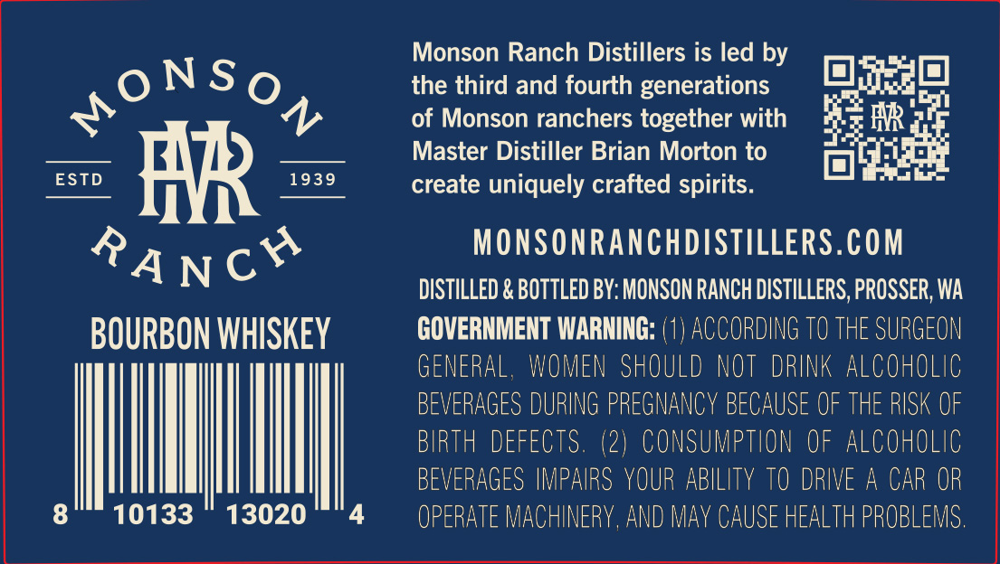
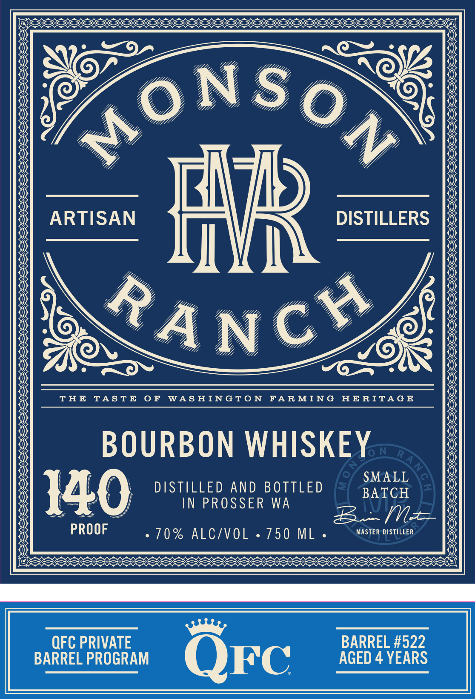

# TTB COLA Label Images - TTBID 26278001000696

**Brand Name:** MONSON RANCH DISTILLERS QFC

**Issue Date:** 10/09/2026

**Origin Code:** 07

**Product Class/Type:** 141

**Source:** [TTB Public COLA Registry](https://ttbonline.gov/colasonline/viewColaDetails.do?action=publicFormDisplay&ttbid=26278001000696)

## Label Images

### Back Label

### Label 1

### Label 3

## Extracted Label Text

*Text extracted via OCR - may contain errors*

*1 image(s) excluded: text did not meet readability threshold*

**Detected Proof:** 140
**Detected Age:** 4 Years

### Back Label

Monson Ranch Distillers is led by
the third and fourth generations
Ki
of Monson ranchers together with
HR
Master Distiller Brian Morton to
ESTD
#R
1939
create uniquely crafted spirits.
MONSONRANCHDISTILLERS.COM
RANCH
DISTILLED & BOTTLED BY: MONSON RANCH DISTILLERS, PROSSER; WA
BOURBON WHISKEY
GOVERNMENT WARNING: (1) ACCORDING TO THE SURGEON
GENERAL , WOMEN SHOULD NOT
DRINK Alcoholic
BEVERAGES DURING PREGNANCY BECAUSE OF THE RISK OF
BIRTH  DEFECTS. (2)   CONSUMPTION €f alcoholic
BEVERAGES IMPAIRS YOUR ABILITY TO DRIVE
A
CAR OR
8
10133
13020
OPERATE MACHINERY,AND May CAUSE HEALTH PROBLEMS.
oNS 0N

### Label 1

ARTISAN
F
DISTILLERS
T H E
TA S T E
0 F
WAS HINGTo N
FAR MING
HE RITA G E
BOURBON WHISKEY
SMALL
140
DISTILLED AND BOTTLED
BATCH
IN PROSSER
WA
m
PROOF
70 % ALCIVOL
750 ML
MASTER DISTILLER
QFC PRIVATE
BARREL #522
BARREL PROGRAM
QFc
AGED 4 YEARS
MONS
0 N
CH
RAN
