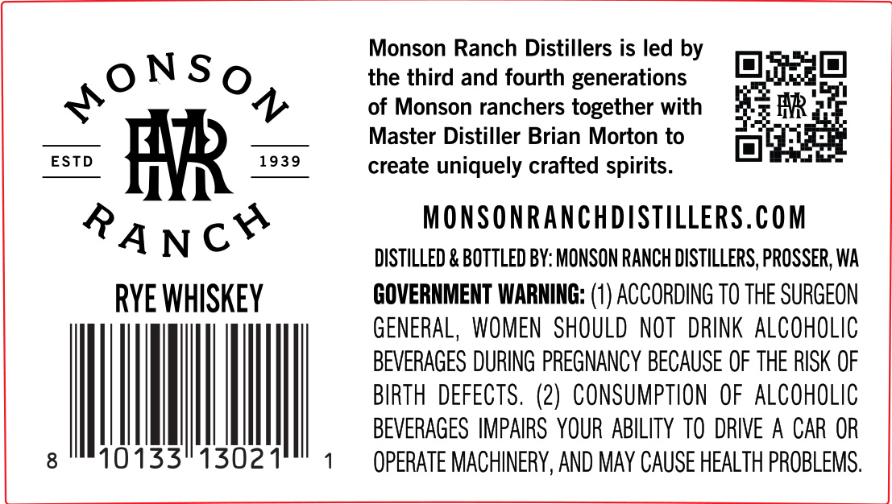
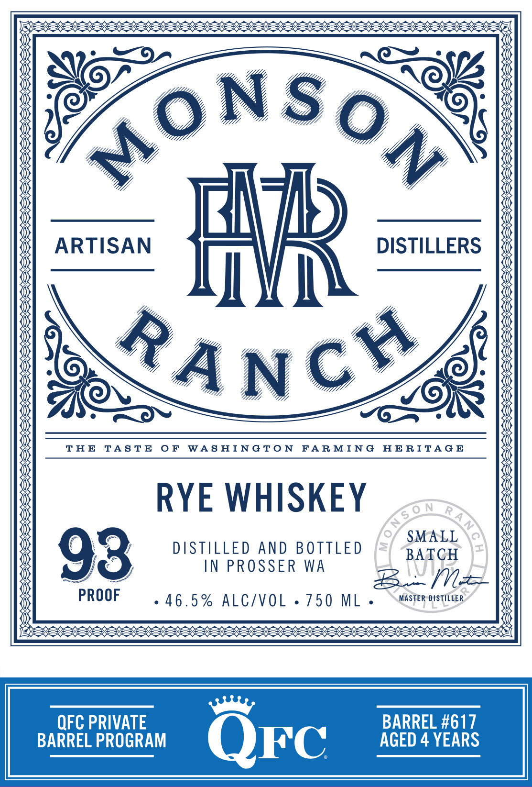

# TTB COLA Label Images - TTBID 26278001000697

**Brand Name:** MONSON RANCH DISTILLERS QFC

**Issue Date:** 10/09/2026

**Origin Code:** 07

**Product Class/Type:** 142

**Source:** [TTB Public COLA Registry](https://ttbonline.gov/colasonline/viewColaDetails.do?action=publicFormDisplay&ttbid=26278001000697)

## Label Images

### Back Label

### Label 1

### Label 3

## Extracted Label Text

*Text extracted via OCR - may contain errors*

*1 image(s) excluded: text did not meet readability threshold*

**Detected Proof:** 92
**Detected Age:** 4 Years

### Back Label

Monson Ranch Distillers is led by

|

|

ONSoO

the third and fourth generations

+

of Monson ranchers together with

HR’:

Master Distiller Brian Morton to

"ESTD.

create uniquely crafted spirits

oo)

MONSONRANCHDISTILLERS.COM

DISTILLED & BOTTLED BY: MONSON RANCH DISTILLERS, PROSSER, WA

RYE WHISKEY

GOVERNMENT WARNING: (1) ACCORDING TO THE SURGEON

GENERAL, WOMEN SHOULD NOT DRINK ALCOHOLIC

BEVERAGES DURING PREGNANCY BECAUSE OF THE RISK OF

BIRTH DEFECTS. (2) CONSUMPTION OF ALCOHOLIC

BEVERAGES IMPAIRS YOUR ABILITY TO DRIVE A CAR OR

|

|

OPERATE MACHINERY, AND MAY CAUSE HEALTH PROBLEMS

### Label 1

ARTISAN
Fb
DISTILLERS
C
TA E
TA STE
0 F
WAS HINGTo N
FA R MIN G
HE RITA G E
RYE WHISKEY
SMALL
93
DASTILLED
AND BOTTLED
BATCH
IN PROSSER
WA
m
PROOF
46 . 5 %
ALC/VOL
750
ML
MASTER DISTILLER
QFC PRIVATE
BARREL #617
BARREL PROGRAM
QFc
AGED 4 YEARS
0 N
S 0 N
RA N
