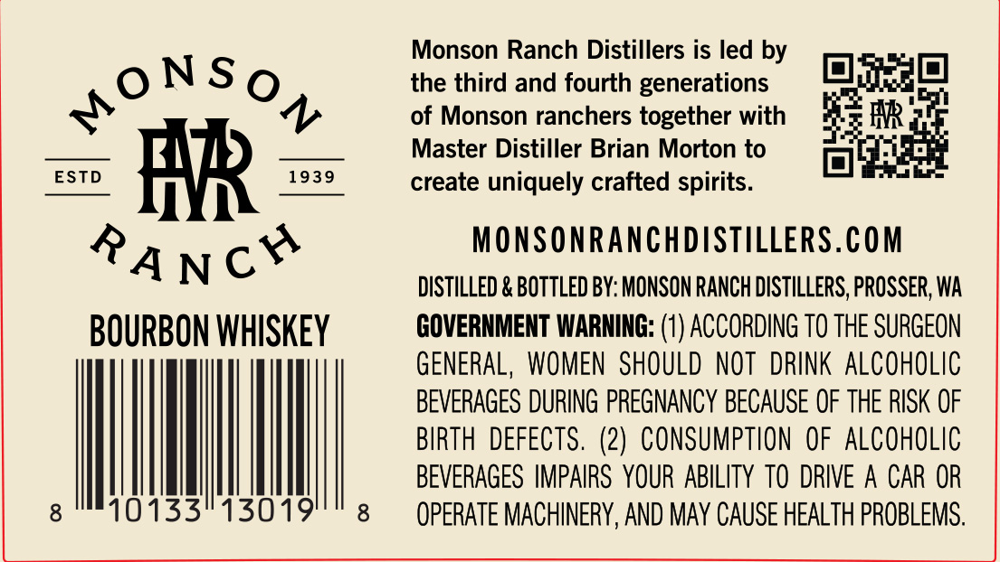
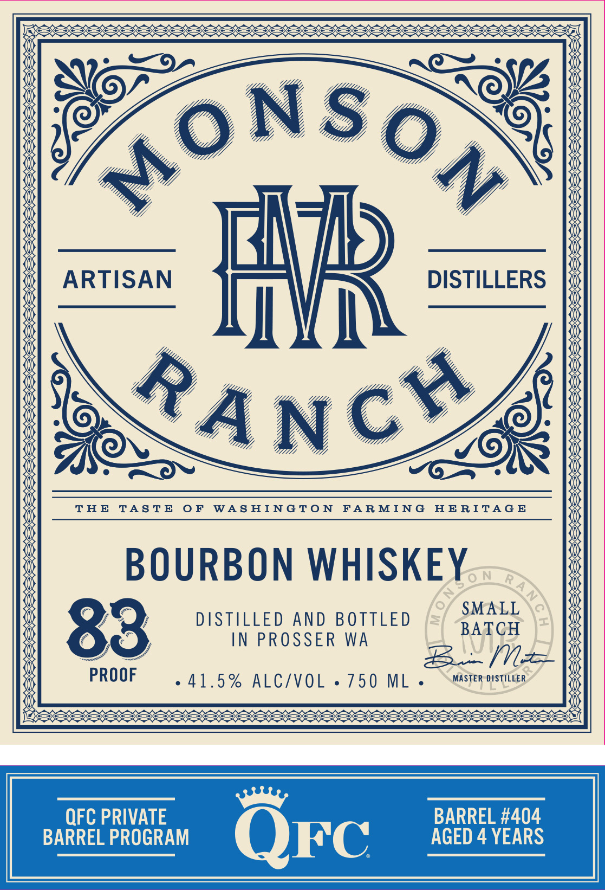

# TTB COLA Label Images - TTBID 26278001000698

**Brand Name:** MONSON RANCH DISTILLERS QFC

**Issue Date:** 10/13/2026

**Origin Code:** 07

**Product Class/Type:** 141

**Source:** [TTB Public COLA Registry](https://ttbonline.gov/colasonline/viewColaDetails.do?action=publicFormDisplay&ttbid=26278001000698)

## Label Images

### Back Label

### Label 1

### Label 3

## Extracted Label Text

*Text extracted via OCR - may contain errors*

*1 image(s) excluded: text did not meet readability threshold*

**Detected Proof:** 83
**Detected Age:** 4 Years

### Back Label

Monson Ranch Distillers is led by

ni}

a]

ONSo

the third and fourth generations

Sy

of Monson ranchers together with

AR

Master Distiller Brian Morton to

eS,

create uniquely crafted spirits

oo}

MONSONRANCHDISTILLERS.COM

DISTILLED & BOTTLED BY: MONSON RANCH DISTILLERS, PROSSER, WA

BOURBON WHISKEY

GOVERNMENT WARNING: (1) ACCORDING T0 THE SURGEON

GENERAL, WOMEN SHOULD NOT DRINK ALCOHOLIC

BEVERAGES DURING PREGNANCY BECAUSE OF THE RISK OF

BIRTH DEFECTS. (2) CONSUMPTION OF ALCOHOLIC

BEVERAGES IMPAIRS YOUR ABILITY TO DRIVE A CAR OR

8

OSS 15019

8

OPERATE MACHINERY, AND MAY CAUSE HEALTH PROBLEMS

### Label 1

ARTISAN
Fb
DISTILLERS
O
N
T H E
TA S T E
0 F
WAS HINGTo N
FARMIN G
HE RITAG E
BOURBON WHISKEY
N
R
SMALL
83
DSTILLED
ANd BOTTLED
BATCH
IN PROSSER
WA
PROOF
41.5 % ALC/VOL
750 ML
MASTER DISTiLLER
QFC PRIVATE
BARREL #404
BARREL PROGRAM
QFc
AGED 4 YEARS
N
Ch
TA N
