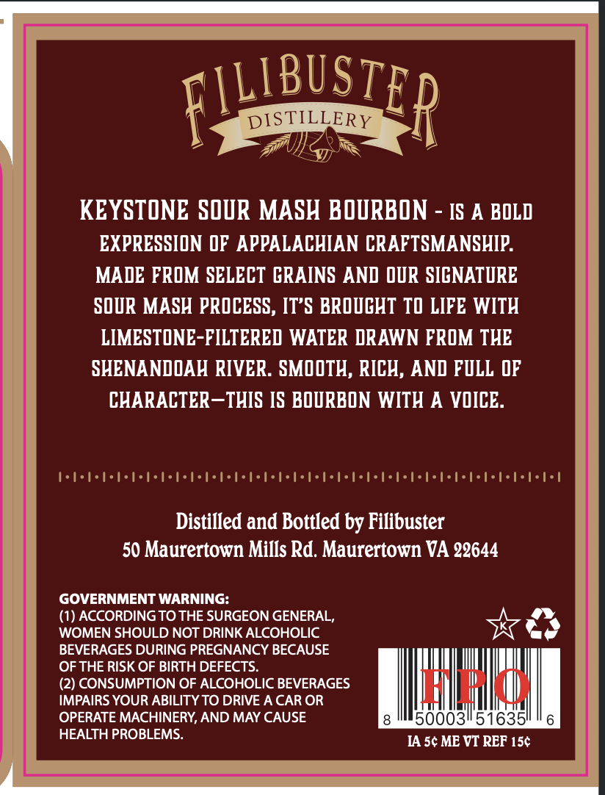
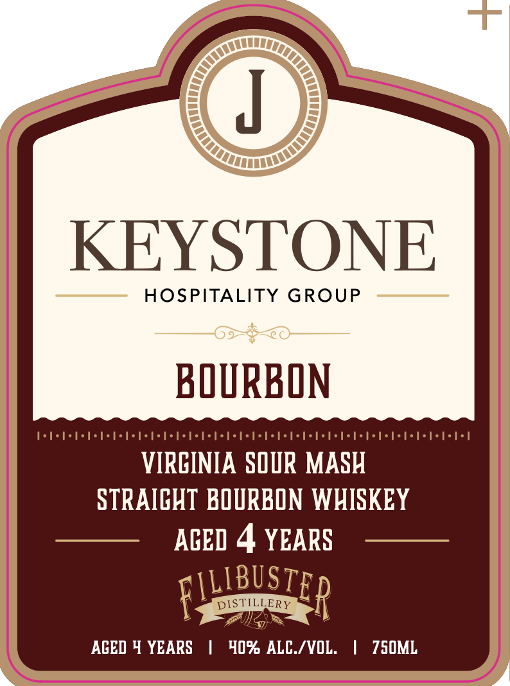

# TTB COLA Label Images - TTBID 26278001000700

**Brand Name:** KEY STONE

**Issue Date:** 10/16/2026

**Origin Code:** 05

**Product Class/Type:** 101

**Source:** [TTB Public COLA Registry](https://ttbonline.gov/colasonline/viewColaDetails.do?action=publicFormDisplay&ttbid=26278001000700)

## Label Images

### Back Label

### Front Label

## Extracted Label Text

*Text extracted via OCR - may contain errors*

**Detected Proof:** 80
**Detected Age:** 4 Years

### Back Label

FIUUBUSTER
DISTILLERY
KEYSTONE SOUR MASH BOURBON
IS A BOLD
EXPRESSION @F APPALACHIAN CRAFTSMANSHIP:
MADE FROM SELECT CRAINS AND ODR SICNATURE
SOUR MASH PROCESS, IT'S BROUCHT TO LIFE WITH
LIMESTONE-FILTERED WATER DRAWN FROM THE
SHENANDOAH RIVER . SMOOTH, RICH, AND FVLL DF
CHARACTER-THIS IS BODRBON WITH A VOICE
1..
1'
I'
1-....'
Distilled and Bottled by Filibuster
50 Maurertown Mills Rd. Maurertown VA 22644
GOVERNMENT WARNING:
(1) ACCORDING TO THE SURGEON GENERAL,
WOMEN SHOULD NOT DRINK ALCOHOLIC
BEVERAGES DURING PREGNANCY BECAUSE
OF THE RISK OF BIRTH DEFECTS
(2) CONSUMPTION OF ALCOHOLIC BEVERAGES
Uau
IMPAIRS YOUR ABILITY TO DRIVE A CAR OR
OPERATE MACHINERY, AND MAY CAUSE
0003/51635
HEALTH PROBLEMS.
IA 5c ME VT REF 15c

### Front Label

KEYSTONE
HOSPITALITY
GROUP
BOURBON
VIRCINIA SOUR MASH
STRAICHT BOURBON WHISKEY
ACED 4 YEARS
DISTILLERY
p
ACED 4 YEARS
40% ALC /VOL:
750ML
FILIBUSTE
