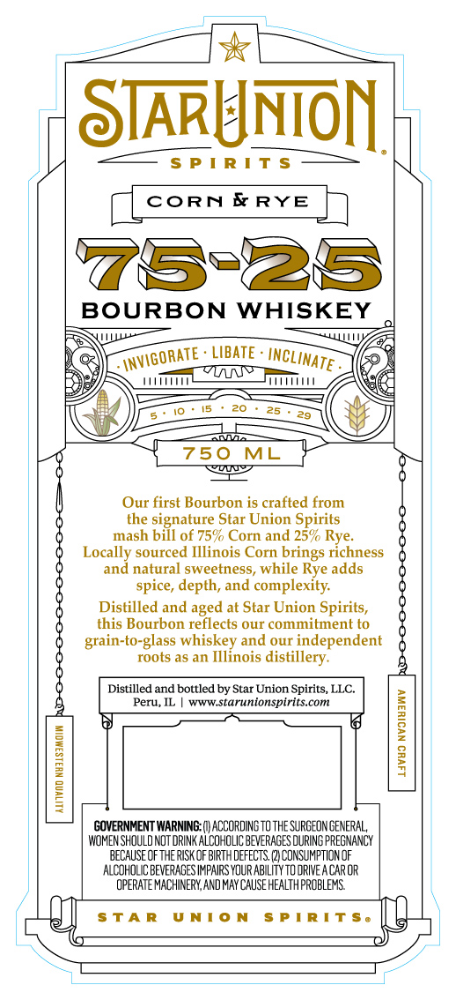
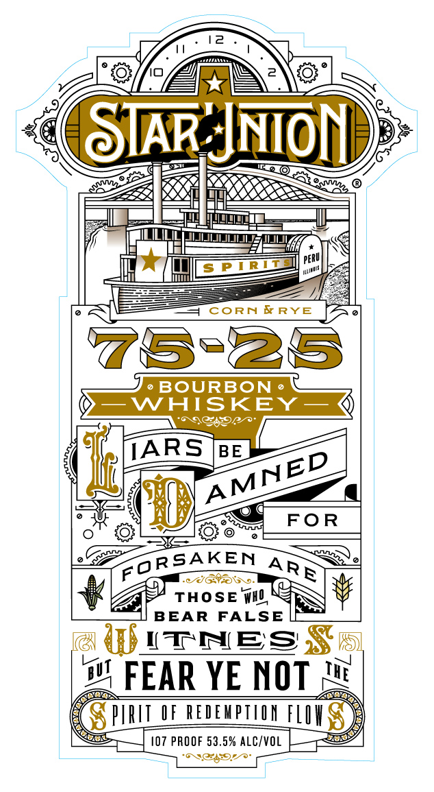
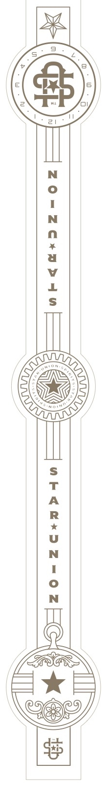

# TTB COLA Label Images - TTBID 26279001000041

**Brand Name:** STAR UNION SPIRITS

**Issue Date:** 10/13/2026

**Origin Code:** 04

**Product Class/Type:** 141

**Source:** [TTB Public COLA Registry](https://ttbonline.gov/colasonline/viewColaDetails.do?action=publicFormDisplay&ttbid=26279001000041)

## Label Images

### Back Label

### Front Label

### Label 3

## Extracted Label Text

*Text extracted via OCR - may contain errors*

*1 image(s) excluded: text did not meet readability threshold*

**Detected Proof:** 107

### Back Label

STARUNON
5 P I R ! T S
CORN
E RYE
75-26
BOURBON WHISKEY
LIBATE
25
cnnoz
750
ML
HCDU
Our first Bourbon is crafted from
the signature Star Union Spirits
mash bill of 759 Corn and 25%0
Locally sourced Illinois Corn brings richness
and natural sweetness, while Rye adds
spice, depth, and complexity
Distilled and aged at Star Union Spirits,
this Bourbon reflects our commitment to
grain-to-glass whiskey and our independent
roots a8 an Illinois
distillery:
Distilled and bottled by Star Union Spirits, LLC
Peru, IL
wwW starunionspirits com
1
1
9
1
GOVERNMENT WARNING: (V ACCORDINGTO the SURGEONGENERAL,
WOMEN SHOULD NOT DRINK ALCOHOLIC BEVERAGES DURING PREGNANCY
because €f The RISK OF BIRTH dEFECTS,
CONSUMPTLON OF
ALCDHOLIC BEVERAGES IMPAIRS YOUR ABILITY TO ORIVE A CAROR
OPERATE MHCHINERY,AND MAY CAUSE HEALTHPROBLEMS
T A R
U NT0 N
PI R! T $ 0
INVIGORATE
InCLINATE
Rye:

### Front Label

SIAR JNON
mue
PERU
FTRL
CoRN &RYE
75-86
BoURBON
WAISKEY
'69849
TARS
BE
FOR
RSAKEN
0/686_
THOSE WHV
BEAR
FALSE
ITNES
w4 FEAR YE NOT
PIRII_OF REDEWPILONFLIX
107 PROOF 53,5% ALC/VOL
Jex90
Sl
MInI
AMNED
ARE
