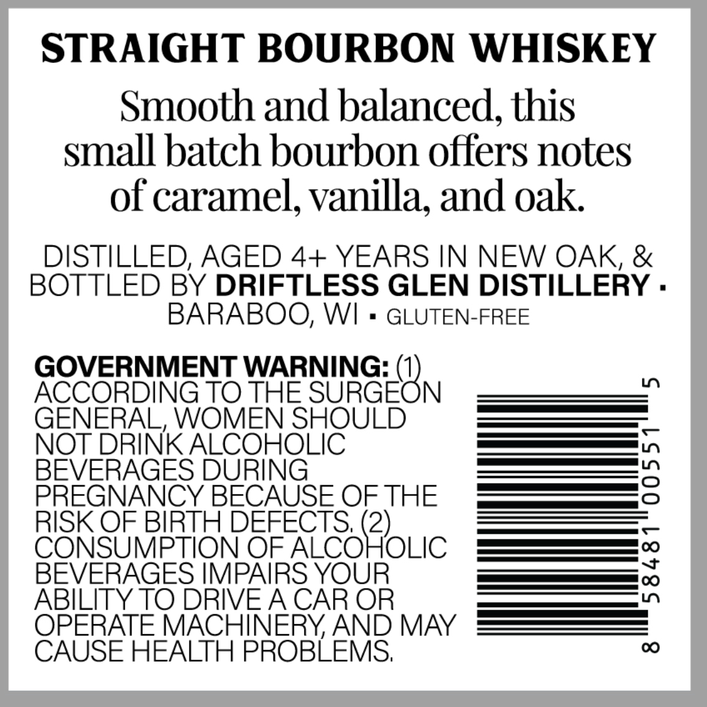
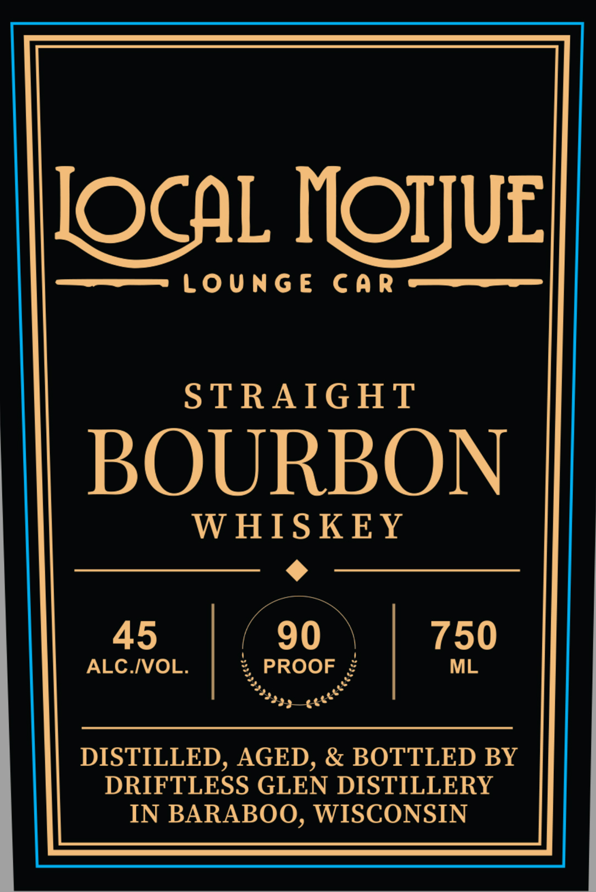

# TTB COLA Label Images - TTBID 26279001000109

**Brand Name:** LOCAL MOTIVE LOUNGE CAR

**Issue Date:** 10/09/2026

**Origin Code:** 48

**Product Class/Type:** 101

**Source:** [TTB Public COLA Registry](https://ttbonline.gov/colasonline/viewColaDetails.do?action=publicFormDisplay&ttbid=26279001000109)

## Label Images

### Back Label

### Front Label

## Extracted Label Text

*Text extracted via OCR - may contain errors*

### Back Label

STRAIGHT BOURBON WHISKEY
Smooth and balanced, this
small batch bourbon offers notes
of caramel; vanilla, and oak
DISTILLED; AGED 4+ YEARS IN NEW OAK; &
BOTTLED BY DRIFTLESS GLEN DISTILLERY .
BARABOO, WI
GLUTEN-FREE
GOVERNMENT WARNING: (1)
LO
ACCORDING TO THE SURGEON
GENERAL, WOMEN SHOULD
NOT DRINK ALCOHOLIC
BEVERAGES DURING
3
PREGNANCY BECAUSE OF THE
RISK OF BIRTH DEFECTS; (2)
CONSUMPTION OF ALCOHOLIC
BEVERAGES IMPAIRS YOUR
3
ABILITY TO DRIVEA CAR OR
OPERATE MACHINERYAND MAY
CAUSE HEALTH PROBLEMS;
0

### Front Label

JOCAL IOIJUL]
LoungE
Car
STRAIGHT
BOURBON
W HISKEY
45
90
750
ALC IVOL.
PROOF
ML
DISTILLED, AGED, & BOTTLED BY
DRIFTLESS GLEN DISTILLERY
IN BARABOO, WISCONSIN
