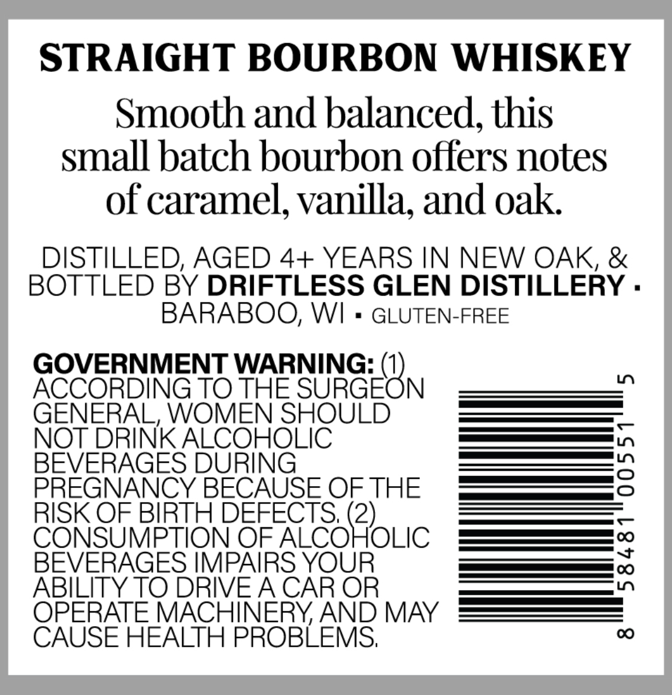
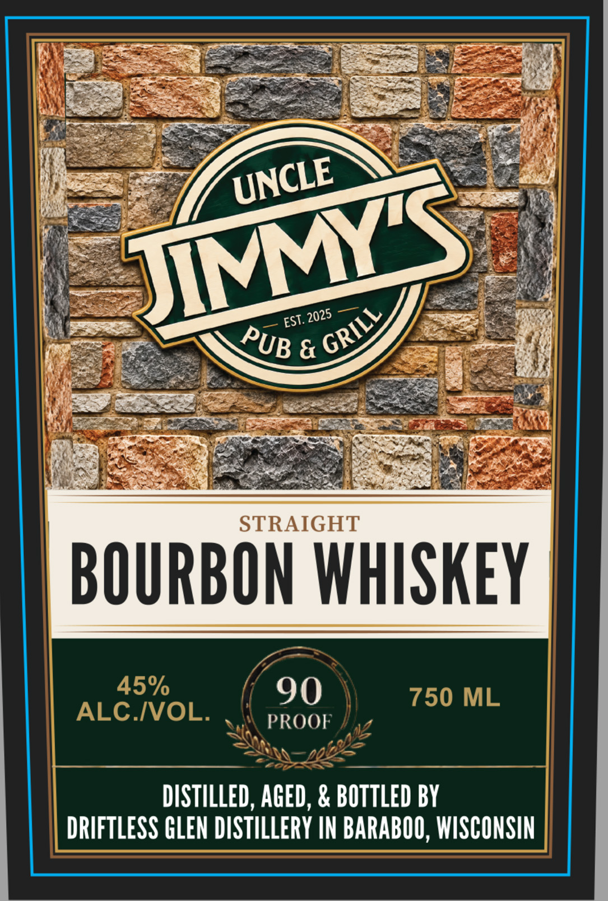

# TTB COLA Label Images - TTBID 26279001000121

**Brand Name:** UNCLE JIMMY'S PUB & GRILL

**Issue Date:** 10/09/2026

**Origin Code:** 48

**Product Class/Type:** 101

**Source:** [TTB Public COLA Registry](https://ttbonline.gov/colasonline/viewColaDetails.do?action=publicFormDisplay&ttbid=26279001000121)

## Label Images

### Back Label

### Front Label

## Extracted Label Text

*Text extracted via OCR - may contain errors*

### Back Label

STRAIGHT BOURBON WHISKEY
Smooth and balanced, this
small batch bourbon offers notes
of caramel, vanilla; and oak.
DISTILLED, AGED 4+ YEARS IN NEW OAK, &
BOTTLED BY DRIFTLESS GLEN DISTILLERY .
BARABOO, WI
GLUTEN-FREE
GOVERNMENT WARNING:
L
ACCORDING TO THE SURGEON
GENERAL, WOMEN SHOULD
NOT DRINK ALCOHOLIC
BEVERAGES DURING
3
PREGNANCY BECAUSE OF THE
RISK OF BIRTH DEFECTS; (2)_
CONSUMPTION OF ALCOHOLIC
BEVERAGES IMPAIRS YOUR
{
ABILITY TO DRIVEACAR OR
OPERATE MACHINERYAND MAY
CAUSE HEALTH PROBLEMS;
0

### Front Label

iys ENG FO RY Sas SO ED
Sa es
ES SSS a)
WR eae ates PS Nd ee Ay
Wyse — y UNCLE ee
: aay St
fee ee)
ee Get
Re 08 NVM sme: a
— Be OY ee
' ee a 4 UB & & Y. — ee |i
SUD EEE SP ner eA
Sih fae, VO Seta. fae RY Ce eR eT FO
PR ea at Neel Bye
ioe easy tg Ss ee pare a
STRAIGHT
ALC.IVOL. .\\ pRoor /,, |
DISTILLED, AGED, & BOTTLED BY
DRIFTLESS GLEN DISTILLERY IN BARABOO, WISCONSIN
