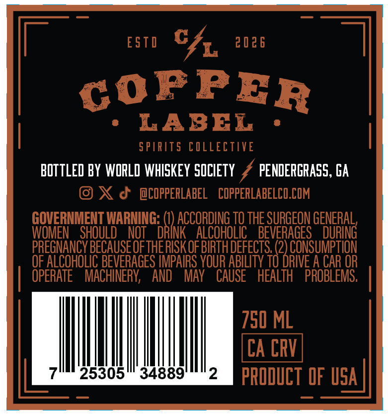
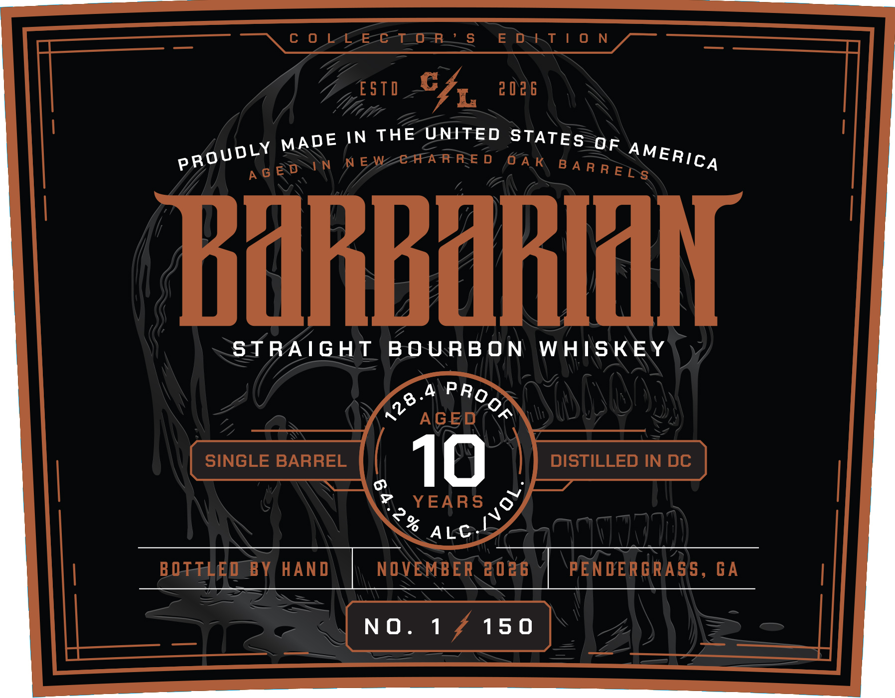

# TTB COLA Label Images - TTBID 26279001000151

**Brand Name:** BARBARIAN

**Issue Date:** 10/13/2026

**Origin Code:** 08

**Product Class/Type:** 141

**Source:** [TTB Public COLA Registry](https://ttbonline.gov/colasonline/viewColaDetails.do?action=publicFormDisplay&ttbid=26279001000151)

## Label Images

### Back Label

### Front Label

## Extracted Label Text

*Text extracted via OCR - may contain errors*

### Back Label

ESTd
CfL
2026
COPPER
LABEL
5 PIRITS COLLECTIVE
BOTTLED BY WORLD WhISKEY 5OCIETY
PENDERGRASS, GA
@0
J
@COPPERLABEL
COPPERLABELCO.COM
GOVERNMENT WARNING: (U) ACCORDING TO THE SURGEON GENERAL,
WOMEN   SHOULD
NOT
DRINK
ALCOHOLIC
BEVERAGES
DURING
PREGNANCY BECAUSE OFTHE RISK OF BIRTH DEFECTS (2) CONSUMPTION
OF ALCOHOLIC BEVERAGES IMPAIRS VOUR ABILITY TO DRIVE A CAR OR
OPERATE
MACHINERY,
AND
MAy
CAUSE
hEALTH
PROBLEMS;
750 ML
CA CRV
25305
34889
2
PRODUCT OF USA

### Front Label

\ C 0 1 Eben S “‘EsD=kT |! ON /

ZEST C4, 2026

DE IN THE UNITED STaTES
proudly MA MEWZEFARRED OAR aK AMERI¢
agev PN BARRE A

BORMAN

STRAIGHT BOURBON WHISKEY

BOT EOEBY HAND NOVEMBER 2086 PENDERGRASS, GA
NO. 1/150
