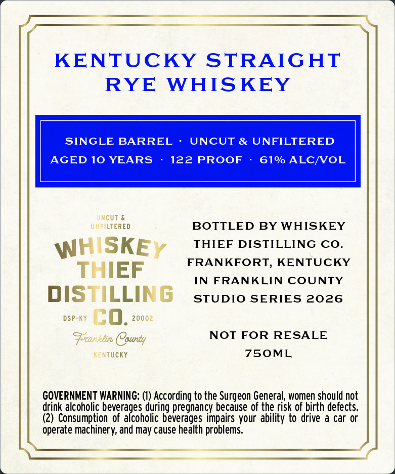
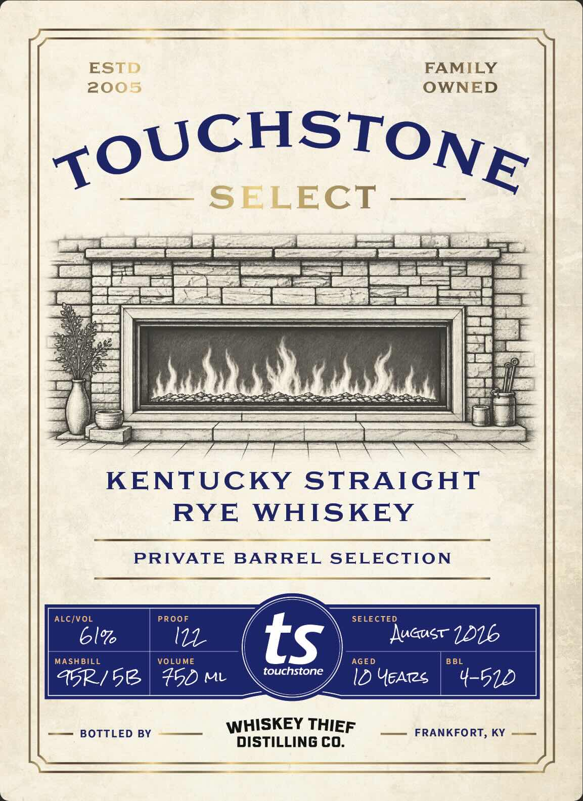

# TTB COLA Label Images - TTBID 26279001000238

**Brand Name:** WHISKEY THIEF DISTILLING CO.

**Fanciful Name:** TOUCHSTONE SELECT

**Issue Date:** 10/14/2026

**Origin Code:** 22

**Product Class/Type:** 102

**Source:** [TTB Public COLA Registry](https://ttbonline.gov/colasonline/viewColaDetails.do?action=publicFormDisplay&ttbid=26279001000238)

## Label Images

### Back Label

### Front Label

## Extracted Label Text

*Text extracted via OCR - may contain errors*

**Detected Proof:** 122
**Detected Age:** 10 Years

### Back Label

KENTUCKY STRAIGHT

RYE WHISKEY

SINGLE BARREL -

UNCUT & UNFILTERED

AGED 10 YEARS

122 PROOF

61% ALC/VOL

UNFILTERED

UNCUT &

BOTTLED BY WHISKEY

THIEF DISTILLING CO.

HISKE

FRANKFORT, KENTUCKY

THIEF

IN FRANKLIN COUNTY

DISTILLING

STUDIO SERIES 2026

DSP-KY Cc 0G. 20002

Franklin County

NOT FOR RESALE

KENTUCKY

7S5OML

GOVERNMENT WARNING: (1) According to the Surgeon General, women should not

drink alcoholic bevera

jes during pregnancy because of the risk of birth defects.

(2) Consumption of al

rf

coholic beverages impairs your ability to drive a car or

operate machinery, and may cause health problems.

### Front Label

ESTD
FAMILY
2005
OWNED
TOUCHSTONE
SELECT
Ku
KENTUCKY STRAIGHT
RYE
WHISKEY
PRIVATE BARREL SELECTION
ALC/VOL
PROOF
SELECTED
6l%
I1
ts
Auust 116
MASHBILL
VOLUME
AGED
B BL
touchstone
45p/51
450 M
ID YEATzs
4-512
BOTTLED BY
WHISKEY THIEF
FRANKFORT, KY
DISTILLING CO_
