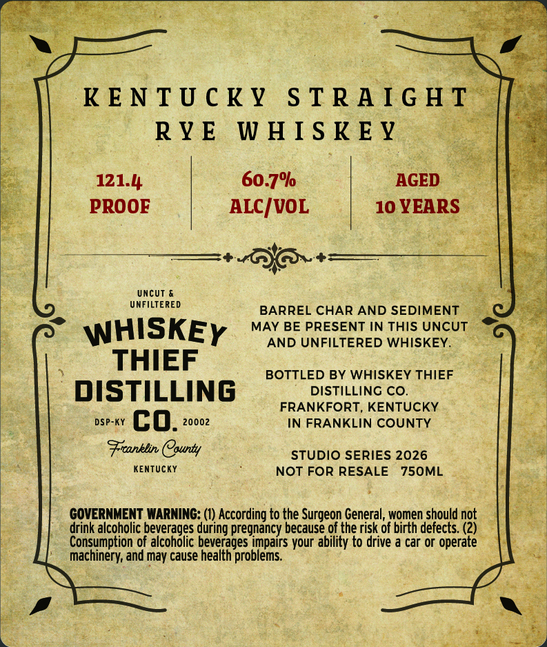
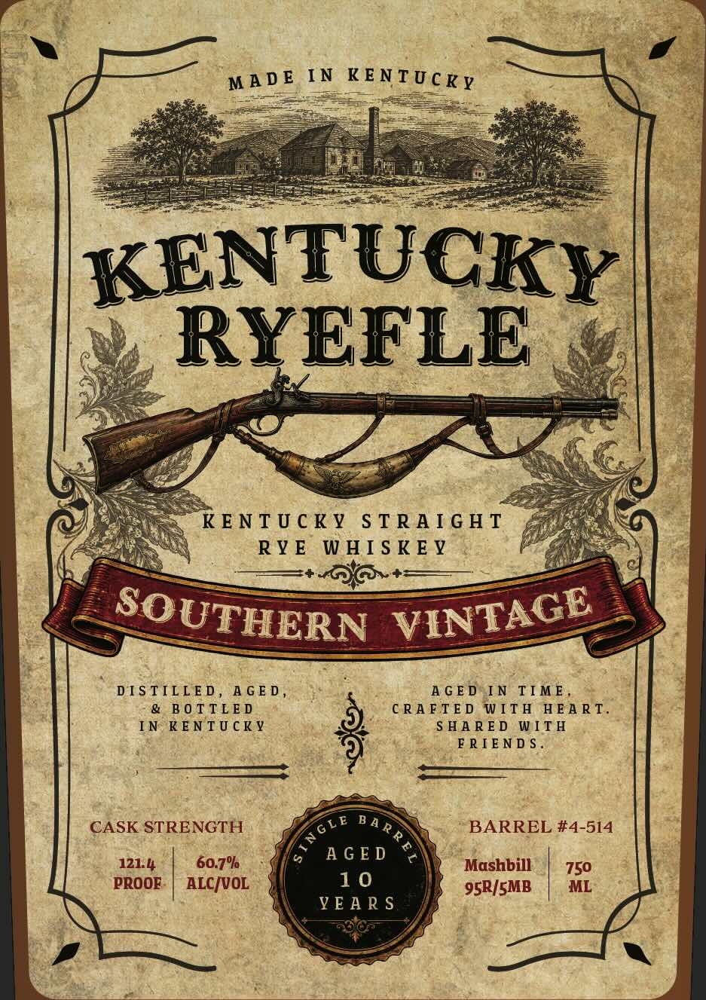

# TTB COLA Label Images - TTBID 26279001000249

**Brand Name:** WHISKEY THIEF DISTILLING CO.

**Fanciful Name:** KENTUCKY RYEFLE

**Issue Date:** 10/13/2026

**Origin Code:** 22

**Product Class/Type:** 102

**Source:** [TTB Public COLA Registry](https://ttbonline.gov/colasonline/viewColaDetails.do?action=publicFormDisplay&ttbid=26279001000249)

## Label Images

### Back Label

### Front Label

## Extracted Label Text

*Text extracted via OCR - may contain errors*

**Detected Proof:** 121.4
**Detected Age:** 10 Years

### Back Label

121.4
60.7%
AGED
PROOF
ALC/VOL
10 YEARS
UncUT
UNFILTERED
BARREL CHAR AND SEDIMENT
WHISKEY
MAY BE PRESENT IN THIS UNCUT
AND UNFILTERED WHISKEY.
THIEF
BOTTLED BY WHISKEY THIEF
DISTILLING
DISTILLINC CO.
FRANKFORT, KENTUCKY
DSP-KY
co.
20002
IN FRANKLIN COUNTY
Fronklin County
STUDIo SERIES 2026
KEnTUcKY
NOT FOR RESALE
750ML
GOVERNMENT WARNING: (1) According to the Surgeon General, women should not
drink alcoholic beverages during pregnancy because of the risk of birth defects (2)
Consumption of alcoholic beverages impairs your ability to drive a car or operate
machinery; and may cause health problems

### Front Label

MADE IN KENTUCKY

Ed

| KENTUCKY

a,

)

Bete

e

=

=H

<4

Ci a

SP

e/

ys

KENTUCKY STRAIGHT &

we

hes

Aah

RYE WHISKEY

+

ag

So

AGE

UTHER

———

N VIN

DISTILLED, AGED,

AGED IN TIME,

& BOTTLED

CRAFTED WITH HEART.

IN KENTUCKY

SHARED WITH

FRIENDS.

————

CASK STRENGTH

vE Ba

BARREL #4-514

12h

60.7%

Whe

AGED

Mashbill

PROOE.

10

750

ALC/VOL

95R/SMB

ML

We

AS
