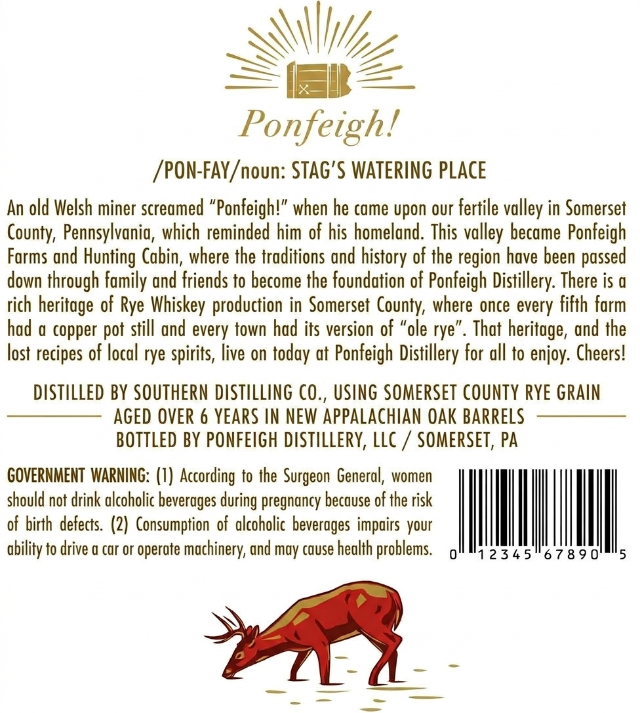
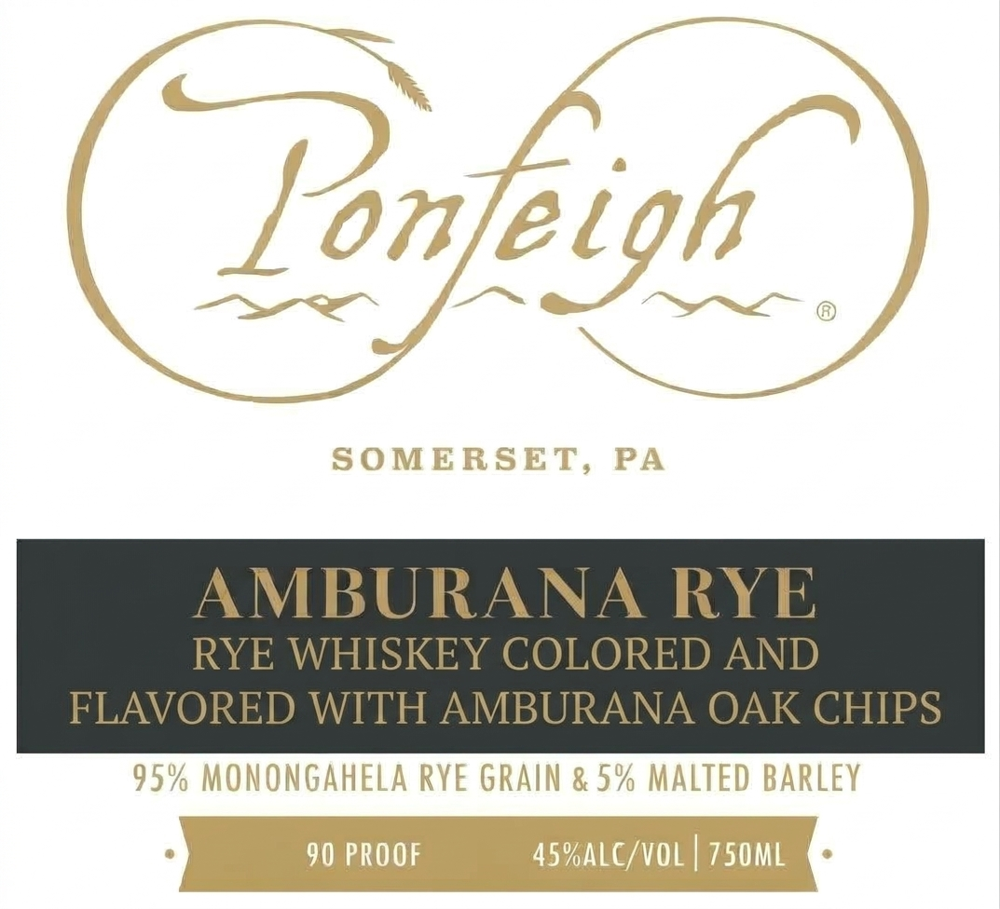

# TTB COLA Label Images - TTBID 26279001000345

**Brand Name:** PONFEIGH DISTILLERY LLC

**Fanciful Name:** AMBURANA RYE

**Issue Date:** 10/16/2026

**Origin Code:** 39

**Product Class/Type:** 142

**Source:** [TTB Public COLA Registry](https://ttbonline.gov/colasonline/viewColaDetails.do?action=publicFormDisplay&ttbid=26279001000345)

## Label Images

### Back Label

### Front Label

## Extracted Label Text

*Text extracted via OCR - may contain errors*

**Detected Proof:** 90
**Detected Age:** 6 Years

### Back Label

Ponfeigh!
/PON-FAY /noun: Stag'$ WATERING place
An old Welsh miner screamed "Ponfeigh!" when he came upon our fertile valley in Somerset
County; Pennsylvanig, which reminded him of his homeland. This
became Ponfeigh
Forms and Hunting Cabin, where the traditions and
of the region have been passed
down through family and friends to become the foundation of Ponfeigh Distillery: There is &
rich
of Rye Whiskey production in Somerset County, where once every fifth form
had a copper pot still and every town had its version of
ole rye"
That heritoge, und the
lost recipes of local rye spirits, live on
at
Ponfeigh Distillery for all to enjoy: Cheers!
DISTILLED BY SOUTHERN DISTILLING CO , USING SoMERSET COUNTY RyE GRAIn
AGED OVER 6 YEARS AN NEW APPALachian Oak BARRELS
BOTTLED BY PONFEIGH distillerY, Llc
SomeRSET, PA
GOVERNMENT WARNING: (I) According to the
General, women
should not drink alcoholic beverages during pregnancy because of the risk
of birth defects  (2) Consumption of alcoholic beveroges impairs your
ability to drive a car or operote mochinery; and may couse health problems
0'
2 345
6 7 8 9 0"
valley
history
heritage
today
Surgeon

### Front Label

Ponfeigh
SOMERSET,
PA
AMBURANA RYE
RYE WHISKEY COLORED AND
FLAVORED WITH AMBURANA OAK CHIPS
95% MONONGAhELA RYE GRAIN & 5% MALTED Barley
90 PROOF
45%aLC/vOL
750ML
