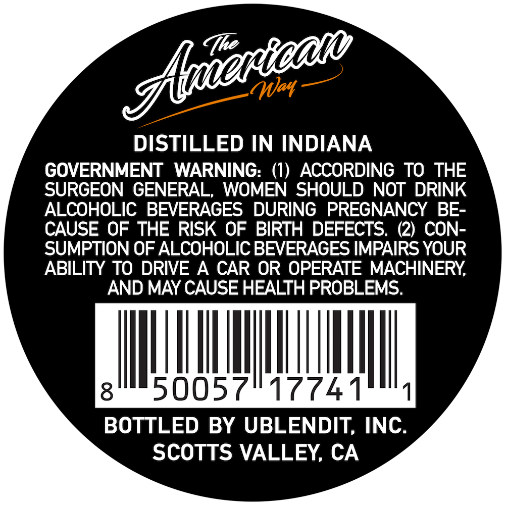
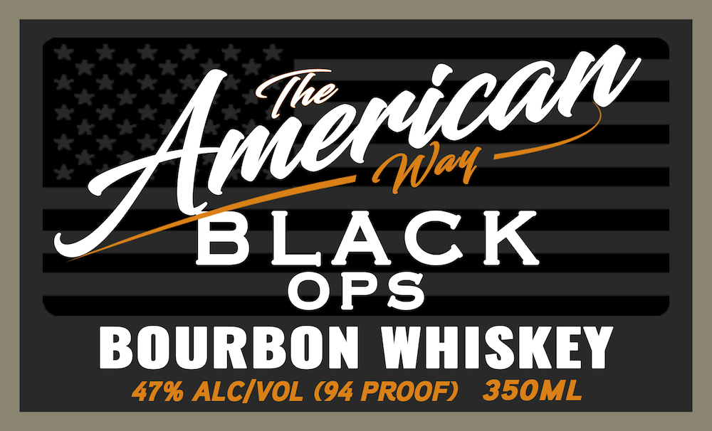

# TTB COLA Label Images - TTBID 26279001000363

**Brand Name:** THE AMERICAN WAY

**Issue Date:** 10/15/2026

**Origin Code:** 01

**Product Class/Type:** 141

**Source:** [TTB Public COLA Registry](https://ttbonline.gov/colasonline/viewColaDetails.do?action=publicFormDisplay&ttbid=26279001000363)

## Label Images

### Back Label

### Label 1

## Extracted Label Text

*Text extracted via OCR - may contain errors*

### Back Label

May
DISTILLED IN INDIANA
GOVERNMENT
WARNING:
(1)
ACCORDING TO THE
SURGEON GENERAL,
WOMEN SHOULD NOT DRINK
ALCOHOLIC BEVERAGES DURING PREGNANCY
BE-
CAUSE OF THE RISK OF BIRTH DEFECTS. (2) CON-
SUMPTION OF ALCOHOLIC BEVERAGES IMPAIRS YOUR
ABILITY TO DRIVE A CAR OR OPERATE MACHINERY
AND MAY CAUSE HEALTH PROBLEMS.
50057
17741T1
BOTTLED BY UBLENDIT; INC.
SCOTTS VALLEY; CA
Farican

### Label 1

UAT

BLACK
OPS
BOURBON WHISKEY
