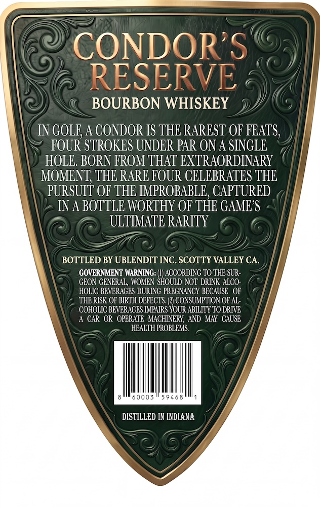
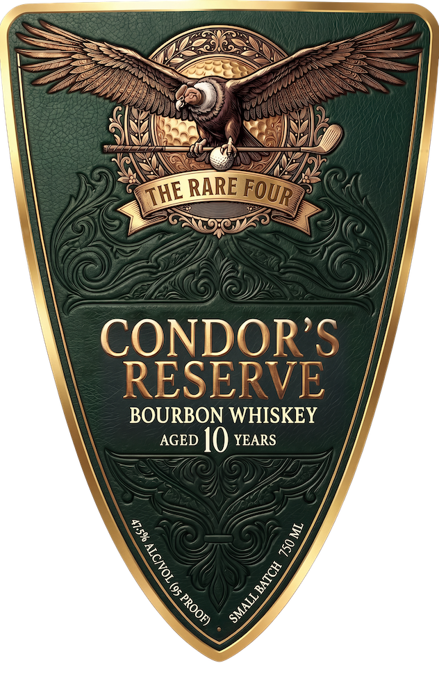

# TTB COLA Label Images - TTBID 26279001000367

**Brand Name:** THE RARE FOUR

**Issue Date:** 10/13/2026

**Origin Code:** 01

**Product Class/Type:** 141

**Source:** [TTB Public COLA Registry](https://ttbonline.gov/colasonline/viewColaDetails.do?action=publicFormDisplay&ttbid=26279001000367)

## Label Images

### Back Label

### Label 1

## Extracted Label Text

*Text extracted via OCR - may contain errors*

### Back Label

CONDORS
RESERVE
BOURBON WHISKEY
IN GOLE; A CONDOR IS THE RAREST OF FEATS;
FOUR STROKES UNDER PAR ON A SINGLE
HOLE, BORN FROM THAT EXTRAORDINARY
MOMENT; THE RARE FOUR CELEBRATES THE
PURSUIT OF THE IMPROBABLE, CAPTURED
IN A BOTTLE WORTHY OF THE GAMES
ULTMMATE RARITY
BOTTLED BY UBLENDIT INC. SCOTTY VALLEY CA
GOVERNMENT WARNENG;
ACCORDING TO THE SUR=
GEON GENERAL, WOMEN SHOULD NOT DRINK ALCO
HOLIC BEVERAGES DURING PREGNANCY BECAUSE   OF
THE RISK OF BIRTH DEFECIS
CONSUMPTION OF AL;
COHOLIC BEVERAGES IMPAIRS
YoorsBiIzTOO ORIVE
CAR OR   OPERATE   MACHINERY;  AND MAY   CAUSE
HEALTH PROBLEMS
50003
59468
DISTILLED IN INDIANA

### Label 1

RARE
CONDORS
RESERVE
BOURBON WHISKEY
AGED
10 xEARS
33
G
FOUR
THE
1
1
1
SMALL E
!
