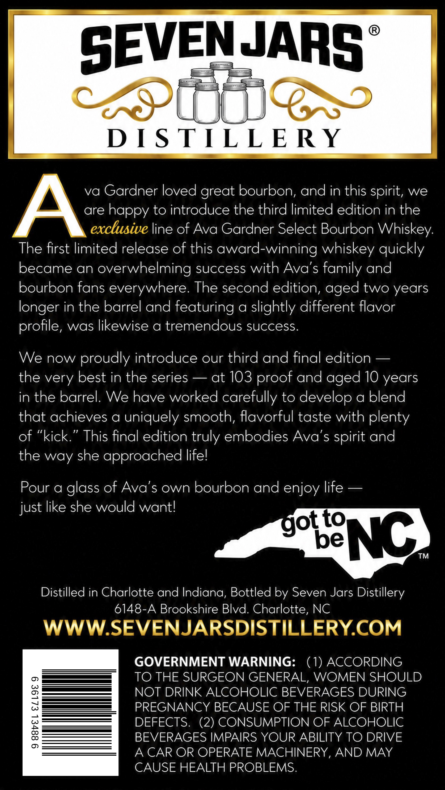
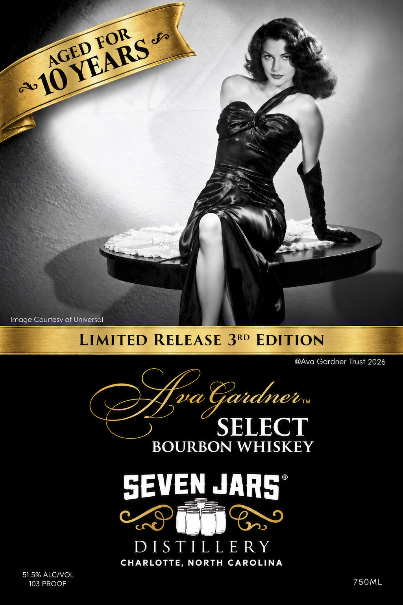

# TTB COLA Label Images - TTBID 26279001000500

**Brand Name:** SEVEN JARS DISTILLERY

**Fanciful Name:** AVA GARDNER SELECT BOURBON WHISKEY

**Issue Date:** 10/13/2026

**Origin Code:** 35

**Product Class/Type:** 141

**Source:** [TTB Public COLA Registry](https://ttbonline.gov/colasonline/viewColaDetails.do?action=publicFormDisplay&ttbid=26279001000500)

## Label Images

### Back Label

### Front Label

## Extracted Label Text

*Text extracted via OCR - may contain errors*

**Detected Proof:** 103
**Detected Age:** 10 Years

### Back Label

SEVENJARS
38
D [ S TILL E RY
va Gardner loved great bourbon, and in this spirit, we
A
are
to introduce the third limited edition in the
exclusive line of Ava Gardner Select Bourbon Whiskey:
The first limited release of this award-winning whiskey quickly
became an
overwhelming success with Ava's family and
bourbon fans everywhere.
The second edition,
two years
longer in the barrel and featuring a slightly different flavor
profile, was likewise a tremendous success
We now proudly introduce our third and final edition
the very best in the series
at 103
and
10 years
in the barrel_
We have worked carefully to develop a blend
that achieves a uniquely smooth, flavorful taste with plenty
of
'kick
This final edition truly embodies Ava's
and
the way she approached lifel
Pour a glass of Ava's own bourbon and enjoy life
just like she would wantl
to
be
NC
TM
Distilled in Charlotte and Indiana, Bottled by Seven Jars Distillery
6148-A Brookshire Blvd. Charlotte, NC
WWWSEVENJARSDISTILLERYCOM
GOVERNMENT WARNING:
(1) ACCORDING
0
TO THE SURGEON GENERAL,
WOMEN SHOULD
NOT DRINK ALCOHOLIC BEVERAGES DURING
3
PREGNANCY BECAUSE OF THE RISK OF BIRTH
8
DEFECTS
(2) CONSUMPTION OF ALCOHOLIC
BEVERAGES IMPAIRS YOUR ABILITY TO DRIVE
0
A CAR OR OPERATE MACHINERY, AND MAY
CAUSE HEALTH PROBLEMS:
happy
aged
aged
proof
spirit
got

### Front Label

Image Courtesy of Universal
LIMITED RELEASE 3RD EDITION
@Ava Gardner Trust 2026
2/aEadner:
SELECT
BOURBON WHISKEY
SEVEN JARS
DI S TTLL E RY
CHARLOTTE, NORTH
CAROLINA
51.5% ALCIVOL
103 PROOF
750ML
FOR
YEARS
AGED
~10
