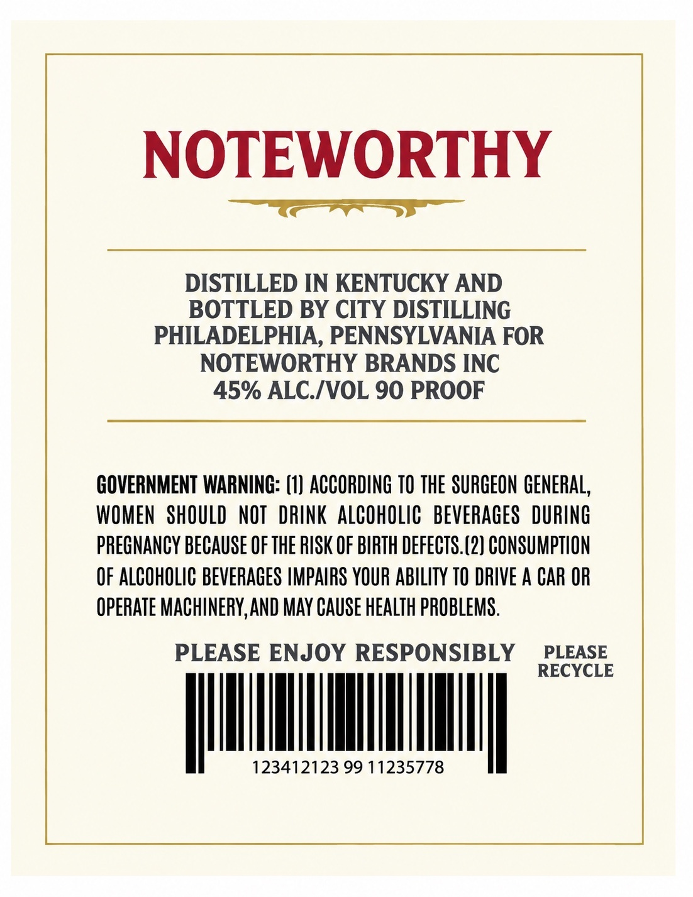
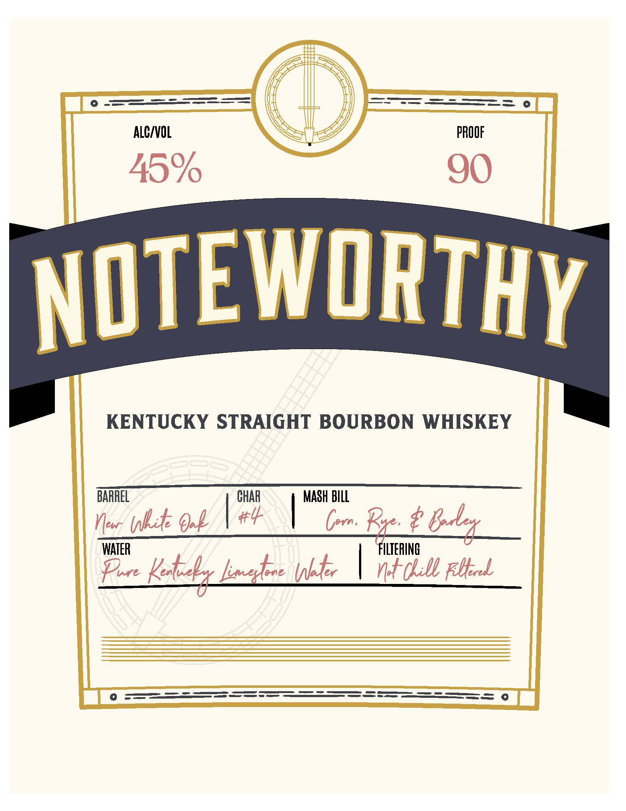

# TTB COLA Label Images - TTBID 26279001000554

**Brand Name:** NOTEWORTHY BOURBON

**Issue Date:** 10/13/2026

**Origin Code:** 39

**Product Class/Type:** 101

**Source:** [TTB Public COLA Registry](https://ttbonline.gov/colasonline/viewColaDetails.do?action=publicFormDisplay&ttbid=26279001000554)

## Label Images

### Back Label

### Front Label

## Extracted Label Text

*Text extracted via OCR - may contain errors*

**Detected Proof:** 90

### Back Label

NOTEWORTHY
DISTILLED IN KENTUCKY AND
BOTTLED BY CITY DISTILLING
PHILADELPHIA, PENNSYLVANIA FOR
NOTEWORTHY BRANDS INC
45% ALC IVOL 90 PROOF
GOVERNMENT WARNING: (1) ACCORDING TO THE SURGEON GENERAL,
WOMEN   SHOULD  NOT   DRINK ALCOHOLIC   BEVERAGES   DURING
PreGNANCY BECAuse €F THE RISK OF BIRTH DEFECTS.(2} CONSUMPTHON
OF ALCOHOLIC BEVERAGES IMPAIRS YOUR ABILITY TO DRIVE A CAR OR
OperAte MACHINERY,AND MAy cause HEAlTh PROBLEMS.
PLEASE ENJOY RESPONSIBLY
PLEASE
RECYCLE
123412123 99 11235778

### Front Label

KENTUCKY STRAIGHT BOURBON WHISKEY

BARREL CHAR | MASH BILL

Now hte Ook NP \ Com Rye é Goeley
WATER ILTERING
Fe Keb mahee hte | at Lill bel
