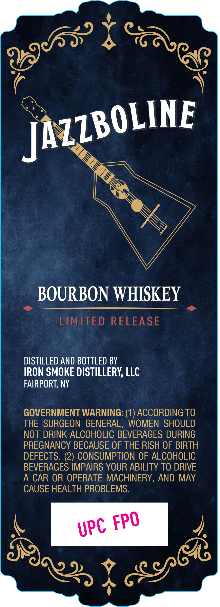
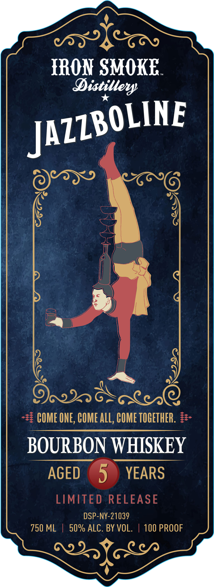
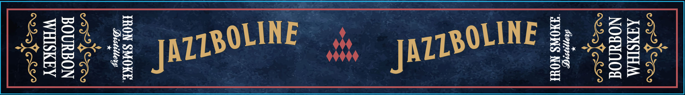

# TTB COLA Label Images - TTBID 26279001000556

**Brand Name:** IRON SMOKE DISTILLERY

**Fanciful Name:** JAZZBOLINE

**Issue Date:** 10/20/2026

**Origin Code:** 02

**Product Class/Type:** 141

**Source:** [TTB Public COLA Registry](https://ttbonline.gov/colasonline/viewColaDetails.do?action=publicFormDisplay&ttbid=26279001000556)

## Label Images

### Back Label

### Front Label

### Label 3

## Extracted Label Text

*Text extracted via OCR - may contain errors*

**Detected Proof:** 100

### Back Label

BOURBON WHISKEY
LIMITED
RELEASE
DISTILLED AND BOTTLED BY
IRON SMOKE DISTILLERY, LLC
FAIRPORT, NY
GOVERNMENT WARNING: (1) ACCORDING TO
THE SURGEON GENERAL, WOMEN SHOULD
NOT DRINK ALCOHOLIC BEVERAGES DURING
PREGNANCY BECAUSE OF THE RISH OF BIRTH
DEFECTS. (2) CONSUMPTION OF ALCOHOLIC
BEVERAGES IMPAIRS YOUR ABILITY TO DRIVE
A CAR OR OPERATE MACHINERY, AND MAY
CAUSE HEALTH PROBLEMS.
198ss) }
JAZZBOLINE
FPO
UPC
89
 YgScG

### Front Label

)
SPSL
TRON SMOKE.

Distillery
j ,
ase
| |
ORD oT O
-23 COME ONE, COME ALL, COME TOGETHER. 22-
BOURBON WHISKEY
AGED 5) YEARS
LIMITED RELEASE
750 ML | cose aio. | 100 PROOF
WIGS
)

### Label 3

SRE tg ya rt8 OHNE, pyr BOLINE Hy BR JATLBOLINE
ith JATLBOLINE Teer
