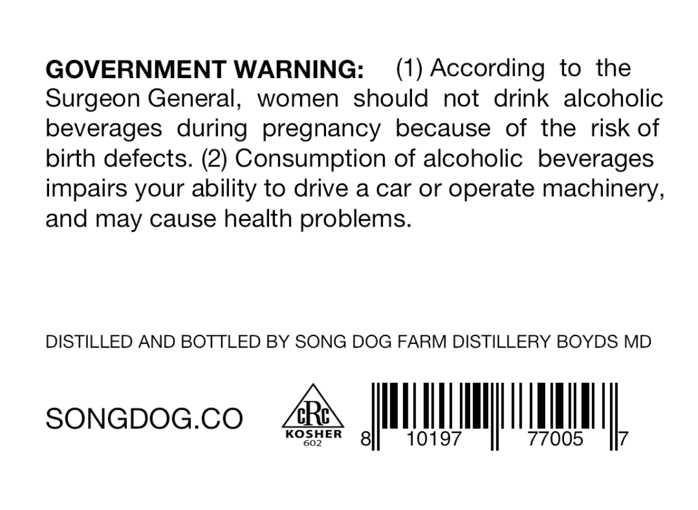
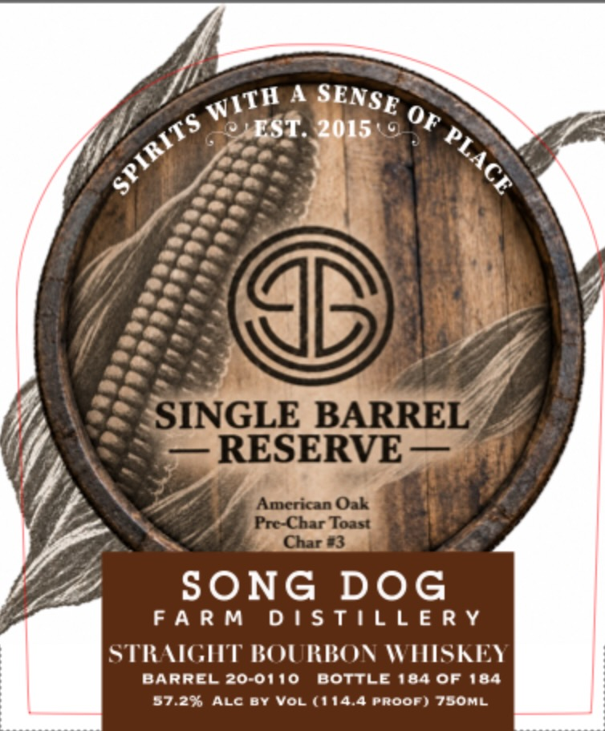

# TTB COLA Label Images - TTBID 26279001000575

**Brand Name:** SONG DOG FARM DISTILLERY

**Fanciful Name:** SINGLE BARREL RESERVE

**Issue Date:** 10/19/2026

**Origin Code:** 25

**Product Class/Type:** 101

**Source:** [TTB Public COLA Registry](https://ttbonline.gov/colasonline/viewColaDetails.do?action=publicFormDisplay&ttbid=26279001000575)

## Label Images

### Back Label

### Front Label

## Extracted Label Text

*Text extracted via OCR - may contain errors*

**Detected Proof:** 114.4

### Back Label

GOVERNMENT WARNING

(1) According to the

women should not drink alcoholic

Surgeon General

beverages during pregnancy because of the risk of

birth defects. (2) Consumption of alcoholic beverages

impairs your ability to drive a car or operate machinery,

and may cause health problems

DISTILLED AND BOTTLED BY SONG DOG FARM DISTILLERY BOYDS MD

SONGDOG.CO ARS

KOSHER

ULM

III

### Front Label

4
EST
2015
SINGLE BARREL
RESERVE
Amcrican Oak
Pr-Char Toast
Char e3
SONG DOG
F A R M
D | STILL E R Y
STRACHT BOURBON WMSKEY
BaRREL 20-0110
BottlE184 Of 184
37.296 ALc BY Vol (114.4 Proof) 7SOML
SENSE
WITH
OF
SPIRITS
PLACE
