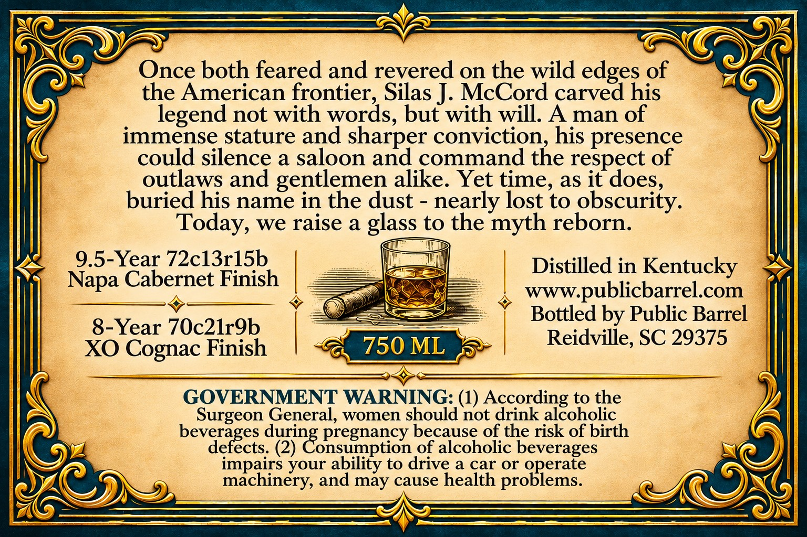
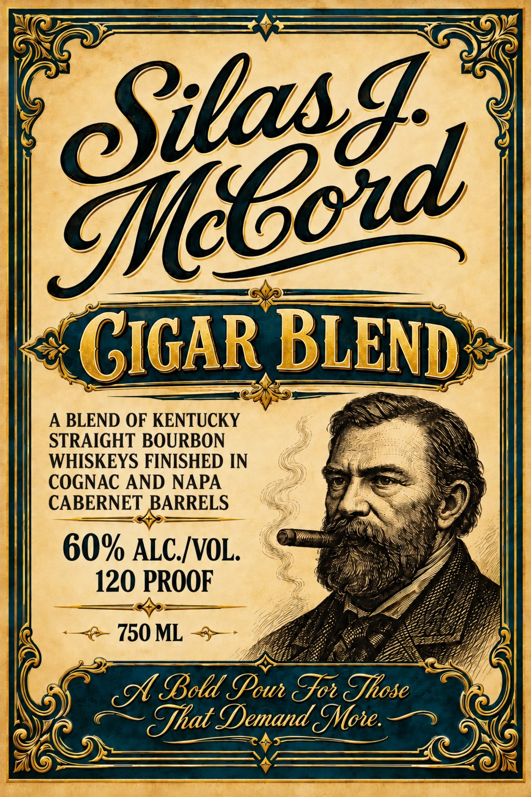

# TTB COLA Label Images - TTBID 26279001000590

**Brand Name:** SILAS J MCCORD

**Issue Date:** 11/10/2026

**Origin Code:** 41

**Product Class/Type:** 121

**Source:** [TTB Public COLA Registry](https://ttbonline.gov/colasonline/viewColaDetails.do?action=publicFormDisplay&ttbid=26279001000590)

## Label Images

### Back Label

### Front Label

## Extracted Label Text

*Text extracted via OCR - may contain errors*

**Detected Proof:** 120

### Back Label

Once both feared and revered on the wild edges of
the American frontier; Silas J. McCord carved his
legend not with words, but with will: A
man of
immense stature and sharper conviction; his presence
could silence a saloon and command the respect of
outlaws and gentlemen alike Yet time, as it does;
buried his name in the dust
nearly lost to obscurity.
we raise a glass to the
myth reborn.
9.5-Year 72cl3rl5b
Distilled in Kentucky
Napa Cabernet Finish
wwwpublicbarrel.com
Bottled by Public Barrel
8-Year 7Oc2lrgb
Reidville, SC 29375
XO Cognac Finish
750 ML
GOVERNMENT WARNING: (1) According to the
Surgeon General, women should not drink alcoholic
beverages
pregnancy because of the risk of birth
defects: (2)
of alcoholic beverages
impairs
ability to drive a car or operate
machinery, and may cause health problems.
Today,
duingonsumptioo &
your

### Front Label

GIGAR BLEND
A BLEND OF KENTUCKY
STRAIGHT BOURBON
WHISKEYS FINISHED IN
COGNAC AND NAPA
CABERNET BARRELS
60% ALC /VOL.
120 PROOF
750 ML
c Bold Pow Jo ZJhose
CJhat Demand MMove:
Skcz
