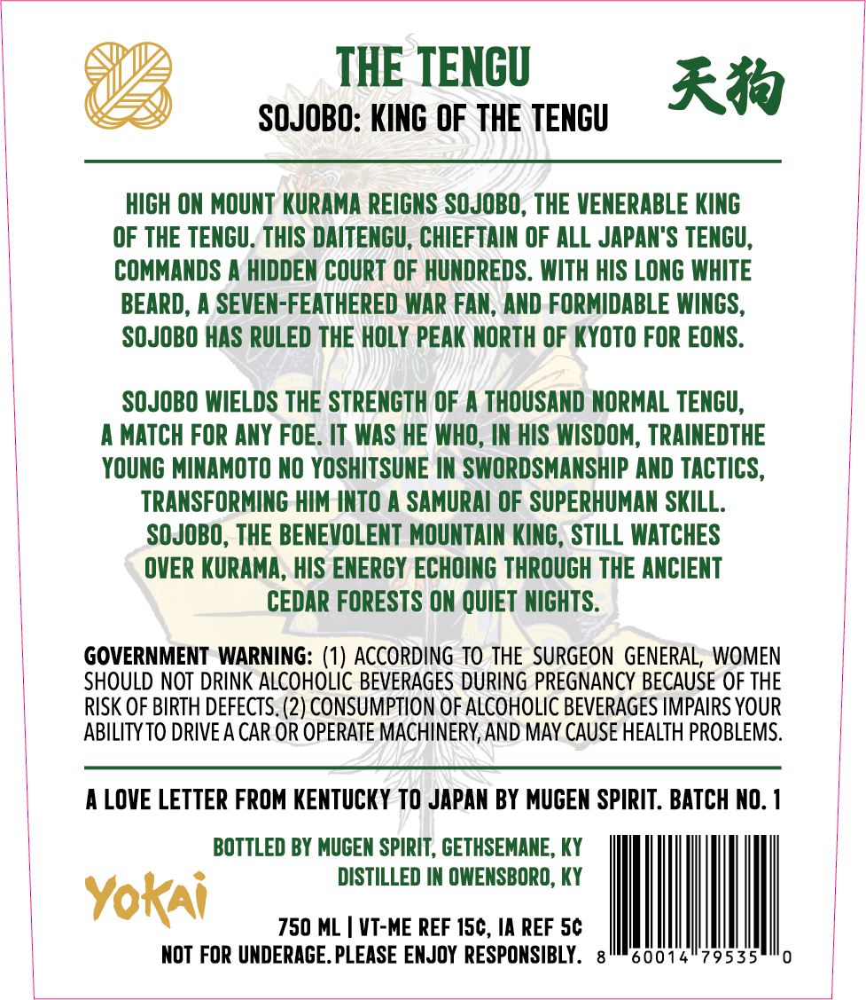
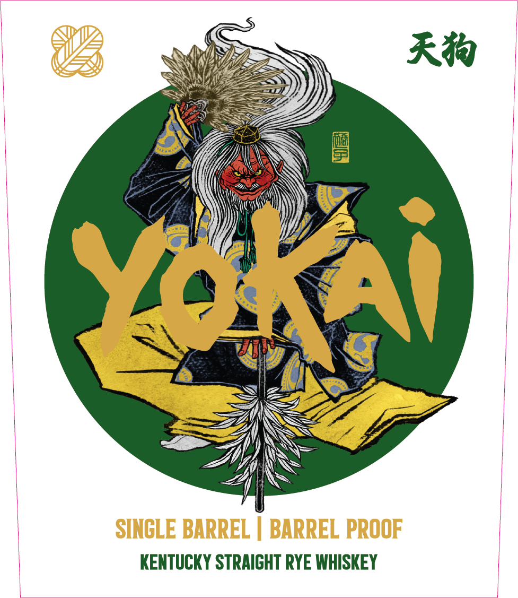
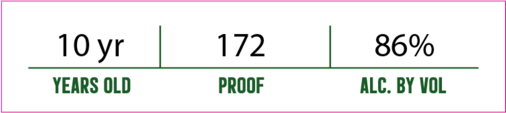

# TTB COLA Label Images - TTBID 26279001000642

**Brand Name:** YOKAI

**Issue Date:** 10/13/2026

**Origin Code:** 22

**Product Class/Type:** 102

**Source:** [TTB Public COLA Registry](https://ttbonline.gov/colasonline/viewColaDetails.do?action=publicFormDisplay&ttbid=26279001000642)

## Label Images

### Back Label

### Front Label

### Label 2

## Extracted Label Text

*Text extracted via OCR - may contain errors*

*1 image(s) excluded: text did not meet readability threshold*

### Back Label

THE TENGU
Rr
SOJOBO: KING OF THE TENGU
hIGH ON MOUNT KURAMA REIGNS SOJOBO, THE VENERABLE KING
OF THE TENGU. THIS DAITENGU, CHIEFTAIN OF ALL JAPAN"S TENGU,
COMMANDS A HIDDEN COURT OF HUNDREDS . WITH HIS LONG WHITE
BEARD, A SEVEN-FEATHERED WAR FAN, AND FORMIDABLE WINGS,
SOJOBO HAS RULED THE HOLY PEAK NORTH OF KYOTO FOR EONS.
SOJOBO WIELDS THE STRENGTH OF
THOUSAND NORMAL TENGU,
MATCH FOR ANY FOE. IT WAS HE WHO, IN HIS WISDOM, TRAINEDTHE
YOUNG MINAMOTO NO YOSHITSUNE IN SWORDSMANSHIP AND TACTICS ,
TRANSFORMING HIM INTO A SAMURAI OF SUPERHUMAN SKILL.
SOJOBO, THE BENEVOLENT MOUNTAIN KING , STILL WATCHES
OVER KURAMA, HIS ENERGY ECHOING THROUGH THE ANCIENT
CEDAR FORESTS ON QUIET NIGHTS:
GOVERNMENT WARNING: (1) ACCORDING TO THE SURGEON GENERAL, WOMEN
SHOULD NOT DRINK ALCOHOLIC BEVERAGES DURING PREGNANCY BECAUSE OF THE
RISK OF BIRTH DEFECTS. (2) CONSUMPTION OF ALCOHOLIC BEVERAGES IMPAIRS YOUR
ABILITY TO DRIVE A CAR OR OPERATE MACHINERY,AND MAY CAUSE HEALTH PROBLEMS.
A LOVE LETTER FROM KENTUCKY TO JAPAN BY MUGEN SPIRIT . BATCH NO.
BOTTLED BY MUCEN SPIRIT , GETHSEMANE, KY
DISTILLED IN OWENSBORO, KY
Yoki
750 ML
VT-ME REF 15c, IA REF 5c
NOT FOR UNDERAGE. PLEASE ENJOY  RESPONSIBLY.
60014"79535

### Front Label

Rr
Yo
SINCLE BARREL
BARREL PROOF
KENTUCKY STRAIGHT RYE WHISKEY
