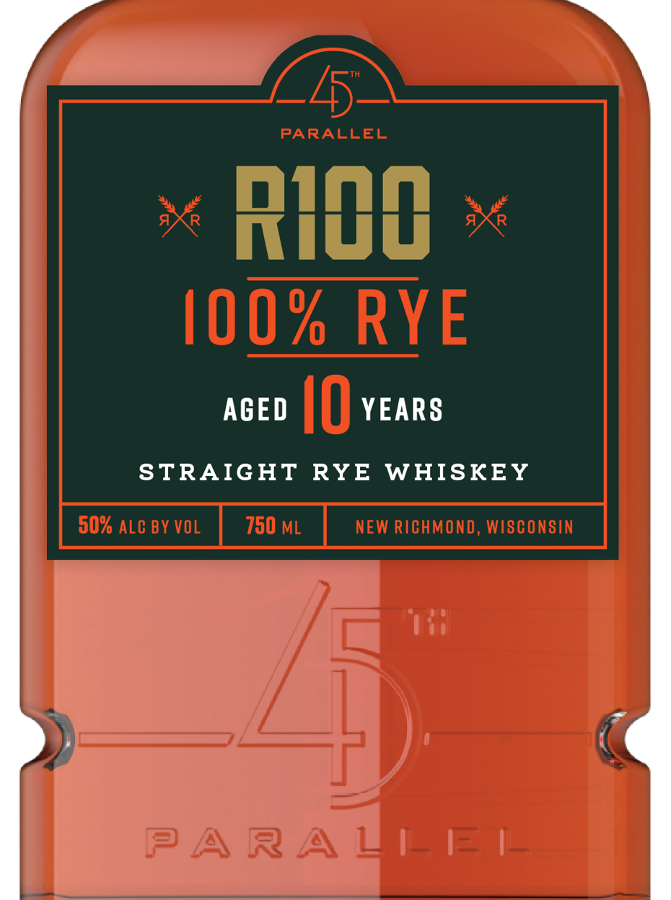
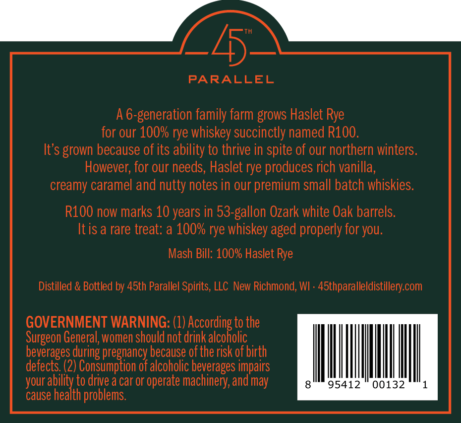

# TTB COLA Label Images - TTBID 26279001000778

**Brand Name:** 45TH PARALLEL

**Fanciful Name:** R100

**Issue Date:** 10/15/2026

**Origin Code:** 48

**Product Class/Type:** 102

**Source:** [TTB Public COLA Registry](https://ttbonline.gov/colasonline/viewColaDetails.do?action=publicFormDisplay&ttbid=26279001000778)

## Label Images

### Label 1

### Label 2

## Extracted Label Text

*Text extracted via OCR - may contain errors*

**Detected Proof:** 100
**Detected Age:** 10 Years

### Label 1

PARALLEL
RIOO
100% RYE
AGED
I0
YEARS
STRAIGHT
RYE
WHISKEY
50% ALC BY VOL
750 ML
NEW RICHMOND, WISCONSIN
PARAZ
_ = _

### Label 2

>

PARALLEL

A6-generation family farm grows Haslet Rye

for our 100% rye whiskey succinctly named R100.

It's grown because of its ability to thrive in spite of our northern winters.

However, for our needs, Haslet rye produces rich vanilla,

creamy caramel and nutty notes in our premium small batch whiskies.

R100 now marks 10 years in 53-gallon Ozark white Oak barrels.

Itis a rare treat: a 100% rye whiskey aged properly for you.

Mash Bill: 100% Haslet Rye

Distilled & Bottled by 45th Parallel Spirits, LLC New Richmond, WI - 45thparalleldistillery.com

GOVERNMENT WARNING: (1) According to the

Surgeon General, women should not drink alcoholic

beverages during pregnancy because of the risk of birth

defects. (2) Consumption of alcoholic beverages impairs

your ability to drive a car or operate machinery, and may

WNT

cause health problems.
