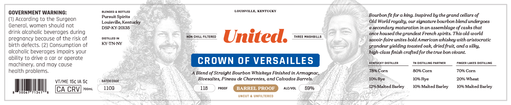
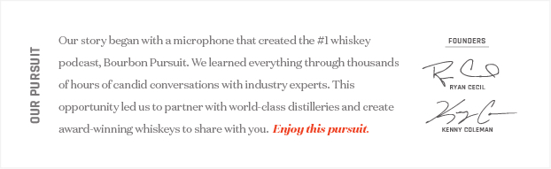

# TTB COLA Label Images - TTBID 26279001000892

**Brand Name:** UNITED

**Fanciful Name:** CROWN OF VERSAILLES

**Issue Date:** 10/16/2026

**Origin Code:** 22

**Product Class/Type:** 121

**Source:** [TTB Public COLA Registry](https://ttbonline.gov/colasonline/viewColaDetails.do?action=publicFormDisplay&ttbid=26279001000892)

## Label Images

### Label 1

### Label 2

## Extracted Label Text

*Text extracted via OCR - may contain errors*

**Detected Proof:** 118

### Label 1

GOVERNMENT WARNING:
BLEHdED
30TTLED
LOUISVILLE, KENTUCKY
Pursuit Spirits
Bourbon fit for a
Inspired _
bythe grand cellars of
Accordlng to the Surgeon
Louisville; Kentucky
Old World royalty; our signature bourbon blend undergoes
General; women should not
DSP-KY-20135
secondary maturation in an assemblage of casks that
drink alcoholic beverages during
once housed the grandest French spirits This old-world
pregnancy because of the risk of
MISTILLED
Non CHILL FILTERE D
United:
THREE MASHBILLS
savoir-faire unites bold American whiskey with aristocratic
birth defects. (2) Consumptlon of
KY-TN-NY
grandeur yielding toasted oak, dried fruit; and a silky;
alcoholic beverages impairs your
high-class finish crafted for thetrue bon vivant:
bility to drive @ cor or operate
CROWN OF VERSAILLES
KentucKY DISTILLER
DISTILLING PARTHER
FINGEF
LAKES DISTILLING
mochinery; ond my couse
heolth problems
Blend of Straight Bourbon Whiskeys Finished in Armagnac,
7896 Corn
8096 Corn
7096 Corn
VT/ME 15c IA 5c
BATCH codE
Rivesaltes, Pineau de Charentes; and Calvados Barrels:
1090 Rye
109o Rye
209 Wheat
CA CRV
7ooml
11c0
118
PROOF
BARREL PROOF
ALc(VOL
5900
1290 Malted Barley
1096 Malted Barley
1096 Malted Barley
uNCUT
VMFILTERED
king:

### Label 2

Our story
wich
microphone that createdthe #Iwhiskey
FuhdeRC
podeast, Bourbon Pursuit: We learned everything through thousands
0_0
[
ofhours ofeandid conversations with incustry experts. This
Rya4 ceCiL
8
opportunity led us
partner with world-class distilleries and create
276
award-winning' whiskeys to share withyou: Enjoy this pursuit
KENAY CCLKAN
began"
