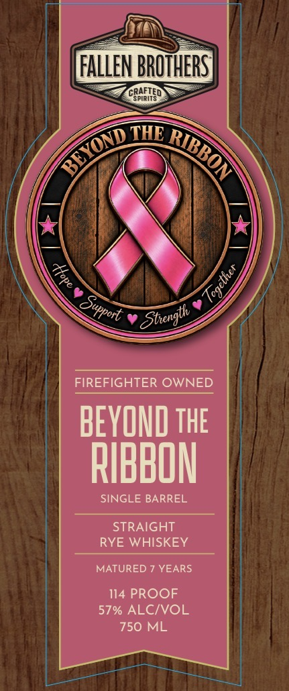
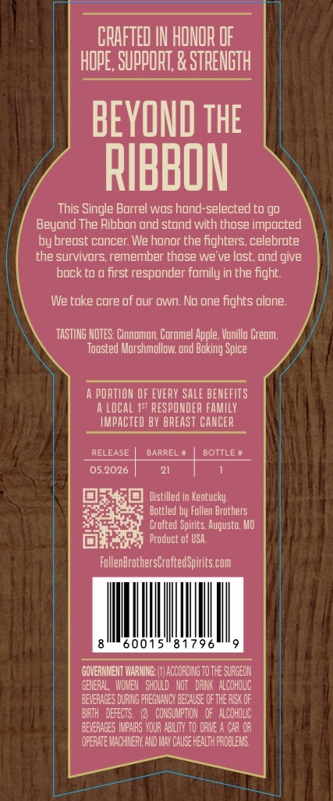
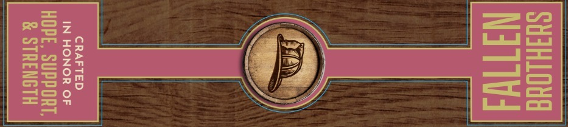

# TTB COLA Label Images - TTBID 26280001000069

**Brand Name:** FALLEN BROTHERS CRAFTED SPIRITS

**Fanciful Name:** BEYOND THE RIBBON 
SINGLE BARREL 
STRAIGHT RYE WHISKEY

**Issue Date:** 10/15/2026

**Origin Code:** 29

**Product Class/Type:** 102

**Source:** [TTB Public COLA Registry](https://ttbonline.gov/colasonline/viewColaDetails.do?action=publicFormDisplay&ttbid=26280001000069)

## Label Images

### Label 1

### Label 2

### Label 3

## Extracted Label Text

*Text extracted via OCR - may contain errors*

**Detected Proof:** 114
**Detected Age:** 7 Years

### Label 1

FaLLEN BROTHERS
CEPHETEO
THE
FIREFIGHTER OWNED
BEYOND ThE
RIBBON
SINGLE BARREL
STRAIGHT
RYE WHISKEY
MATURED 7 YEARS
114 PROOF
57% ALCIVOL
750 ML
BEYOND
RIBBON
J
4
Support
Strength_

### Label 2

CRAFTED IN HONOR OF
HOpE, SuppORT; & STRENGTH
BEYOND thE
RIBBON
This Single Barrel wos hond-selected to go
Beyond The Ribbon ond stond with those impocted
by breost Cuncer: We honor the fighters, celebrote
the survivors remember those we' ve lost, ond give
bock to @ first responder fumily in the fight:
We toke cure of our Own. No one fights olone:
TASTING NOTES: Cinnomon Coromel Apple, Vunilla Creom,
Toosted Murshmollow; ond Buking Spice
A PORTLON OF EveRy sale beMEFITS
A LoCAL 1st RESPONdeR faMILY
IMPACTEd BY BREAST CanCeR
RELEASE
BARREL
BOTTLE
05.2026
Distilled in Kentucky:
Boteled by Follen Brothers
Crofted Spirits Augusto; HO
Produce of USA.
FollenBrothersGroftedSpirits com
00
8 1796
GOVERNIENT VARMNG;
LACCORDIG To The SURGEON
GEERAL   IOHBU   Should   NOT = DRMK   ALcohouc
BEHERAGES DURING PREGHALCY BECAUSE Of The REk OF
BATH   defEcts.
(2   COKSUMPTCH   OF   alcoholc
BEHERAGES IRFXRS YOUR ABILITY TO DrNe
CAR OR
Opcrhe Machiery Ad MX Cauk Healh PROBLEIK

### Label 3

SHHLOUE
NIT |

CRAFTED
IN HONOR OF

HOPE, SUPPORT,
& STRENGTH
