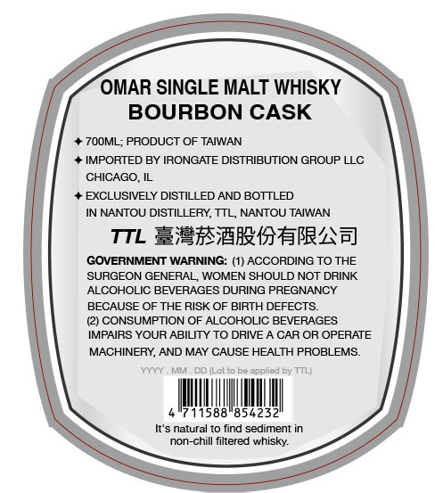
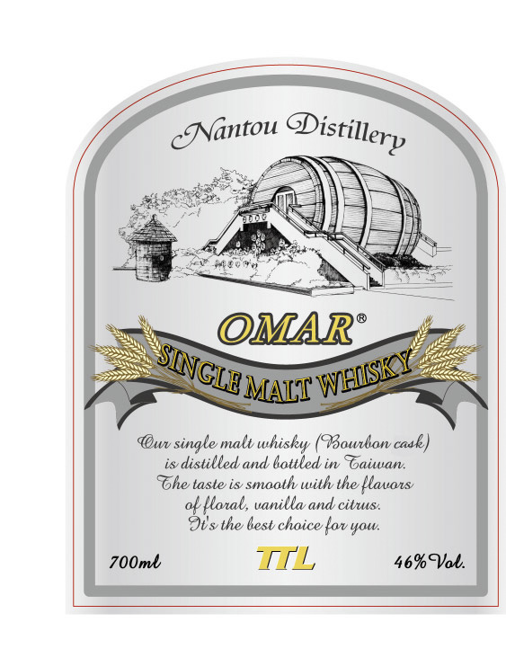

# TTB COLA Label Images - TTBID 26280001000153

**Brand Name:** OMAR

**Issue Date:** 10/15/2026

**Origin Code:** 8A

**Product Class/Type:** 118

**Source:** [TTB Public COLA Registry](https://ttbonline.gov/colasonline/viewColaDetails.do?action=publicFormDisplay&ttbid=26280001000153)

## Label Images

### Back Label

### Front Label

## Extracted Label Text

*Text extracted via OCR - may contain errors*

### Back Label

OMAR SINGLE MALT WHISKY
BOURBON CASK
7OOML; PRODUCT OF TAIWAN
IMPORTED BY IRONGATE DISTRIBUTION GROUP LLC
CHICAGO, IL
EXCLUSIVELY DISTILLED AND BOTTLED
IN NANTOU DISTILLERY, TTL NANTOU TAIWAN
TTL Exxr@irI+bRAA]
GOVERNMENT WARNING: (1) ACCORDING TO THE
SURGEON GENERAL; WOMEN SHOULD NOT DRINK
ALCOHOLIC BEVERAGES DURING PREGNANCY
BECAUSE OF THE RISK OF BIRTH DEFECTS
(2) CONSUMPTION OF ALCOHOLIC BEVERAGES
IMPAIRS YOUR ABILITY TO DRIVE A CAR OR OPERATE
MACHINERY, AND MAY CAUSE HEALTH PROBLEMS:
DD ILot to
appllied by TTL
11588"85423
It'$ natural tO find sediment in
non-chill filtered whisky

### Front Label

Nantou
OMAR
MAIT
@wv single malt whisky (@ourbon casl)
is distilled and 6ottled in Toaiwan:
The taste is smaalh wilh the llauas
ok /tatal, uanilla and citus:
9isthe 6est choice {ov
700ml
TIL
46%Qab:
QDistillery
~SINGLE
'WNHIISKY
Yol.
