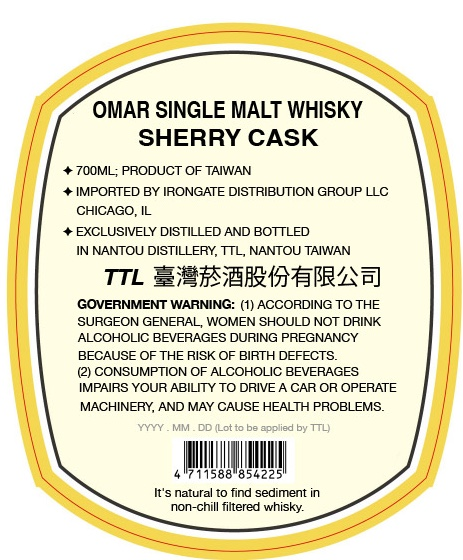
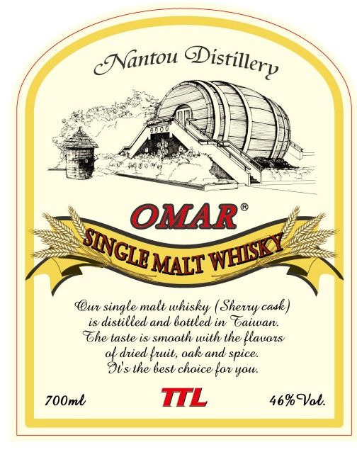

# TTB COLA Label Images - TTBID 26280001000158

**Brand Name:** OMAR

**Issue Date:** 10/15/2026

**Origin Code:** 8A

**Product Class/Type:** 118

**Source:** [TTB Public COLA Registry](https://ttbonline.gov/colasonline/viewColaDetails.do?action=publicFormDisplay&ttbid=26280001000158)

## Label Images

### Back Label

### Front Label

## Extracted Label Text

*Text extracted via OCR - may contain errors*

### Back Label

OMAR SINGLE MALT WHISKY
SHERRY CASK
7OOML; PRODUCT OF TAIWAN
IMPORTED BY IRONGATE DISTRIBUTION GROUP LLC
CHICAGO, IL
EXCLUSIVELY DISTILLED AND BOTTLED
IN NANTOU DISTILLERY, TTL NANTOU TAIWAN
TTL ExxrW1rITbRAA]
GOVERNMENT WARNING: (1) ACCORDING TO THE
SURGEON GENERAL WOMEN SHOULD NOT DRINK
ALCOHOLIC BEVERAGES DURING PREGNANCY
BECAUSE OF THE RISK OF BIRTH DEFECTS
(2) CONSUMPTION OF ALCOHOLIC BEVERAGES
IMPAIRS YOUR ABILITY TO DRIVE
CAR OR OPERATE
MACHINERY,
MAY CAUSE HEALTH PROBLEMS:
XYYY
DD ILot to be applied by TTL
11588"85422
It'$ natural tO find sediment in
non-chill filtered whisky:
AND

### Front Label

lantou
OMAR
MALT
(Owv
single malt whisky
casl)
distilled and lattled iw  baiwan
%ohe taste is smaathv with the
{tauazs
ak diied {uit, aak and spice:
Sus lhe 6esl chaice lav you:
700ml
TIL
46%Val
QDistillerp
SINGLB)
'WHXY
Shevuy =
