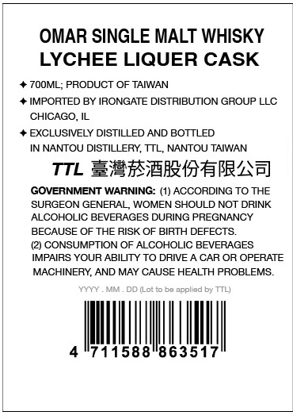
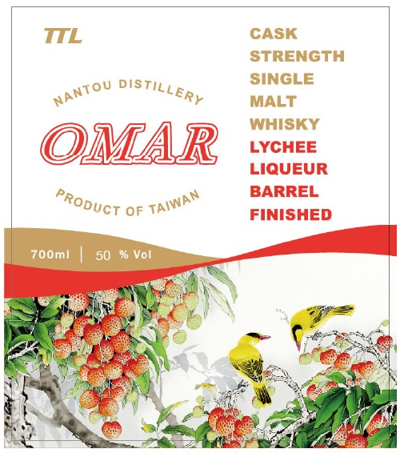

# TTB COLA Label Images - TTBID 26280001000167

**Brand Name:** OMAR

**Issue Date:** 10/15/2026

**Origin Code:** 8A

**Product Class/Type:** 118

**Source:** [TTB Public COLA Registry](https://ttbonline.gov/colasonline/viewColaDetails.do?action=publicFormDisplay&ttbid=26280001000167)

## Label Images

### Back Label

### Front Label

## Extracted Label Text

*Text extracted via OCR - may contain errors*

### Back Label

OMAR SINGLE MALT WHISKY
LYCHEE LIQUER CASK
7OOML; PRODUCT OF TAIWAN
IMPORTED BY IRONGATE DISTRIBUTION GROUP LLC
CHICAGO,IL
EXCLUSIVELY DISTILLED AND BOTTLED
IN NANTOU DISTILLERY, TTL; NANTOU TAIWAN
TTL E2rwrITbRZA
GOVERNMENT WARNING: (1) ACCORDING TO THE
SURGEON GENERAL
WOMEN SHOULD NOT DRINK
ALCOHOLIC BEVERAGES DURING PREGNANCY
BECAUSE OF THE RISK OF BIRTH DEFECTS
CONSUMPTION OF ALCOHOLIC BEVERAGES
IMPAIRS YOUR ABILITY TO DRIVE _
CAR OR OPERATE
MACHINERY; AND MAY CAUSE HEALTH PROBLEMS
DD (Lot tc
appliad by TTL)
711588"863517

### Front Label

TTL
CASK
STRENGTH
SINGLE
MALT
WHISKY
OMAR
LYCHEE
LIQUEUR
BARREL
OF
FINISHED
700ml
50
D0 Vol
'DistiLLERY
NANTOU
PRODUCT
TAIWAN
