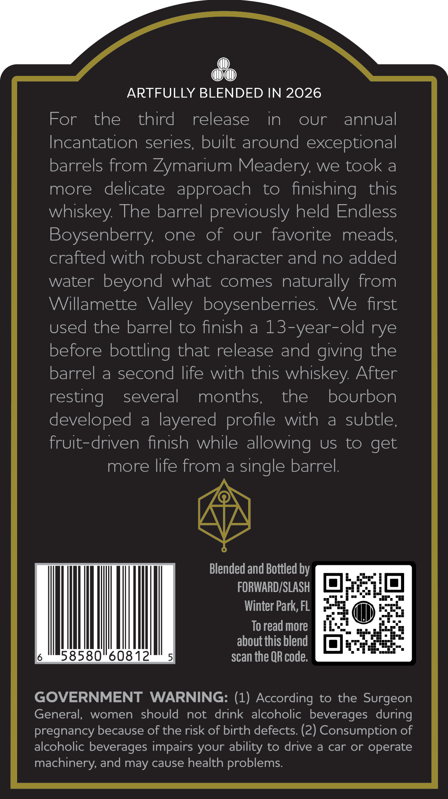
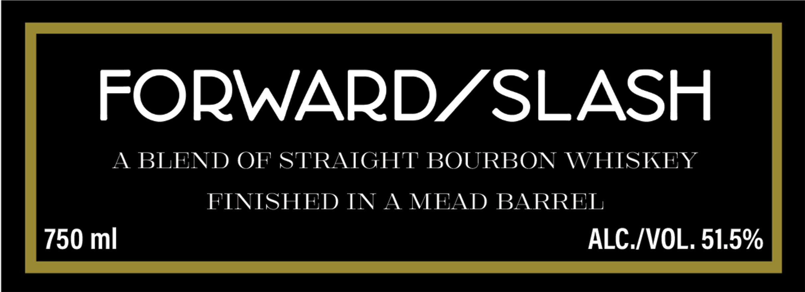
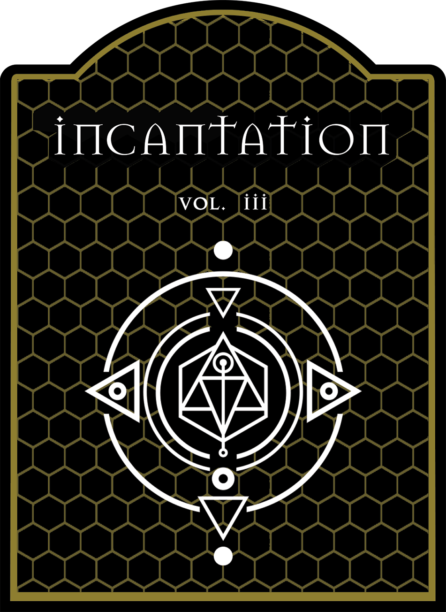

# TTB COLA Label Images - TTBID 26280001000245

**Brand Name:** FORWARD/SLASH

**Fanciful Name:** INCANTATION

**Issue Date:** 10/19/2026

**Origin Code:** 16

**Product Class/Type:** 121

**Source:** [TTB Public COLA Registry](https://ttbonline.gov/colasonline/viewColaDetails.do?action=publicFormDisplay&ttbid=26280001000245)

## Label Images

### Back Label

### Label 1

### Label 2

## Extracted Label Text

*Text extracted via OCR - may contain errors*

### Back Label

ARTFULLY BLENDED IN 2026
For
the
third
release
in
oUr
annual
Incantation series; built around exceptional
barrels from Zymarium Meadery: we took a
more
delicate  approach
to
finishing
this
whiskey The barrel previously held Endless
Boysenberry;
one
of
our  favorite
meads;
crafted with robust character and no added
water beyond
what
comes
naturally from
Willamette  Valley boysenberries:
We
first
used the barrel to finish a 13-year-old rye
before bottling that release and giving the
barrel
a
second life with this whiskey: After
resting
several
months,
the
bourbon
developed
a
layered
with
a
subtle;
fruit-driven finish while allowing
US
to get
more life from a single barrel
Blended and Bottled by
FORWARD/SLASH
Winter Park; FL
To read more
about this blend
58580"60812
scan the QR code:
GOVERNMENT
WARNING: (1) According to the Surgeon
General,
women  should
not
drink
alcoholic beverages  during
pregnancy because of the risk of birth defects: (2) Consumption of
alcoholic beverages impairs your ability to drive a car or operate
machinery; and may cause health problems:
profile

### Label 1

FORWARDZSLASH
A BLEND OF STRAIGHT BOURBON WHISKEY
FINISHED IN A
MEAD BARREL
750 ml
ALC /VOL, 51,5%

### Label 2

_ pws
—AO6SSsss
eee eee eee

' incanTaATion,
LTT Wet. vii
ISSSSSSSSSSSeS
SOSCCSUSSSCS
TODA IN TO
See ae iNONGe
COL VAN NOO
MIE (/ \V >
LISS ieee
Se6UN 77/680
TOONS AO
SeeoNG- 87600
acts ecuett
ISSSSSSSSSSSS
