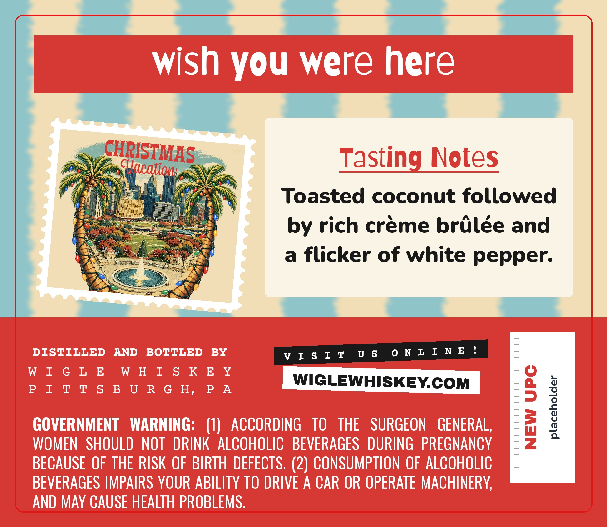
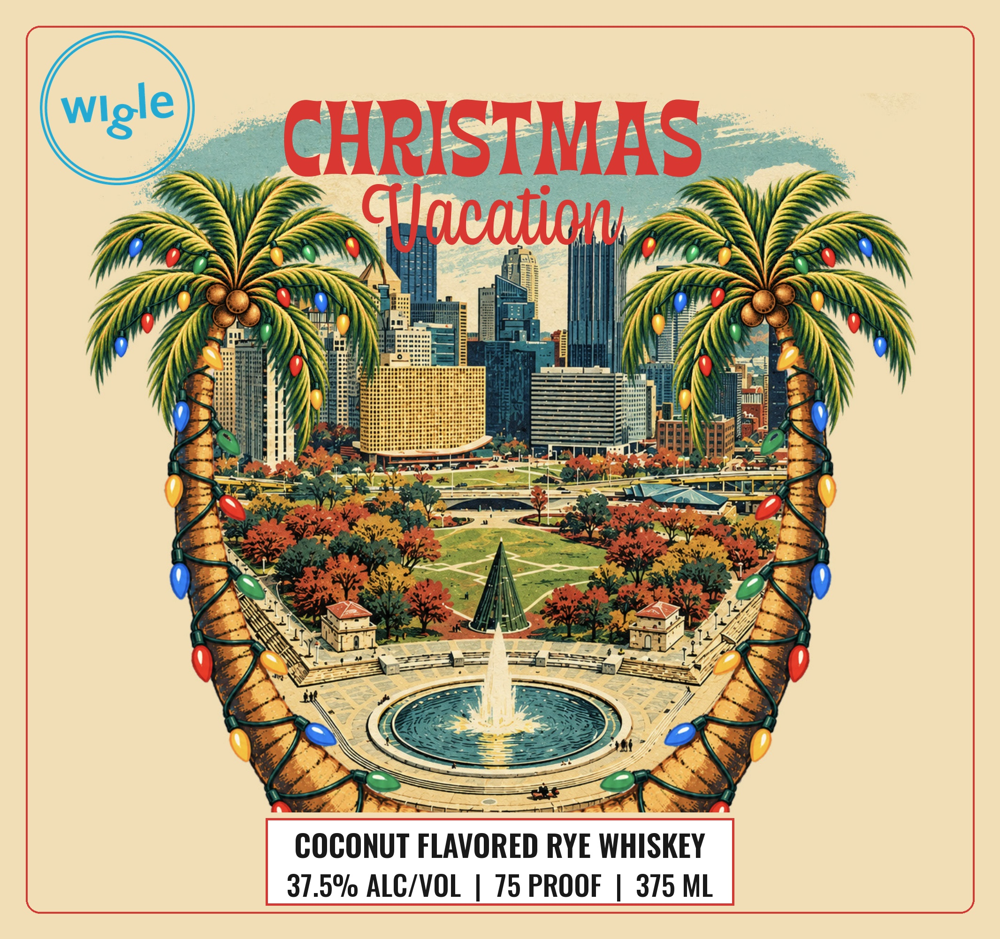

# TTB COLA Label Images - TTBID 26280001000317

**Brand Name:** WIGLE

**Fanciful Name:** CHRISTMAS VACATION

**Issue Date:** 10/14/2026

**Origin Code:** 39

**Product Class/Type:** 149

**Source:** [TTB Public COLA Registry](https://ttbonline.gov/colasonline/viewColaDetails.do?action=publicFormDisplay&ttbid=26280001000317)

## Label Images

### Back Label

### Front Label

## Extracted Label Text

*Text extracted via OCR - may contain errors*

**Detected Proof:** 150

### Back Label

wish you were here
Sxmsmmas
Tasting Notes
Toasted coconut followed
by rich creme brulee and
a flicker of white pepper.
DISTILLED
AND
BOTTLED
BY
V I S I I
U $   0 N L I N E !
W I G L E
W H I & K E Y
P I T
T S B U R G H,
P A
WIGLEWHISKEYCOM
g
GOVERNMENT
WARNING:   (1)
ACCORDING
TO
THE
SURGEON
GENERAL;
4
1
WOMEN   SHOULD   NOT
DRINK  ALCOHOLIC   BEVERAGES   DURING   PREGNANCY
BECAUSE OF THE RISK OF BIRTH DEFECTS. (2) CONSUMPTION OF ALCOHOLIC
BEVERAGES IMPAIRS YOUR ABILITY TO DRIVE A CAR OR OPERATE MACHINERY;
AND MAY CAUSE HEALTH PROBLEMS:

### Front Label

CHRISTMAS
Glcationv
COCONUT FLAVORED RYE WHISKEY
37.59 ALC/VOL
75 PROOF
375 ML
Wlgle
