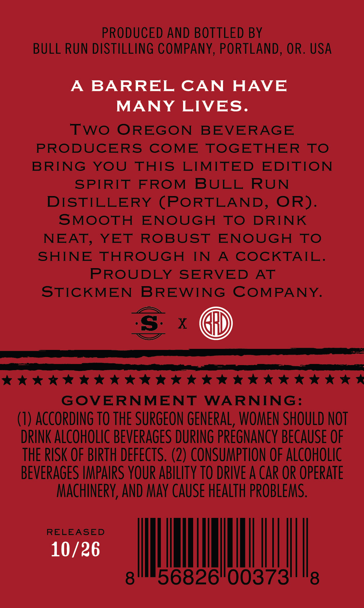
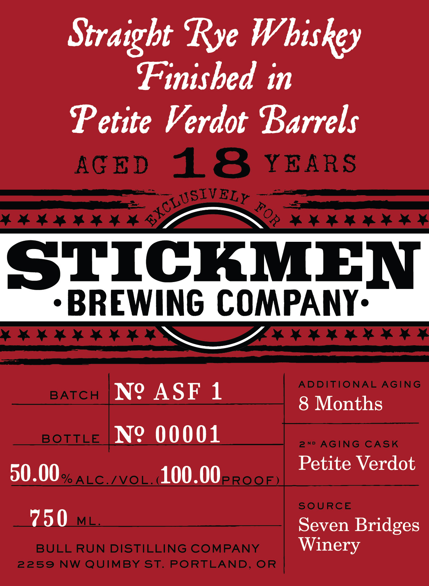

# TTB COLA Label Images - TTBID 26280001000338

**Brand Name:** EXCLUSIVELY FOR STICKMEN BREWING COMPANY

**Issue Date:** 10/16/2026

**Origin Code:** 38

**Product Class/Type:** 102

**Source:** [TTB Public COLA Registry](https://ttbonline.gov/colasonline/viewColaDetails.do?action=publicFormDisplay&ttbid=26280001000338)

## Label Images

### Back Label

### Label 1

### Label 3

## Extracted Label Text

*Text extracted via OCR - may contain errors*

*1 image(s) excluded: text did not meet readability threshold*

**Detected Age:** 18 Years

### Back Label

PRODUCED AND BOTTLED BY
BULL RUN DISTILLING COMPANY, PORTLAND, OR. USA

A BARREL CAN HAVE
MANY LIVES.

TWO OREGON BEVERAGE
PRODUCERS COME TOGETHER TO
BRING YOU THIS LIMITED EDITION

SPIRIT FROM BULL RUN

DISTILLERY (PORTLAND, OR).
SMOOTH ENOUGH TO DRINK
NEAT, YET ROBUST ENOUGH TO
SHINE THROUGH IN A COCKTAIL.
PROUDLY SERVED AT
STICKMEN BREWING COMPANY.

@

EE IIIT IIE IAEA CLIT EI NDE EGES.
KKK KK KKK KKK HKKK KKK KS
GOVERNMENT WARNING:

(1) ACCORDING TO THE SURGEON GENERAL, WOMEN SHOULD NOT
DRINK ALCOHOLIC BEVERAGES DURING PREGNANCY BECAUSE OF
THE RISK OF BIRTH DEFECTS. (2) CONSUMPTION OF ALCOHOLIC
BEVERAGES IMPAIRS YOUR ABILITY TO DRIVE A CAR OR OPERATE
MACHINERY, AND MAY CAUSE HEALTH PROBLEMS.

|

6826°00373

RELEASED

10/26

8 8

### Label 1

Strdigbt Rye Wbiskey
Finisbed in
Petite Verdot Barrels
AG ED
18
YEARS
STICKMEN
BREWING COMPANY:
ADDITIONAL AGING
BATCH
No
ASF 1
8 Months
BOTILE
N9 00001
2nD
AGING CASK
Petite Verdot
50.00 ALC_/vL_100.00eRQQE)
SOURCE
750
ML
Seven Bridges
BULL RUN DISTILLING COMPANY
Winery
2259
NW QUIMBY ST. PORTLAND;
OR
SXCLUSIV
ELY
FOR
