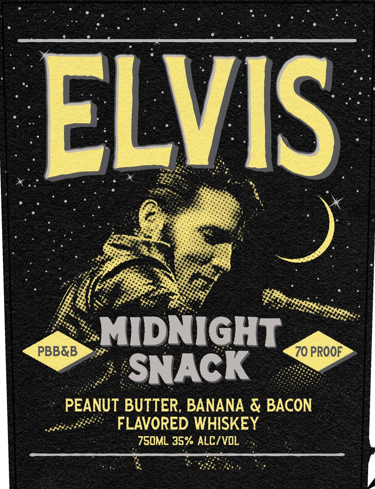
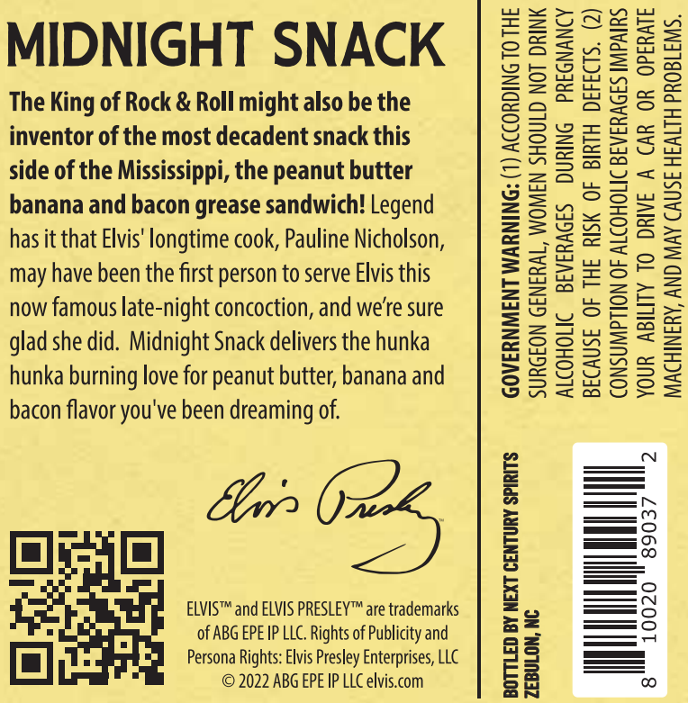

# TTB COLA Label Images - TTBID 26280001000581

**Brand Name:** ELVIS

**Fanciful Name:** MIDNIGHT SNACK

**Issue Date:** 10/14/2026

**Origin Code:** 35

**Product Class/Type:** 149

**Source:** [TTB Public COLA Registry](https://ttbonline.gov/colasonline/viewColaDetails.do?action=publicFormDisplay&ttbid=26280001000581)

## Label Images

### Label 1

### Label 2

### Label 3

## Extracted Label Text

*Text extracted via OCR - may contain errors*

*1 image(s) excluded: text did not meet readability threshold*

**Detected Proof:** 140

### Label 1

: @ e 3 2

at

poe

FE

So.

Pa. Oat

et

; < ws

ve

LP

AS Di,

fe

&

mw

Pate

wens

%

en Fo

MIDNIGHT

PBB&B

70 PROOF

Ju

a

*

SNACK .

Seg Lae

eT oe Witte

args

i a

Ete

een

bee inca at Nae

ek Aik Re der

em

Pag ated

5 eG AI,

~ PEANUT BUTTER, BANANA & BACON

pends cpa

FLAVORED WHISKEY.

7SOML 35% ALC/VOL .

doid

### Label 3

MIDNIGHT SNACK

The King of Rock & Roll might also be the
inventor of the most decadent snack this
side of the Mississippi, the peanut butter
banana and bacon grease sandwich! Legend
has it that Elvis' longtime cook, Pauline Nicholson,
may have been the first person to serve Elvis this
now famous late-night concoction, and we're sure
glad she did. Midnight Snack delivers the hunka
hunka burning love for peanut butter, banana and
bacon flavor you've been dreaming of.

ELVIS™ and ELVIS PRESLEY™ are trademarks
. of ABG EPE IP LLC. Rights of Publicity and
OO} . Persona Rights: Elvis Presley Enterprises, LLC
© 2022 ABG EPE IP LLC elvis.com

GOVERNMENT WARNING: (1) ACCORDING TO THE
SURGEON GENERAL, WOMEN SHOULD NOT DRINK

ALCOHOLIC BEVERAGES DURING PREGNANCY

BOTTLED BY NEXT CENTURY SPIRITS

ZEBULON, NC

BECAUSE OF THE RISK OF BIRTH DEFECTS. (2)
CONSUMPTION OF ALCOHOLIC BEVERAGES IMPAIRS
YOUR ABILITY TO DRIVE A CAR OR OPERATE

2

10020 § 89037

MACHINERY, AND MAY CAUSE HEALTH PROBLEMS.
