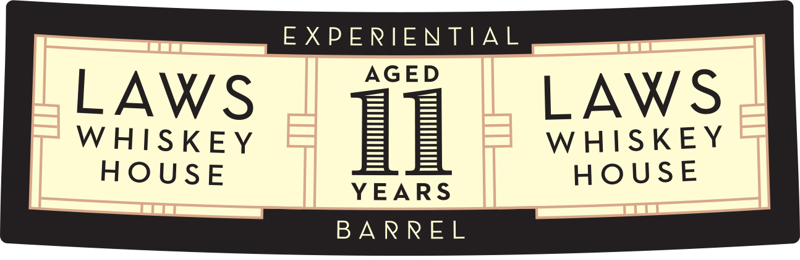
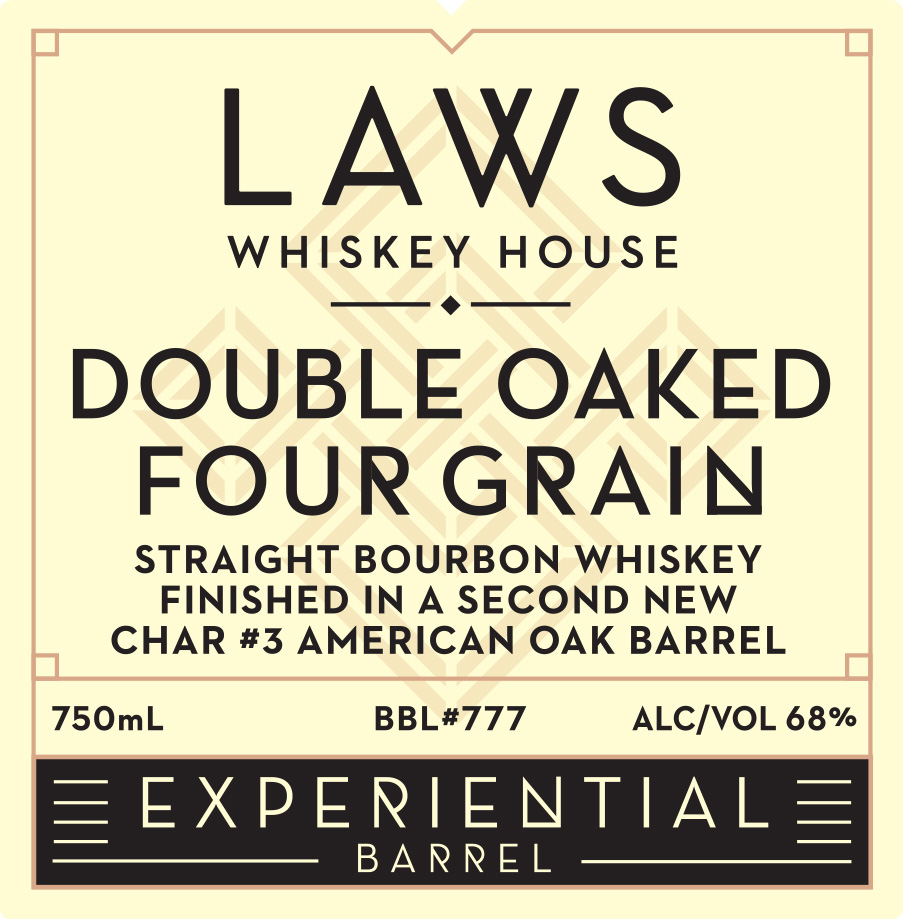

# TTB COLA Label Images - TTBID 26280001000604

**Brand Name:** LAWS WHISKEY HOUSE

**Fanciful Name:** DOUBLE OAKED FOUR GRAIN

**Issue Date:** 10/19/2026

**Origin Code:** 13

**Product Class/Type:** 101

**Source:** [TTB Public COLA Registry](https://ttbonline.gov/colasonline/viewColaDetails.do?action=publicFormDisplay&ttbid=26280001000604)

## Label Images

### Back Label

### Front Label

## Extracted Label Text

*Text extracted via OCR - may contain errors*

### Back Label

EXPERIENTIAL

AGED

LAWS

LAWS

WHISKEY

HOUSE

WHISKEY

YEARS

HOUSE

BARREL

### Front Label

LAWS
WHISKEY
HOUsE
DOUBLE OAKED
FOUR GRAIN
STRAIGHT BOURBON WHISKEY
FINISHED IN A SECOND NEW
CHAR #3 AMERICAN OAK BARREL
750mL
BBL#777
ALCIVOL 68%
EEXPERIENTIAL
BA RREL
