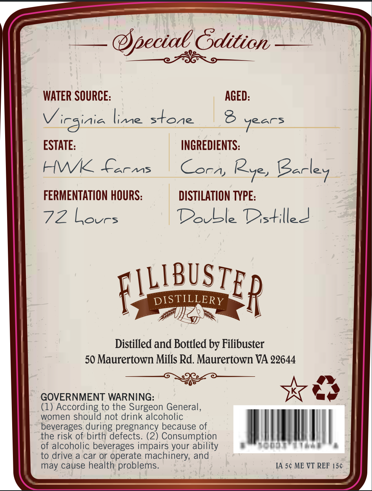
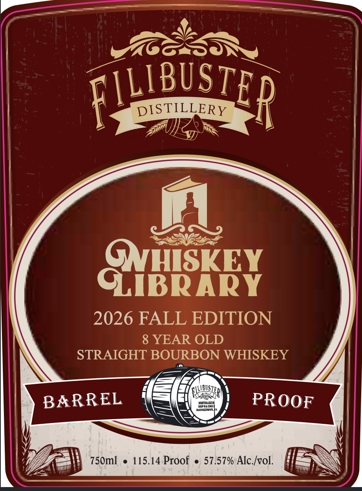

# TTB COLA Label Images - TTBID 26280001000638

**Brand Name:** FILIBUSTER

**Fanciful Name:** WHISKY LIBRARY

**Issue Date:** 10/22/2026

**Origin Code:** 05

**Product Class/Type:** 101

**Source:** [TTB Public COLA Registry](https://ttbonline.gov/colasonline/viewColaDetails.do?action=publicFormDisplay&ttbid=26280001000638)

## Label Images

### Back Label

### Front Label

## Extracted Label Text

*Text extracted via OCR - may contain errors*

**Detected Proof:** 115.1
**Detected Age:** 8 Years

### Back Label

@peciae Gdition
WATER SOURCE:
AGED:
Virginia lime stone
8 Years
ESTATE:
INGREDIENTS:
AWK
ACMS
Cora,
Barley
FERMENTATION HOURS:
DISTILATION TYPE:
72 Lovrs
DoLle DstilleJ
FWBUSIER
DISTILLERY
Distilled and Bottled by Filibuster
50 Maurertown Mills Rd. Maurertown VA 22644
GOVERNMENT WARNING:
(1) According to the Surgeon General)
women should not drink alcoholic
beverages during
because of
the risk of birth defects.
eregtsangy benausepeion
of alcoholic beverages impairs your ability
to drive a car or operate machinery; and
may cause health problems
IA 5c ME VT REF 156
02,

### Front Label

FTLIBUSTER
DISTILLERY
GNBEKEY
2026 FALL EDITION
8 YEAR OLD
STRAIGHT BOURBON WHISKEY
BARREL
distILuo
PROOF
750ml
115.14 Proof
57.57% Alc Ivol.
GLLUBUSI
