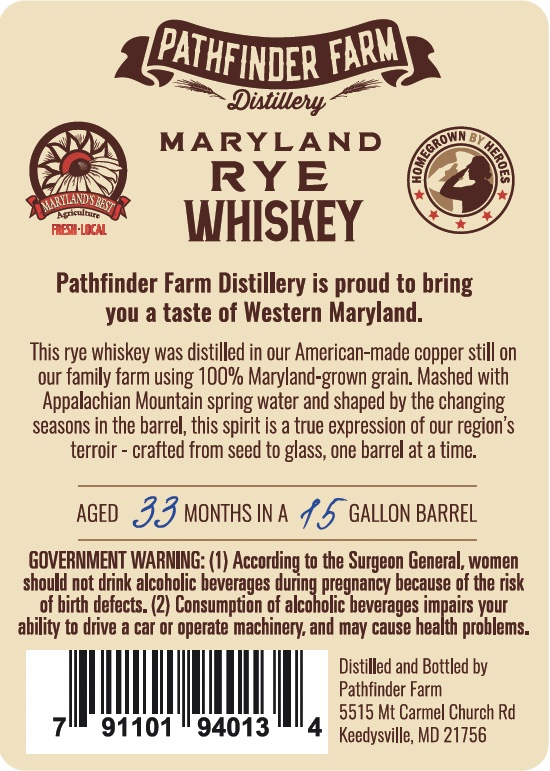
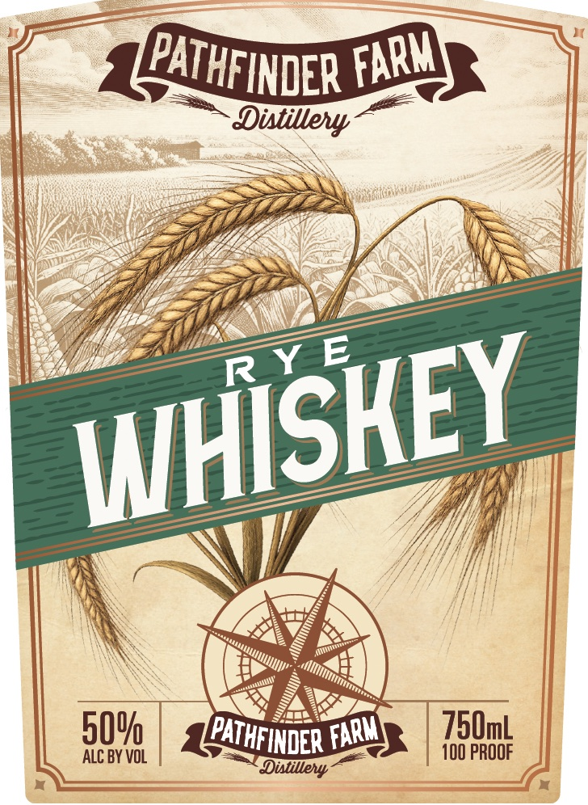

# TTB COLA Label Images - TTBID 26280001000641

**Brand Name:** PATHFINDER FARM

**Issue Date:** 10/20/2026

**Origin Code:** 25

**Product Class/Type:** 142

**Source:** [TTB Public COLA Registry](https://ttbonline.gov/colasonline/viewColaDetails.do?action=publicFormDisplay&ttbid=26280001000641)

## Label Images

### Back Label

### Front Label

## Extracted Label Text

*Text extracted via OCR - may contain errors*

### Back Label

Dintilely-
MARYLAND
RYE
MaRyaNdSbasty
Lcncutt
RBIVI
WHISKEY
Pathfinder Farm Distillery is
to bring
you a taste of Western Maryland.
This rye whiskey was distilled in our American-made copper still on
our family farm using OO% Maryland-grown
Mashed with
Appalachian Mountain spring water and shaped by the changing
seasons in the barrel, this spirit is a true expression of our region'$
terroir
crafted from seed to glass, one barrel at a time:
AGED
33 MONTHS IN A 7,5 Gallon BARREL
GOVERNMENT WARNING: (0) According to the
General; women
should not drink alcoholic beverages
pregnancy because of the risk
of birth defects: (2) Consumption of
daleokonegheverzbecanoani (jeui
ability to drive a car or operate machinery; and may cause health problems:
Distilled and Bottled by
Pathfinder Farm
5515 Mt Carmel Church Rd
91101
94013
Keedysville; MD 21756
PATHFINDER
FARM
proud
grain
Surgeon

### Front Label

Distillely
509
750mL
ALC BY VOL
10O PROOF
Dixtilley
FARM
PATHFINDER
RY E
WHISKEY
PATHFINDER '
FARM
