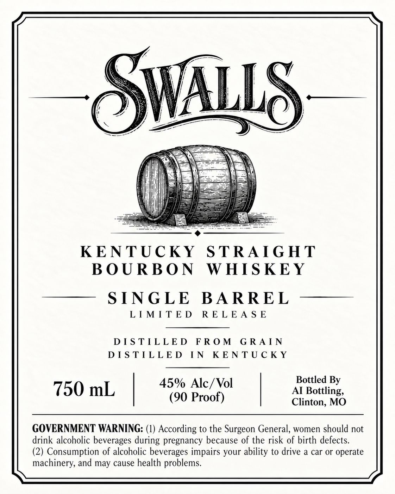

# TTB COLA Label Images - TTBID 26280001000648

**Brand Name:** SWALLS

**Issue Date:** 10/20/2026

**Origin Code:** 29

**Product Class/Type:** 101

**Source:** [TTB Public COLA Registry](https://ttbonline.gov/colasonline/viewColaDetails.do?action=publicFormDisplay&ttbid=26280001000648)

## Label Images

### Label 1

## Extracted Label Text

*Text extracted via OCR - may contain errors*

### Label 1

Ww ie ai
di) ehh eet
iia iy tata
KENTUCKY STRAIGHT
BOURBON WHISKEY
—— SINGLE BARREL —
LIMITED RELEASE
DISTILLED FROM GRAIN
DISTILLED IN KENTUCKY
(1) Bottled By
roo Clinton, MO
GOVERNMENT WARNING: (1) According to the Surgeon General, women should not
drink alcoholic beverages during pregnancy because of the risk of birth defects.
(2) Consumption of alcoholic beverages impairs your ability to drive a car or operate
machinery, and may cause health problems.
