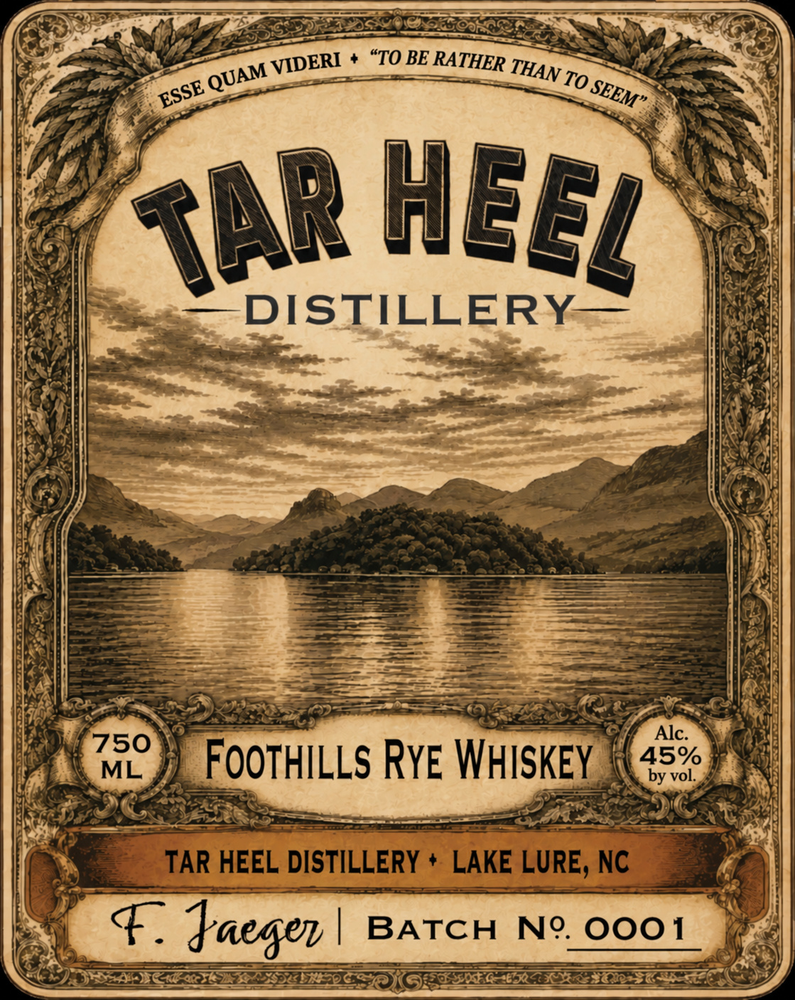
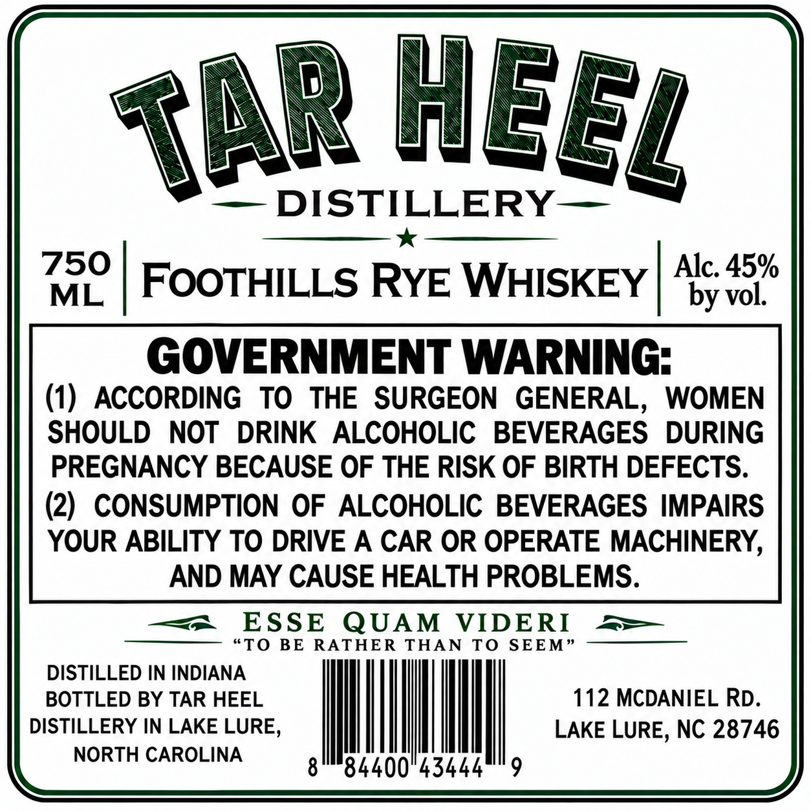

# TTB COLA Label Images - TTBID 26281001000034

**Brand Name:** TAR HEEL DISTILLERY

**Issue Date:** 10/23/2026

**Origin Code:** 35

**Product Class/Type:** 142

**Source:** [TTB Public COLA Registry](https://ttbonline.gov/colasonline/viewColaDetails.do?action=publicFormDisplay&ttbid=26281001000034)

## Label Images

### Label 1

### Label 2

## Extracted Label Text

*Text extracted via OCR - may contain errors*

### Label 1

"TO BE RATHER
To
DISTILLERY
Alc:
750
ML
FooTHILLs RYE WHISKEY
45vo
TAR HEEL DISTILLERY
LAKE LURE, NC
F
Jaeser
BATCH
Ng.
0o01
VIDERI
THAN
QUAM
SEEM"
ESSE
heel
TAR

### Label 2

»

—DISTILLERY—

Alc. 45%

eg d FOOTHILLS RYE WHISKEY |

by vol

GOVERNMENT WARNING

(1) ACCORDING TO THE SURGEON GENERAL, WOMEN

SHOULD NOT DRINK ALCOHOLIC BEVERAGES DURING

PREGNANCY BECAUSE OF THE RISK OF BIRTH DEFECTS

(2) CONSUMPTION OF ALCOHOLIC BEVERAGES IMPAIRS

YOUR ABILITY TO DRIVE A CAR OR OPERATE MACHINERY,

AND MAY CAUSE HEALTH PROBLEMS.

= ESSE QUAM Keble

_——

ATHER THAN T

———

DISTILLED IN ahaha

BOTTLED BY TAR HEEL

112 MCDANIEL RD

DISTILLERY IN LAKE LURE

|

LAKE LURE, NC 28746

NORTH CAROLINA

|

4400

43444

9
