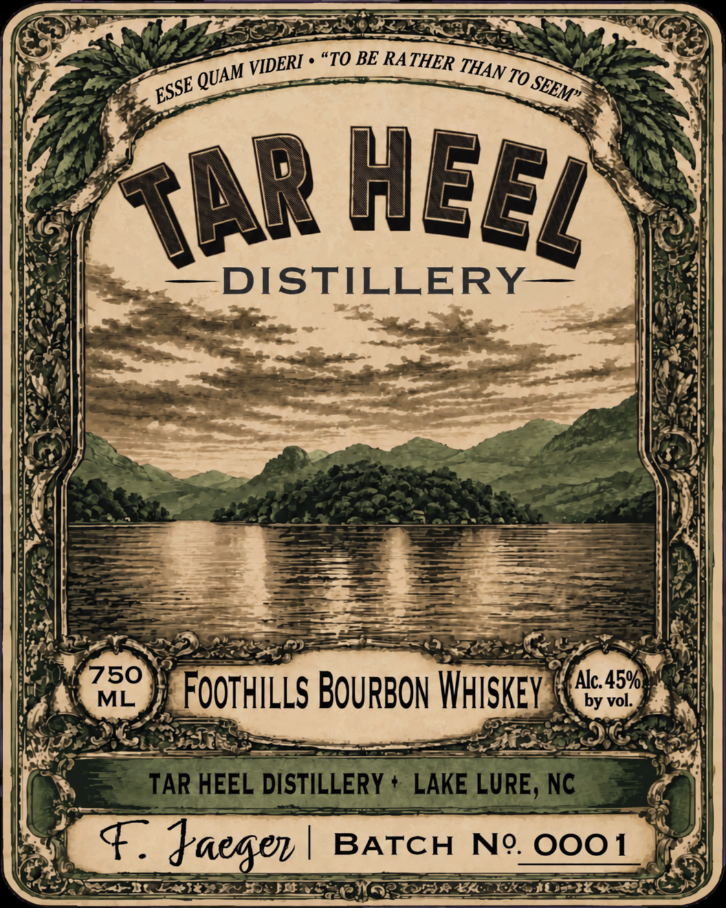
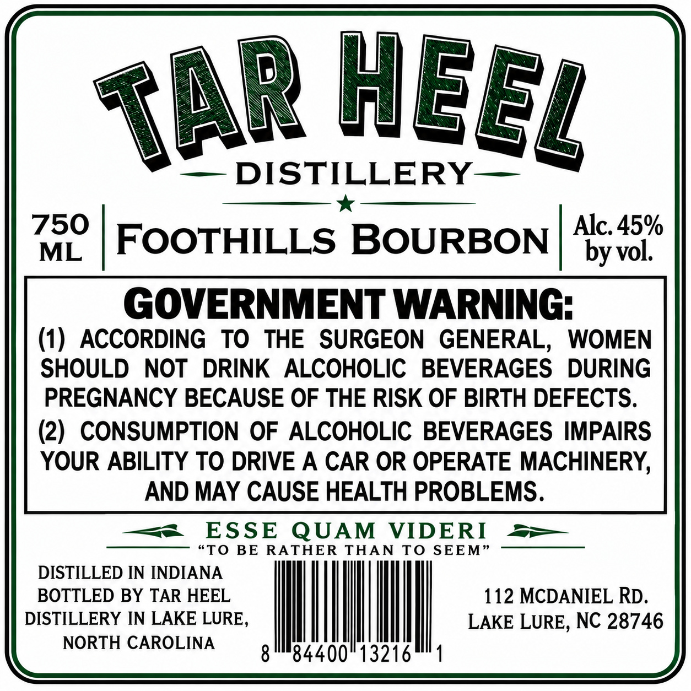

# TTB COLA Label Images - TTBID 26281001000035

**Brand Name:** TAR HEEL DISTILLERY

**Issue Date:** 10/23/2026

**Origin Code:** 35

**Product Class/Type:** 141

**Source:** [TTB Public COLA Registry](https://ttbonline.gov/colasonline/viewColaDetails.do?action=publicFormDisplay&ttbid=26281001000035)

## Label Images

### Label 1

### Label 2

## Extracted Label Text

*Text extracted via OCR - may contain errors*

### Label 1

"TO BE RA_
TO ,
DISTILLERY
750
Alc.45%
ML
Foothills BOuRBOn Whskey
by vol:
TAR HEEL DISTILLERY
LAKE LURE; NC
F.
Jaeger
BATCH
No. OOO1
THER
VIDERI
THAN =
QUAM
ESSE
SEEM"
heel
TAR

### Label 2

DISTILLERY
750
Alc. 45%
ML
FOOTHILLS BOURBON
by vol.
GOVERNMENT WARNING:
(1)  ACCORDING
TO
THE
SURGEON GENERAL,
WOMEN
SHOULD
NOT
DRINK
ALCOHOLIC
BEVERAGES
DURING
PREGNANCY BECAUSE OF THE RISK OF BIRTH DEFECTS.
(2)
CONSUMPTION OF ALCOHOLIC BEVERAGES IMPAIRS
YOUR ABILITY TO DRIVE A CAR OR OPERATE MACHINERY;
AND MAY CAUSE HEALTH PROBLEMS.
ESSE
QUAM
VIDERI
STo
BE
RATHER
THAN
TO SEEM
DISTILLED IN INDIANA
BOTTLED BY TAR HEEL
112 MCDANIEL RD
DISTILLERY IN LAKE LURE,
LAKE LURE, NC 28746
NORTH CAROLINA
8
84400'
3216
heel
TAR
