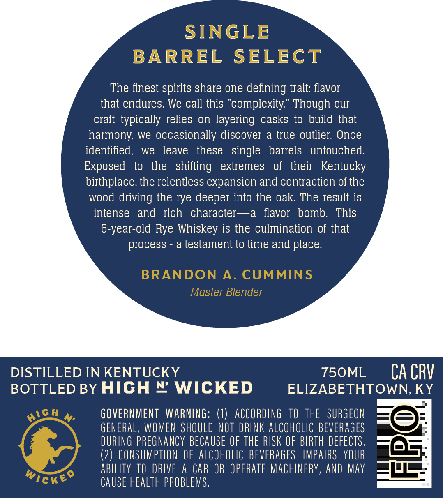
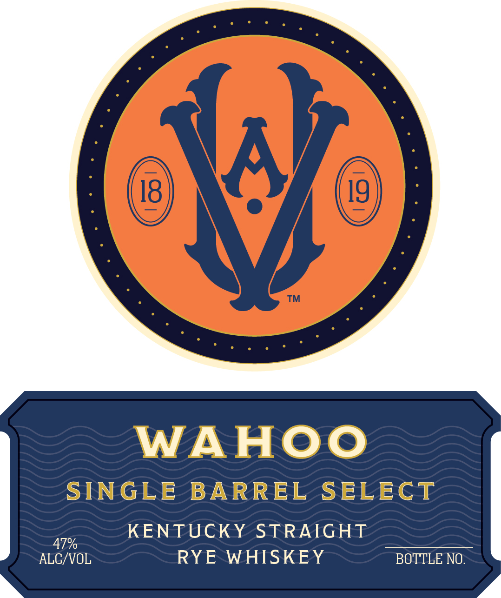

# TTB COLA Label Images - TTBID 26281001000146

**Brand Name:** WAHOO

**Fanciful Name:** SINGLE BARREL SELECT

**Issue Date:** 10/16/2026

**Origin Code:** 22

**Product Class/Type:** 102

**Source:** [TTB Public COLA Registry](https://ttbonline.gov/colasonline/viewColaDetails.do?action=publicFormDisplay&ttbid=26281001000146)

## Label Images

### Back Label

### Front Label

### Label 2

## Extracted Label Text

*Text extracted via OCR - may contain errors*

*1 image(s) excluded: text did not meet readability threshold*

### Back Label

SINGLE
BARREL
SELECT
The finest spirits share one defining trait: flavor
that endures. We call this "complexity:" Though our
craft  typically relies on layering
casks to build that
harmony; we occasionally discover a true outlier: Once
identified,
we
leave
these
single
barrels
untouched.
Exposed
to
the   shifting
extremes
of
their   Kentucky
birthplace, the relentless expansion and contraction of the
wood driving the rye deeper into the oak The result is
intense
and
rich
character-~a
flavor
bomb:
This
6-year-old Rye Whiskey is the culmination of that
process
a testament to time and place.
BRANDON
A.
CUMMINS
Master Blender
DISTILLED IN KENTUCKY
750ML
CA CRV
BOTTLED BY HIGH € WICKED
ELIZABETHTOWN, KY
M'
GOVERNMENT   WARNING: ()
ACCORdING   TO   thE   SURGEON
GENERAL, WOMEN ShOULD NOT DRLNK alCoholic BEVERaGes
DURING pREGNAncY BECAUSE OF thE RISK €F BIRTH defectS.
(2) CONSUMPTION €F  alCohOLIc BEvERaGes   IMPAIRS   YOUR
abllity TO DRIVE
H
CAR OR operate MachinerY, ANd May
Wickeo
CAUSE health PROBLeMS ,
HicH

### Front Label

WAHOO

SINGLE BARREL SELECT

a KENTUCKY STRAIGHT
ALG/VOL RYE WHISKEY BOTTLE NO:
