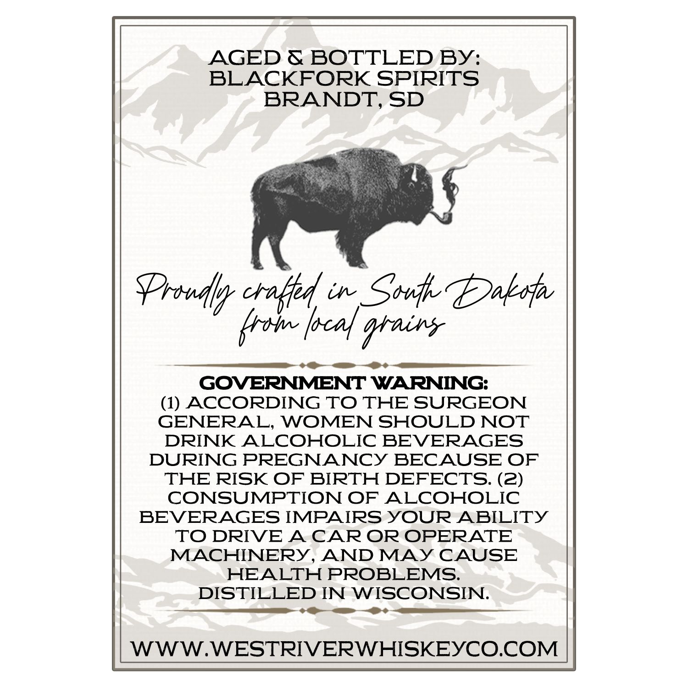
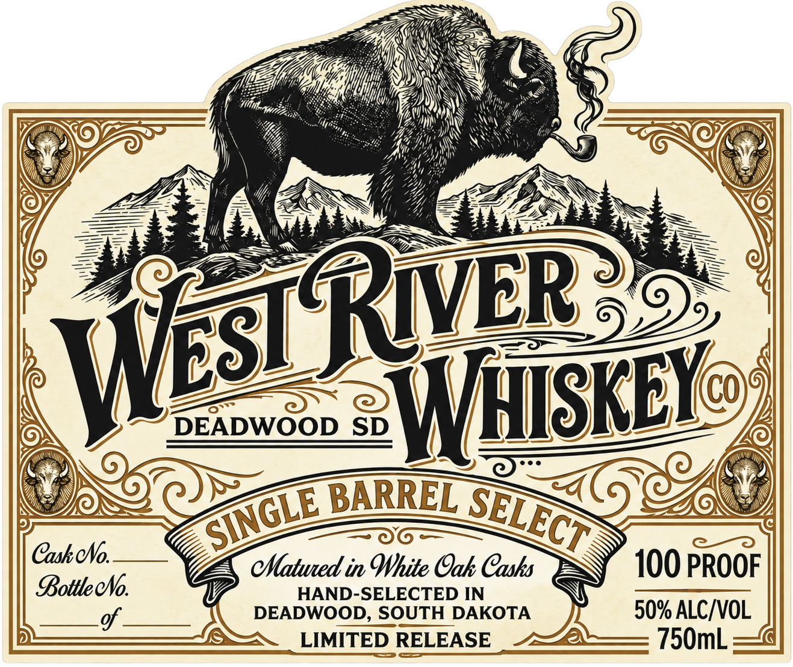

# TTB COLA Label Images - TTBID 26281001000184

**Brand Name:** WEST RIVER WHISKEY

**Issue Date:** 10/15/2026

**Origin Code:** 42

**Product Class/Type:** 140

**Source:** [TTB Public COLA Registry](https://ttbonline.gov/colasonline/viewColaDetails.do?action=publicFormDisplay&ttbid=26281001000184)

## Label Images

### Back Label

### Label 1

## Extracted Label Text

*Text extracted via OCR - may contain errors*

**Detected Proof:** 100

### Back Label

AGED & BOTTLED BY:
BLACKFORK SPIRITS
BRANDT, SD
PrsuA cralta
in
Soni Daksfa
krom |oca] %tains
GOVERNMENT WARNING:
(1) ACCORDING TO THE SURGEON
GENERAL, WOMEN SHOULD NOT
DRINK
ALCOHOLIC BEVERAGES
DURING PREGNANCY BECAUSE OF
THE RISK OF BIRTH DEFECTS: (2)
CONSUMPTION OF
ALCOHOLIC
BEVERAGES IMPAIRS YOUR ABILITY
TO DRIVE
A
CAR OR OPERATE
MACHINERY
AND MAY CAUSE
HEALTH PROBLEMS:
DISTILLED IN WISCONSIN:
WWW.WESTRIVERWHISKEYCO.COM

### Label 1

DEADWOOD SD
WHISKEY
BARREL
CaskeNo.
cMatwed in White Gak Cashs
100 PROOF
BottleeNo
HAND-SELECTED IN
of
DEADWOOD, SOUTH DAKOTA
50% ALC/VOL
LIMITED RELEASE
750mL
WSTRyER
SINGLE
SELECT
