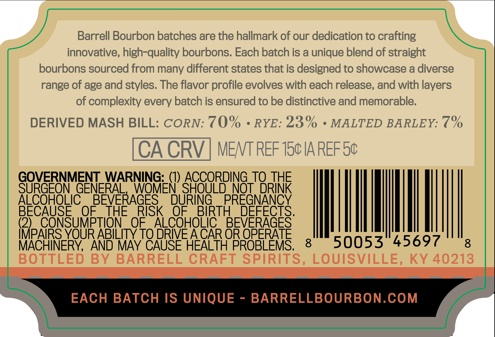
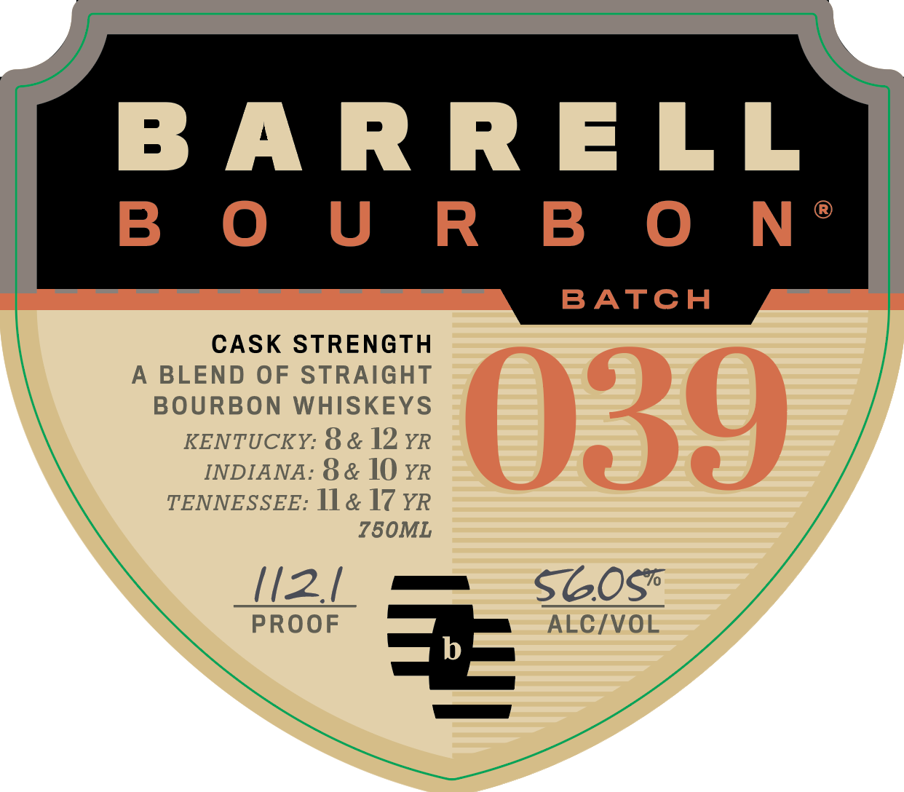

# TTB COLA Label Images - TTBID 26281001000242

**Brand Name:** BARRELL BOURBON

**Issue Date:** 10/15/2026

**Origin Code:** 22

**Product Class/Type:** 121

**Source:** [TTB Public COLA Registry](https://ttbonline.gov/colasonline/viewColaDetails.do?action=publicFormDisplay&ttbid=26281001000242)

## Label Images

### Back Label

### Front Label

### Label 3

## Extracted Label Text

*Text extracted via OCR - may contain errors*

*1 image(s) excluded: text did not meet readability threshold*

**Detected Age:** 12 Years

### Back Label

Barrell Bourbon batches are the hallmark of our dedication to crafting
innovative; high-quality bourbons: Each batch is a unique blend of straight
bourbons sourced from many different states that is designed to showcase a diverse
range of age and styles. The flavor profile evolves with each release, and with layers
of complexity every batch is ensured to be distinctive and memorable:
DERIVED MASH BILL: CORN: 70%
RYE: 23%
MALTED BARLEY: 7%
CACRV
MENT REF 150 IA REF 50
GOVERNMENT WARNING: (1) ACCORDING
JORTHE
SURGEON GENERAL
WQMEN' SHOULD NQT
ALCOHOLIC
BEVERAGES
DURING
PREGNANCY
BECAUSE
OF
THE
RISK
OF
BIRTH
DEFECTS.
(2)
CONSUMPTION
OF
ALCOHOLIC
BEVERAGES
IMPAIRS YOUR ABILITY TO DRIVE ACAR OR OPERATE
MACHINERY,
AND MAY CAUSE HEALTH PROBLEMS;
8
50053
45697
8
BOTTLED
BY
BARRELL CRAFT SPIRITS, LOUISVILLE,
KY 40213
EACH BATCH IS UNIQUE
BARRELLBOURBON.COM

### Front Label

BARRELL

B OUR BO N*

BATCH

CASK STRENGTH

A BLEND OF STRAIGHT

BOURBON WHISKEYS

KENTUCKY: 8 & 12 yr

INDIANA: 8& 10 rR

TENNESSEE: 11& 17 YR

Z50ML

(2/ =m sGOSs*

PROOF

ALC/VOL
