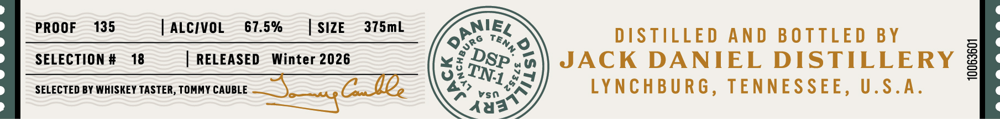

# TTB COLA Label Images - TTBID 26281001000253

**Brand Name:** JACK DANIEL'S

**Fanciful Name:** DISTILLERY SERIES TENNESSEE BLEND #1

**Issue Date:** 10/20/2026

**Origin Code:** 43

**Product Class/Type:** 120

**Source:** [TTB Public COLA Registry](https://ttbonline.gov/colasonline/viewColaDetails.do?action=publicFormDisplay&ttbid=26281001000253)

## Label Images

### Back Label

### Front Label

## Extracted Label Text

*Text extracted via OCR - may contain errors*

*1 image(s) excluded: text did not meet readability threshold*

**Detected Proof:** 135

### Front Label

PROOF
135
ALCIVOL
67.5%
SIZE
375mL
DISTILLED
And BOTTLED
BY
SELECTION #
18
RELEASED
Winter 2026
JACK DANIEL DISTILLERY
1
SELECTED BY WHISKEY TASTER, TOMMY CAUBLE
4au
Vs0
LYNCHBURG ,
TENNESSEE,
U.S.A
Xja
Ganiek
Tenn;
(
9
DSP"
4
1
TN1,
