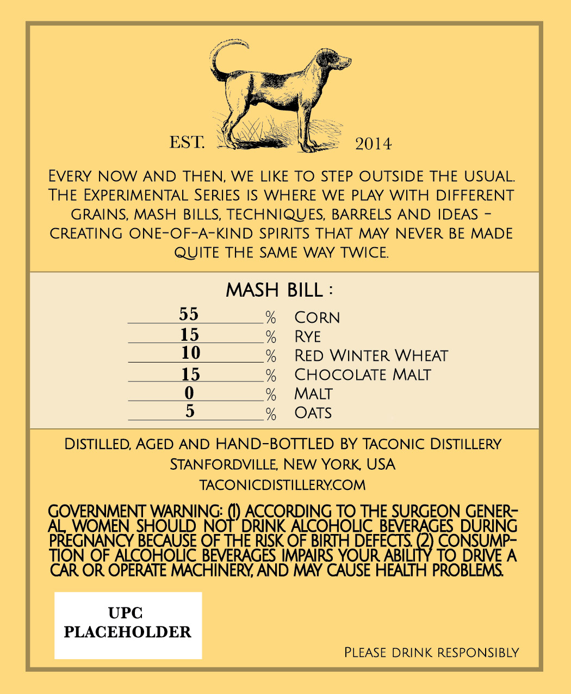
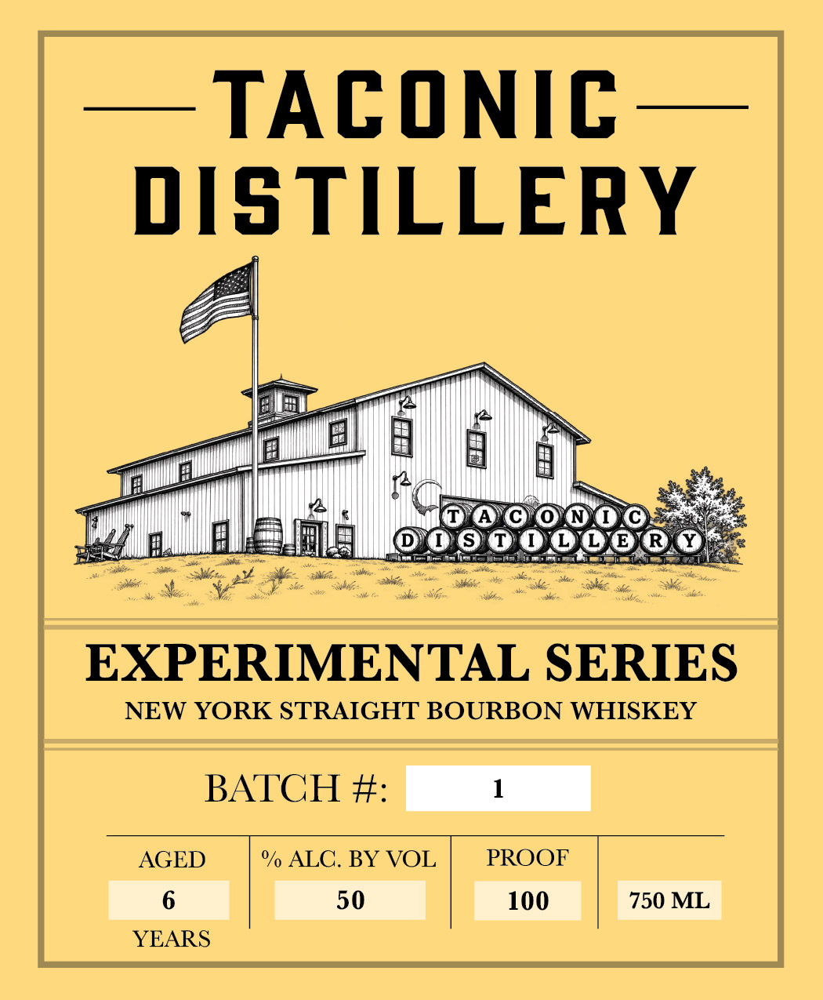

# TTB COLA Label Images - TTBID 26281001000420

**Brand Name:** TACONIC DISTILLERY

**Fanciful Name:** EXPERIMENTAL SERIES

**Issue Date:** 10/15/2026

**Origin Code:** 02

**Product Class/Type:** 101

**Source:** [TTB Public COLA Registry](https://ttbonline.gov/colasonline/viewColaDetails.do?action=publicFormDisplay&ttbid=26281001000420)

## Label Images

### Back Label

### Front Label

## Extracted Label Text

*Text extracted via OCR - may contain errors*

**Detected Proof:** 100
**Detected Age:** 6 Years

### Back Label

EST
2014
EVERY NOW AND THEN, WE LIKE TO STEP OUTSIDE THE USUAL
THE EXPERIMENTAL SERIES IS WHERE WE PLAY WITH DIFFERENT
GRAINS, MASH BILLS, TECHNIQUES, BARRELS AND IDEAS
CREATING ONE-OF-A-KIND SPIRITS THAT MAY NEVER BE MADE
QUITE THE SAME WAY TWICE
MASH
BILL :
55
CORN
RYE
RED WINTER WHEAT
1
MAOCOLATE
MALT
OATS
DISTILLED, AGED AND HAND-BOTTLED BY TACONIC DISTILLERY
STANFORDVILLE; NEW YORK USA
TACONICDISTILLERYCOM
GOVERNMENT WARNING:
NoH BCSORRISH8LHHEEURGEONSENERG
AL_WOMEN SHOULD
DRINK ALCOHOLC BEVERAGES DURING
PREGNANCY BECAUSE OF THE RISK OF BRTH DEFECTS
SRA
TION OF ACOHOLC BEVERAGES IMPAIRS YOUR ABIVT
DRIVE A
CAR OR OPERATE MACHINERY AND MAY CAUSE HEALTH PROBLEMS
UPC
PLACEHOLDER
PLEASE DRINK RESPONSIBLY

### Front Label

— TACONIC —
DISTILLERY

EXPERIMENTAL SERIES

NEW YORK STRAIGHT BOURBON WHISKEY

BATCH #: 1

PROOF
100

% ALC. BY VOL
50

AGED
6
YEARS

750 ML
