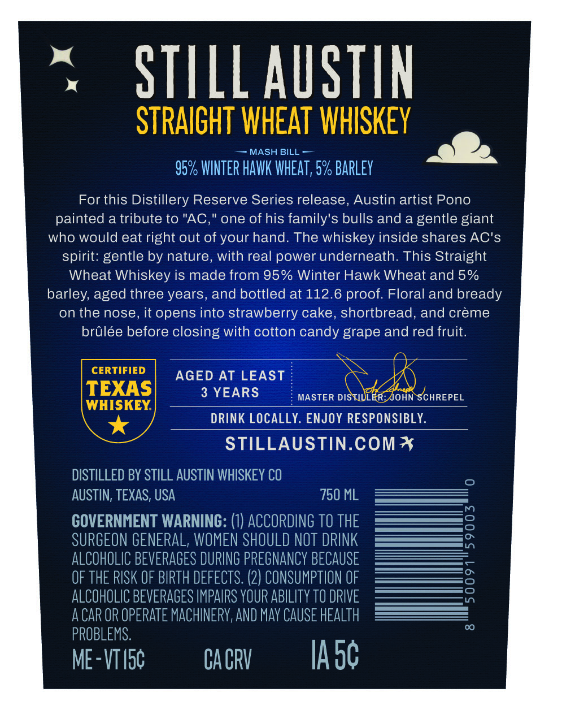
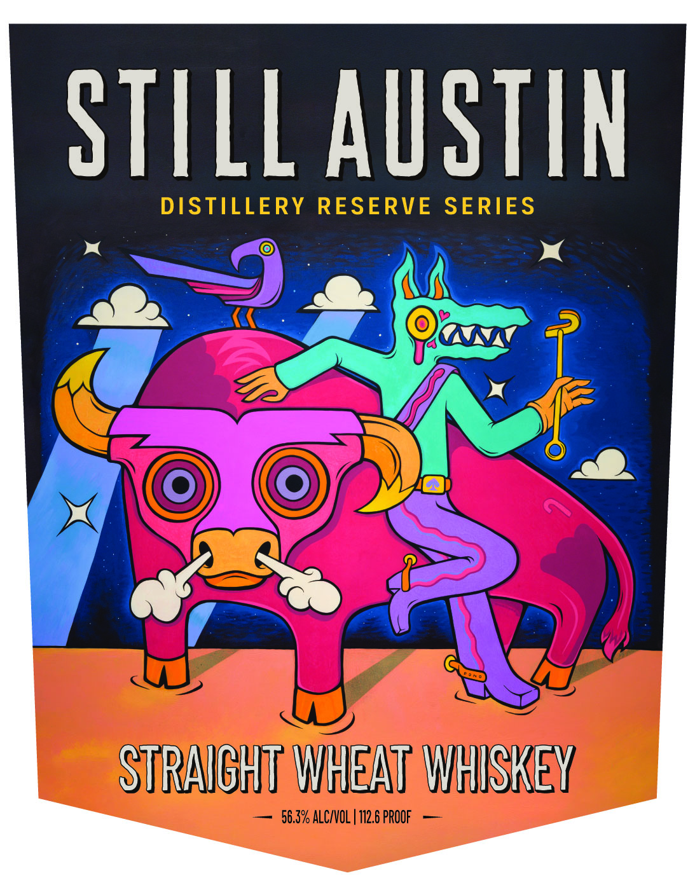

# TTB COLA Label Images - TTBID 26281001000485

**Brand Name:** STILL AUSTIN

**Fanciful Name:** DISTILLERY EXCLUSIVE

**Issue Date:** 10/15/2026

**Origin Code:** 44

**Product Class/Type:** 109

**Source:** [TTB Public COLA Registry](https://ttbonline.gov/colasonline/viewColaDetails.do?action=publicFormDisplay&ttbid=26281001000485)

## Label Images

### Back Label

### Front Label

### Label 3

## Extracted Label Text

*Text extracted via OCR - may contain errors*

**Detected Proof:** 112.6
**Detected Age:** 3 Years

### Back Label

STILLAuSTIn
STRAICHT WHEAT WHISKEY
MASH BILL
95% WINTER HAWK WHEAT, 5% BARLEY
For this Distillery Reserve Series release, Austin artist Pono
painted a tribute to "AC,
one of his family's bulls and a gentle giant
who would eat right out of your hand: The whiskey inside shares AC's
spirit: gentle by nature, with real power underneath. This Straight
Wheat Whiskey is made from 95% Winter Hawk Wheat and 5%
barley, aged three years, and bottled at 112.6 proof. Floral and bready
on the nose, it opens into strawberry cake, shortbread, and creme
brulee before closing with cotton candy grape and red fruit.
CERTIFIED
AGED
AT LEAST
TEXAS
3 YEARS
MASTER DISTIULER AJOHN SCHREPEL
WHISKEY
DRINK LOCALLY. ENJOY RESPONSIBLY.
STILLAUSTIN.COM*
DISTILLED BY STILL AUSTIN WHISKEY CO
AUSTIN; TEXAS; USA
750 ML
GOVERNMENT WARNING:
ACCORDING TO THE
3
SURGEON GENERAL, WOMEN SHOULD NOT DRINK
ALCOHOLIC BEVERAGES DURING PREGNANCY BECAUSE
OF THE RISK OF BIPTH DEFECTS: (2) CONSUMPTION OF
9
ALCOHOLIC BEVERAGES IMPAIPS YOUR ABILITy TO DRIVE
A CAR OR OPERATE MACHINERY,AND May CAUSE HEALTH
PROBLEMS:
ME-VTIsc
CA CRV
IA 5c

### Front Label

STILLAUSTIN
DISTILLERY RESERVE SERIES
STRAICHT WHEAT WHISKEY
56.3% ALCIVOL | 112.6 PROOF

### Label 3

DISTILLERY RESERVE SERIES

SHlWIS JAYISIY AYITULSIA
