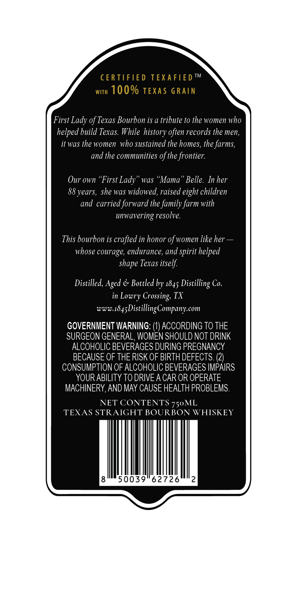
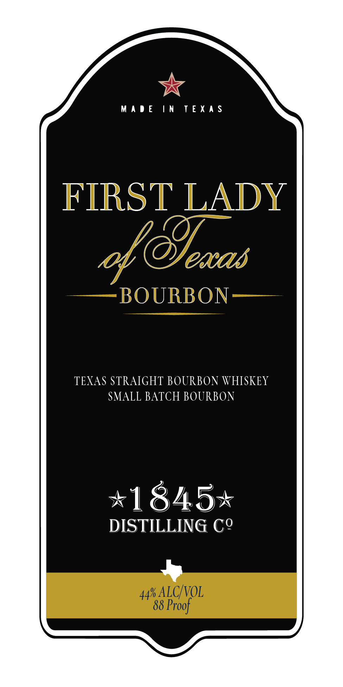

# TTB COLA Label Images - TTBID 26281001000511

**Brand Name:** FIRST LADY OF TEXAS

**Issue Date:** 10/15/2026

**Origin Code:** 44

**Product Class/Type:** 101

**Source:** [TTB Public COLA Registry](https://ttbonline.gov/colasonline/viewColaDetails.do?action=publicFormDisplay&ttbid=26281001000511)

## Label Images

### Back Label

### Front Label

## Extracted Label Text

*Text extracted via OCR - may contain errors*

### Back Label

CERTIFIE D
TEXAFIE D TM
WITH
100% TEXAS GRAIN
First Lady of Texas Bourbon is a tribute to the women who
helped build Texas: While history often records the men;
it was the women who sustained the homes, the farms;
and the communities of the frontier:
Our own
'First Lady
was
Mama" Belle.
In her
she was widowed, raised eight children
and carried forward the family farm with
unwavering resolve.
This bourbon is crafted in honor of women like her
whose courage, endurance, and spirit helped
Texas itself
Distilled, Aged & Bottled by
Distilling Co.
in
Crossing; TX
Www;
1845 DistillingCompanycom
GOVERNMENT WARNING:
ACCORDING TO THE
SURGEON GENERAL, WOMEN SHOULD NOT DRINK
ALCOHOLIC BEVERAGES DURING PREGNANCY
BECAUSE OF THE RISK OF BIRTH DEFECTS: (2)
CONSUMPTION OF ALCOHOLIC BEVERAGES IMPAIRS
YOUR ABILITY TO DRIVEA CAR OR OPERATE
MACHINERY,AND MAY CAUSE HEALTH PROBLEMS.
NET CONTENTS
TEXAS STRAIGHT BOURBON WHISKEY
8'
50039"62726
2
88 years,
shape
1845
Lowry
750ML

### Front Label

*

MADE IN TEXAS

FIRST LADY

of Seans

OURBON

TEXAS STRAIGHT BOURBON WHISKEY

SMALL BATCH BOURBON

*1845%

DISTILLING C2

+
