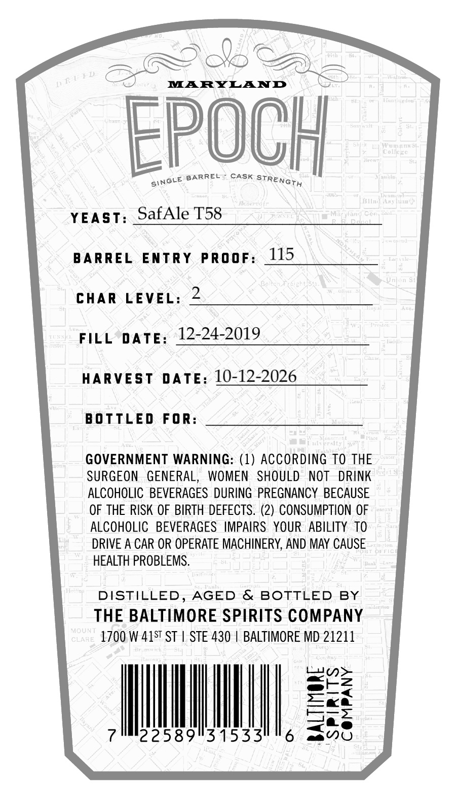
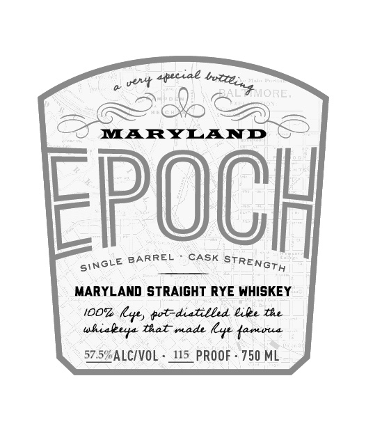

# TTB COLA Label Images - TTBID 26281001000537

**Brand Name:** EPOCH

**Issue Date:** 10/16/2026

**Origin Code:** 25

**Product Class/Type:** 102

**Source:** [TTB Public COLA Registry](https://ttbonline.gov/colasonline/viewColaDetails.do?action=publicFormDisplay&ttbid=26281001000537)

## Label Images

### Back Label

### Front Label

### Label 2

## Extracted Label Text

*Text extracted via OCR - may contain errors*

*1 image(s) excluded: text did not meet readability threshold*

**Detected Proof:** 115

### Back Label

iS

aS ha

MARYLAND

EPOCH

NGLe BARREL CASK TT

YEAST SafAle T58

BARREL ENTRY PROOF

115

CHAR LEVEL: 2

FILL DATE 12-24-2019

HARVEST DATE: 10-12-2026

BOTTLED FOR

GOVERNMENT WARNING: (1) ACCORDING TO THE

SURGEON GENERAL, WOMEN SHOULD NOT DRINK

ALCOHOLIC BEVERAGES DURING PREGNANCY BECAUSE

OF THE RISK OF BIRTH DEFECTS. (2) CONSUMPTION OF

ALCOHOLIC BEVERAGES IMPAIRS YOUR ABILITY TO

DRIVE A CAR OR OPERATE MACHINERY, AND MAY CAUSE

HEALTH PROBLEMS.

DISTILLED, AGED & BOTTLED BY

THE BALTIMORE SPIRITS COMPANY

1700 W 415 ST | STE 430 | BALTIMORE MD 21211

Ln>

awtZ

se

«<a

NMI

——s

aa O

### Front Label

vext 4peciae
MARYLAND
EpOCH
BARREL
CASK
MARYLAND strAIGHT RYE WHISKEY
iOOz
kye, fot-diatilbed &ile te
tal made
Lyte {amoua
57.5'ALCIVOL
415_PROOF
750 ML
botteint ORE:
STREnGTH
SINGLE
uhiaeer
