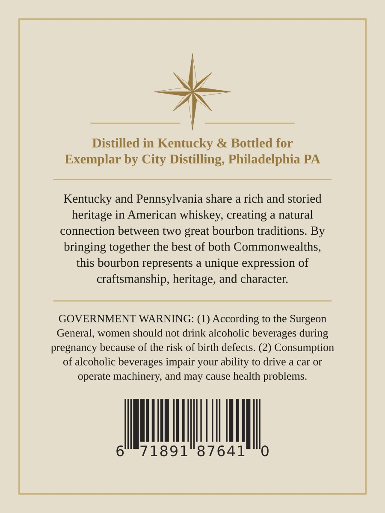
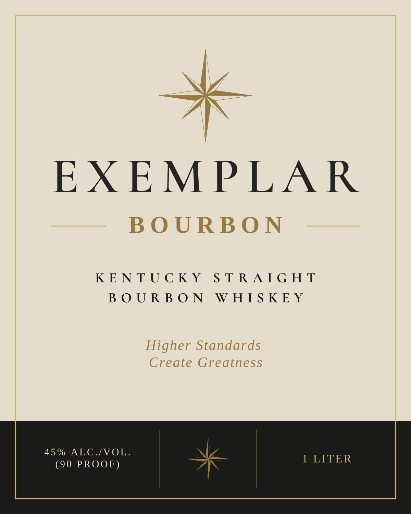

# TTB COLA Label Images - TTBID 26281001000708

**Brand Name:** EXEMPLAR BOURBON

**Issue Date:** 10/15/2026

**Origin Code:** 39

**Product Class/Type:** 101

**Source:** [TTB Public COLA Registry](https://ttbonline.gov/colasonline/viewColaDetails.do?action=publicFormDisplay&ttbid=26281001000708)

## Label Images

### Back Label

### Front Label

## Extracted Label Text

*Text extracted via OCR - may contain errors*

**Detected Proof:** 90

### Back Label

Distilled in Kentucky
Bottled for
Exemplar by City Distilling, Philadelphia PA
Kentucky and Pennsylvania share a rich and storied
heritage in American whiskey, creating
natural
connection between two great bourbon traditions. By
bringing together the best of both Commonwealths,
this bourbon represents
unique expression of
craz
ftsmanship, heritage, and character:
GOVERNMENT WARNING: (1) According to the Surgeon
General_
women should not drink alcoholic beverages during
pregnancy because of the risk of birth defects. (2) Consumption
of alcoholic beverages impair your ability to drive a car or
operate machinery; and may cause health problems.
6
71891
87641
0

### Front Label

EXEMPLAR

BOURBON

KENTUCKY STRAIGHT

BOURBON WHISKEY

Higher Standards

Create Greatness

45% ALC./VOL.

1 LITER

(90 PROOF)
