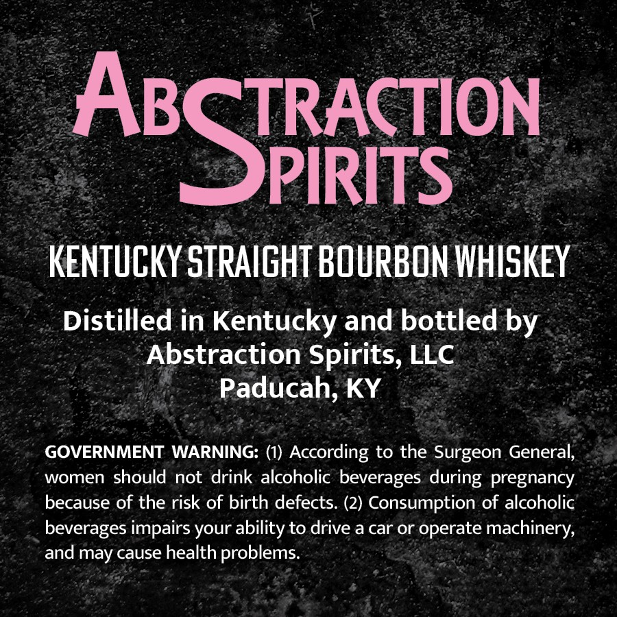
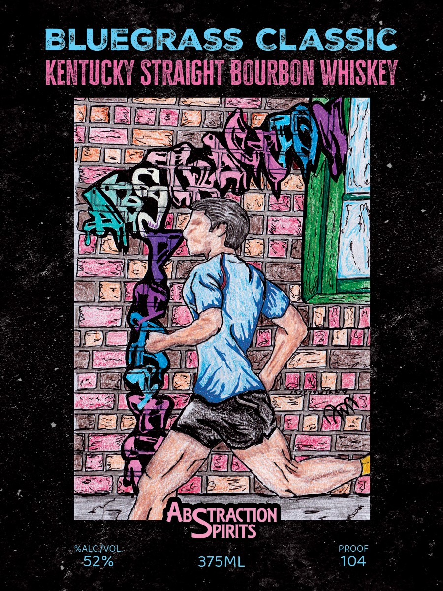

# TTB COLA Label Images - TTBID 26281001000726

**Brand Name:** ABSTRACTION SPIRITS

**Fanciful Name:** BLUEGRASS CLASSIC

**Issue Date:** 10/15/2026

**Origin Code:** 22

**Product Class/Type:** 101

**Source:** [TTB Public COLA Registry](https://ttbonline.gov/colasonline/viewColaDetails.do?action=publicFormDisplay&ttbid=26281001000726)

## Label Images

### Back Label

### Front Label

## Extracted Label Text

*Text extracted via OCR - may contain errors*

**Detected Proof:** 104

### Back Label

ABSJRToN
KENTUCKY STPAIGHT BOURBON WHISKEY
Distilled in Kentucky and bottled by
Abstraction Spirits, LLC
Paducah, KY
GOVERNMENT WARNING: (1) According to the Surgeon General;
women should not drink alcoholic beverages during pregnancy
because of the risk of birth defects. (2) Consumption of alcoholic
beverages impairs your ability to drive a car or operate machinery;
and may cause health problems:

### Front Label

BLUEGRASS CLASSIC
KENTUCKY STRAIGHT BOURBON WHISKEY
AzSFirTon
%ALC IVOL
PROOF
52%
375ML
104
