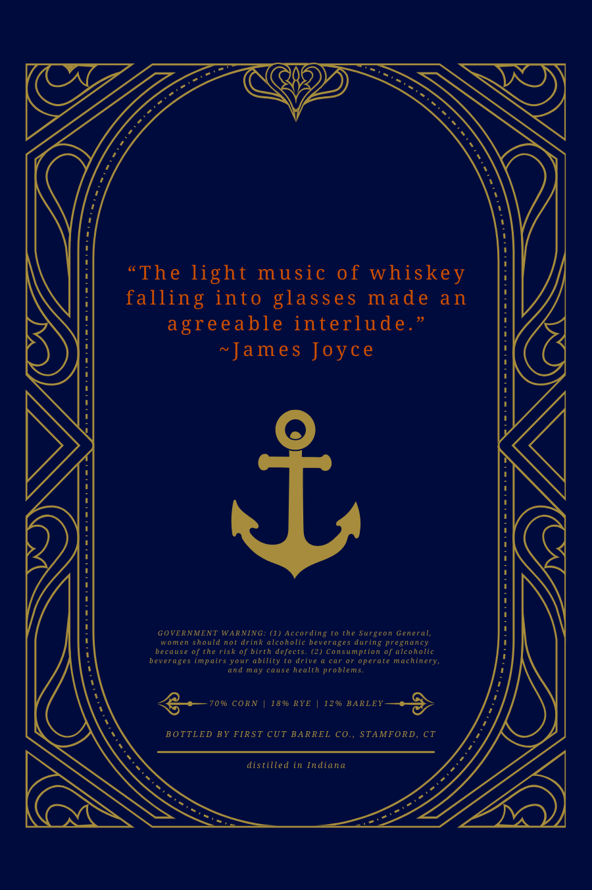
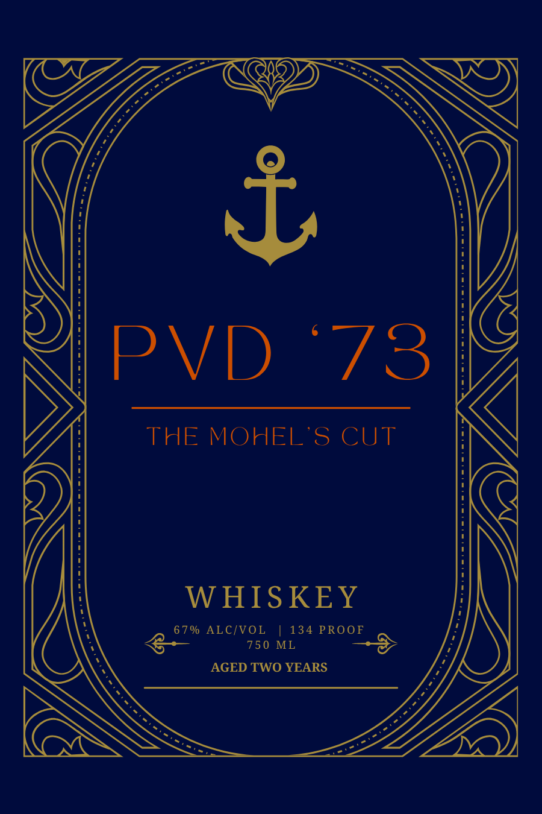

# TTB COLA Label Images - TTBID 26281001000797

**Brand Name:** PVD '73

**Fanciful Name:** THE MOHEL'S CUT

**Issue Date:** 10/15/2026

**Origin Code:** 14

**Product Class/Type:** 140

**Source:** [TTB Public COLA Registry](https://ttbonline.gov/colasonline/viewColaDetails.do?action=publicFormDisplay&ttbid=26281001000797)

## Label Images

### Back Label

### Front Label

## Extracted Label Text

*Text extracted via OCR - may contain errors*

**Detected Proof:** 134

### Back Label

"The light music of whiskey
falling into glasses made
an
agreeable interlude.
~James Joyce
8
GOVERNMENT
WARNING
(1) According (0
the surgeon General,
women
should not
drink alcoholic
Uain
ages during pregnancy
because 0f the risk 0f birth defects. (2) Consumption of alconolic
beverages impairs Yotr
ability
drive
cat
operate machinery_
and
cause health problems.
70% CoRN
18%0 RYE
120
BARLEY
BOTTLED BY FIRST CUT BARREL C0., STAMFORD, CT
distilled in Indiana
L0)

### Front Label

PVD
73
THE MOHEL'S CUT
W HISKEY
6 7 % ALC/VOL
134 PROOF
750 ML
AGED TWO YEARS
i
