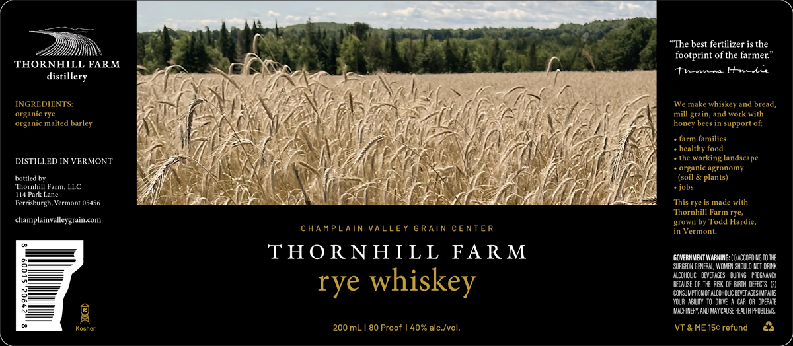

# TTB COLA Label Images - TTBID 26281001000834

**Brand Name:** THORNHILL FARM, LLC

**Issue Date:** 11/13/2026

**Origin Code:** 46

**Product Class/Type:** 142

**Source:** [TTB Public COLA Registry](https://ttbonline.gov/colasonline/viewColaDetails.do?action=publicFormDisplay&ttbid=26281001000834)

## Label Images

### Label 1

## Extracted Label Text

*Text extracted via OCR - may contain errors*

**Detected Proof:** 80

### Label 1

"The best fertilizer is the
footprint of the farmer
THORNHILL FARM
4
HiA
distillery
INGREDIENTS:
We make whiskey and bread,
organic rye
mnill
grain, and work with
organic malted barley
honey bees in support of;
farm families
healthy food
DISTILLED IN VERMONT
the working landscape
organic agronomy
hottled by
(soil & plants)
Fhomnkil
LLC
jobs
I4 Park Lane
Ferrisburgh; Vermont
This rye is made with
Thornhill Farm rye,
champlainvalleygrain com
by Todd Hardic,
CHAMPLAIN VALLEY GRaIN CENTER
in Vermont
THO RN HILL
FARM
GOVERMMEMT WAFMNG: (V] ACCLF@IsToThe
SupGEC  GENERIL WQMEN Shoulo 6OT daLY
ACOHCUIC   bEVERUGES   DurILG   PFEGMACY
rye whiskey
RchisE If Tle RE'
BRTH DEFECTS (2)
CIuMFTONCF HCOHLL EeveaaGES MphRS
IOR  AEIUNY  T0  @enVE
CiA @A @peRATE
a
MUACHIMERY, AD MaY ChUS Fealth PROELELLI
Rosnet
200 mL
80 Proof
40% alc Ivol:
VT & ME 15c refund
Jatm
Jeas
Etown
