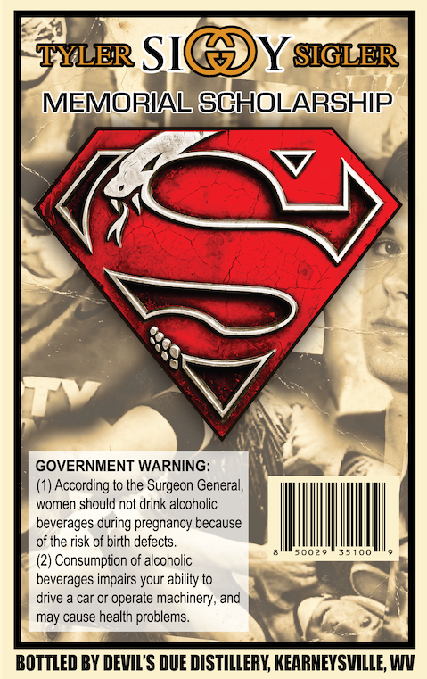
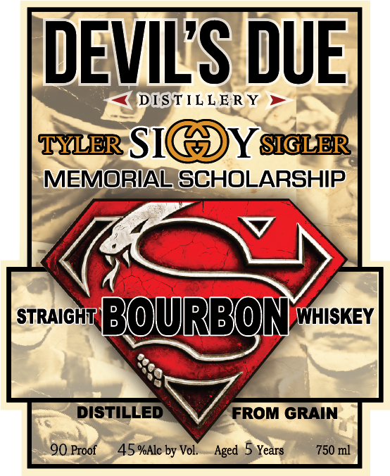
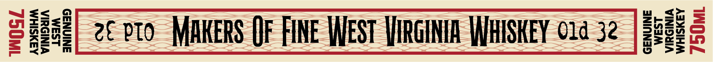

# TTB COLA Label Images - TTBID 26282001000172

**Brand Name:** DEVIL'S DUE DISTILLERY

**Fanciful Name:** NONE

**Issue Date:** 10/21/2026

**Origin Code:** 47

**Product Class/Type:** 101

**Source:** [TTB Public COLA Registry](https://ttbonline.gov/colasonline/viewColaDetails.do?action=publicFormDisplay&ttbid=26282001000172)

## Label Images

### Back Label

### Front Label

### Label 2

## Extracted Label Text

*Text extracted via OCR - may contain errors*

**Detected Proof:** 90

### Back Label

TYLER SIC
YSGLER
MEMORIAL SCHOLARSHIP
GOVERNMENT WARNING:
According to the
Surgeon General,
women should not drink alcoholic
beverages during pregnancy because
of the risk of birth defects
U2 0
Consumption of alcoholic
beverages impairs your ability to
arive
car or operate machinery, and
may cause health problems
BOTTLED BY DEVIL'S DUE DISTILLERY, KEARNEYSVILLE, WV

### Front Label

DEVILS DUE
DISTIL LE R Y
TYLER SIC
YSIGLER
MEMORIAL SCHOLARSHIP
STRAIGHI
BOURBONwhiskev
DISTILLED
FROM GRAIN
90 Proof
45 %Alc by Vol.
Aged
Years
750 ml

### Label 2

=5<0

ZESu

aQame

mez

2€ PTO MAKERS QF FINE WEST VIRGINIA WHISKEY 01a 32

Geez

DuOw
