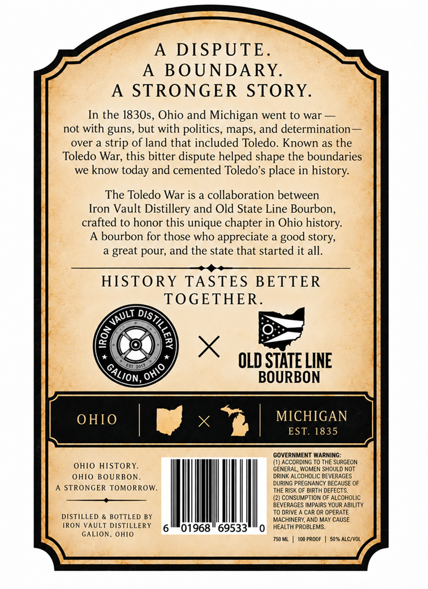
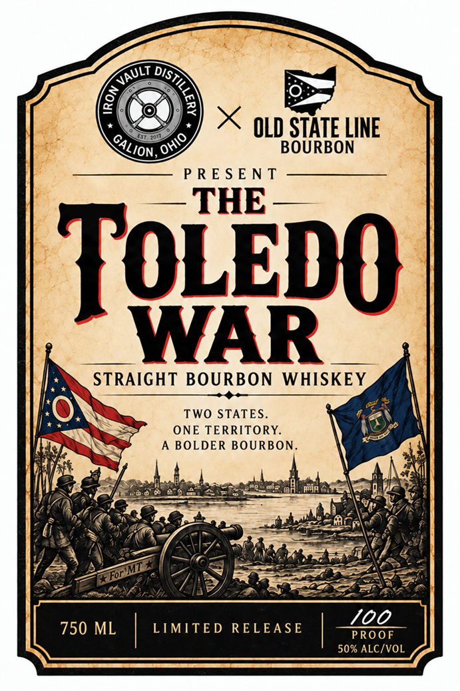
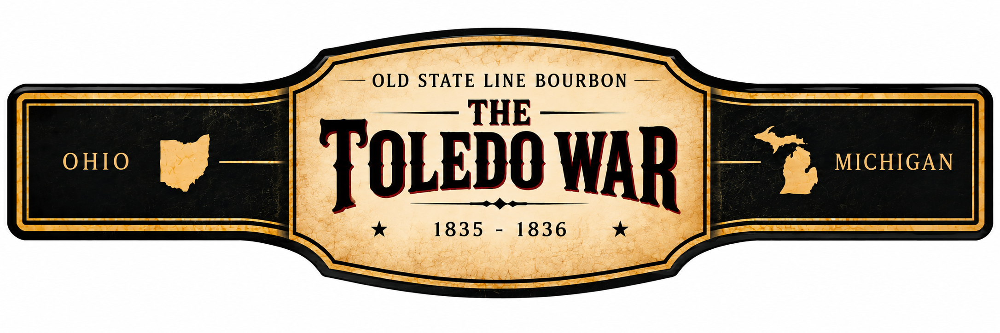

# TTB COLA Label Images - TTBID 26282001000237

**Brand Name:** IRON VAULT DISTILLERY

**Fanciful Name:** TOLEDO WAR BOURBON

**Issue Date:** 10/15/2026

**Origin Code:** 09

**Product Class/Type:** 101

**Source:** [TTB Public COLA Registry](https://ttbonline.gov/colasonline/viewColaDetails.do?action=publicFormDisplay&ttbid=26282001000237)

## Label Images

### Back Label

### Label 1

### Label 3

## Extracted Label Text

*Text extracted via OCR - may contain errors*

**Detected Proof:** 100

### Back Label

A
DISPUTE.
A
BOUNDARY.
A
STRONGER
STORY.
In the 1830s, Ohio and Michigan went to war
not with guns, but with politics, maps, and determination
over a
strip of land that included Toledo. Known as the
Toledo War; this bitter dispute helped shape the boundaries
we know
and cemented Toledo's place in history:
The Toledo War is a collaboration between
Vault Distillery and Old State Line Bourbon,
crafted to honor this unique chapter in Ohio history:
A bourbon for those who
appreciate
great pour; and the state that started it all.
HISTORY
TASTES BETTER
TOGETHER.
OLD STATE LINE
BOURBON
OHIO
MICHIGAN
EST. 1835
GOVERNMENT WARNING
OHIO HISTORY.
(1) ACCORDING To THE SURGEON
GENERAL; WOMEN SHOULD No
OHIO BOURBON
DRINK ALCOHOLIC BEVERAGES
DURING PREGNANCY BECAUSE Of
STRONGER TOMORROW
THE RiSk OF BIRTH DEFECTS_
(2) CONSUMPTION Of AlcoholiC
BEVERAGES IMPAIRS YOUR Ability
TO DRIVE
CAR OR OPERATE
DISTILLED
BOTTLED BY
MACHINERY; AND MAY CAUSE
IRON VAULT DISTILLERY
01968
69533
HEALTH PROBLEMS:
GALION; ohiO
750 ML
Io0 PROOF
507 ALCIVOL
today
Iron
good
story;
9
VAULT
8
GALION
OHIO

### Label 1

OLD STATE LINE
BOURBON
P R E S E N T
THE
ToLEpo
WAR
STRAIGHT BOURBON
WHISKEY
TWo STATES_
ONE TERRITORY.
BOLDER BOURBON
For
100
750 ML
LIMITED
RELEASE
PROOF
50% ALC/VOL
VAULT
)
8
OHIO
GALION

### Label 3

OLD STATE
LINE BOURBON
THE
OHIO
TOLEDOWAR
MICHIGAN
1835
1836
