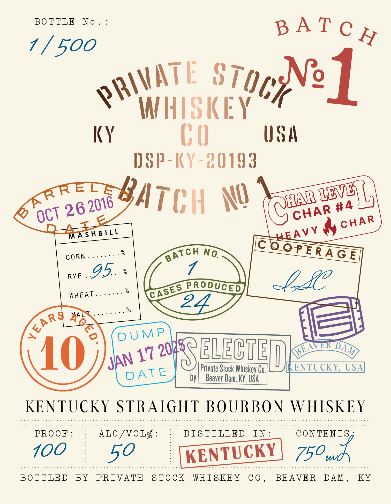
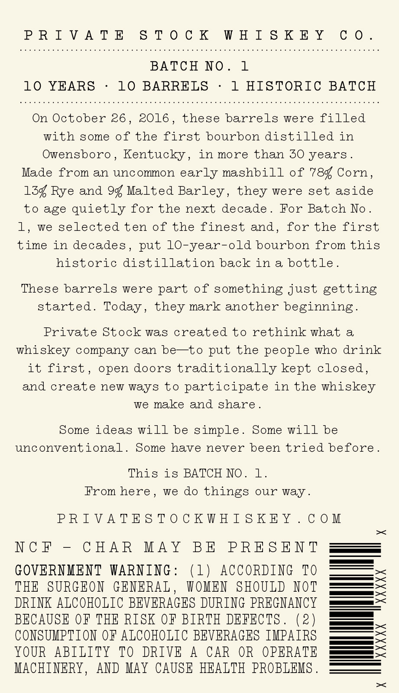

# TTB COLA Label Images - TTBID 26282001000284

**Brand Name:** PRIVATE STOCK WHISKEY CO

**Issue Date:** 10/15/2026

**Origin Code:** 22

**Product Class/Type:** 101

**Source:** [TTB Public COLA Registry](https://ttbonline.gov/colasonline/viewColaDetails.do?action=publicFormDisplay&ttbid=26282001000284)

## Label Images

### Label 1

### Label 2

## Extracted Label Text

*Text extracted via OCR - may contain errors*

**Detected Age:** 10 Years

### Label 1

BOTTLE
No .
7 / 500
ATE
STQcNe1
H HISKEY
KY
( 0
USA
HSP-KY-20193
NQ
LDVL)
Q
MAsHB!LL
%
GE
RYE
95,.
%
%
PRODUCED
WHEAT
%
MAL
DUMP
10
17
SELECTET
[Private Stock Whiskey Co,
ENTUCKY,
USA
by
Beaver Dam; KY, USA
KENTUCKY STRAIGHT BOURBON WHISKEY
PRO OF
ALC /VOL%
DISTILLED
In
C ONTENTS
100
KENTUCKY
750wd
BOTTLED
BY
PRIVATE
STOCK
WHISKFY
C 0 .
BEAVER
DAM
KY
B A T € H
PKIV
Batch
KRRETE
(@C
2016
#4
26
CHAR
OCT
CHAR
4TF
HEA VY
QOPE RA
BATCH
No.
CORN
CASES
XEAR&
20217
BEAVER
DAM
JAN
DATE
50

### Label 2

PRIVATE STOCK WHISKEY CO.

BATCH NO. 1
10 YEARS - 10 BARRELS - 1 HISTORIC BATCH

On October 26, 2016, these barrels were filled
with some of the first bourbon distilled in
Owensboro, Kentucky, in more than 30 years.

Made from an uncommon early mashbill of 784 Corn,
134 Rye and 94 Malted Barley, they were set aside
to age quietly for the next decade. For Batch No.
1, we selected ten of the finest and, for the first
time in decades, put 10-year-old bourbon from this
historic distillation back ina bottle.

These barrels were part of something just getting
started. Today, they mark another beginning.

Private Stock was created to rethink what a
whiskey company can be—to put the people who drink
it first, open doors traditionally kept closed,
and create new ways to participate in the whiskey
we make and share.

Some ideas will be simple. Some will be
unconventional. Some have never been tried before.

This is BATCH NO. 1.
From here, we do things our way.

PRIVATESTOCKWHISKEY.COM

X

|

NCF - CHAR MAY BE PRESENT

GOVERNMENT WARNING: (1) ACCORDING TO
THE SURGEON GENERAL, WOMEN SHOULD NOT
DRINK ALCOHOLIC BEVERAGES DURING PREGNANCY
BECAUSE OF THE RISK OF BIRTH DEFECTS. (2)
CONSUMPTION OF ALCOHOLIC BEVERAGES IMPAIRS
YOUR ABILITY TO DRIVE A CAR OR OPERATE
MACHINERY, AND MAY CAUSE HEALTH PROBLEMS. [===

XXXXX

XXXXX

X
